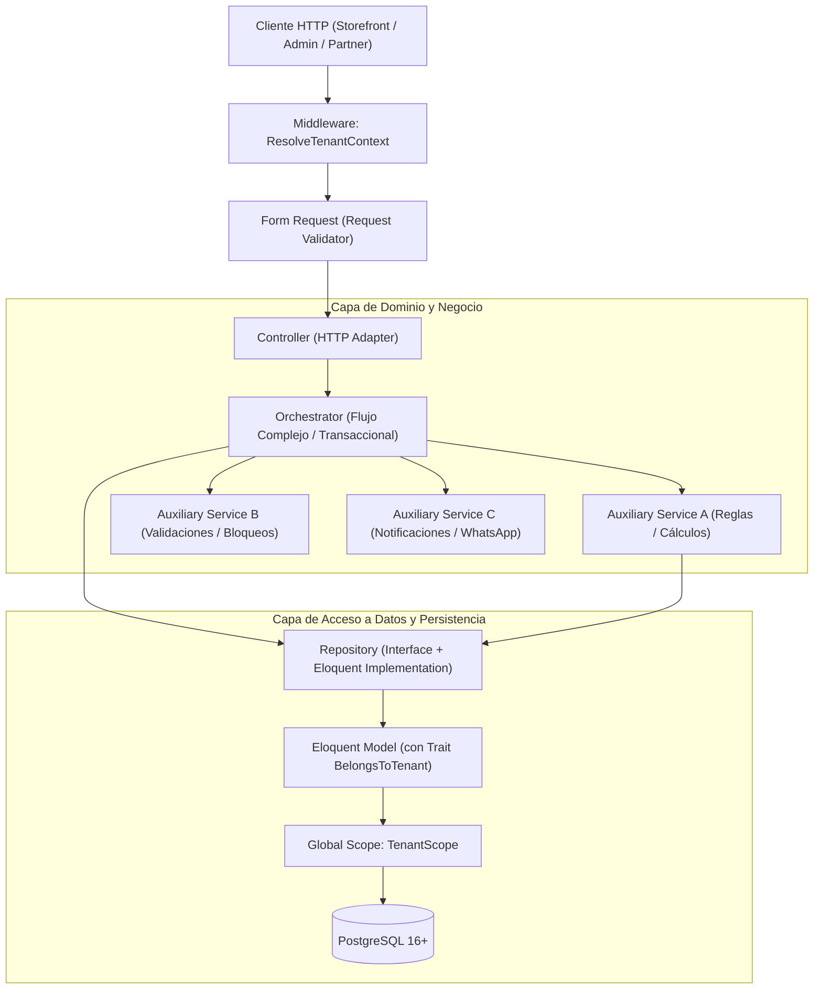
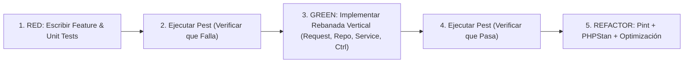

# Documento de Arquitectura de Software
**Proyecto:** Plataforma SaaS Multi-Tenant de Comercio Electrónico Asistido (Schema-Driven)  
**Motor del Framework:** Laravel 11+ / PHP 8.5  
**Patrones Nucleares:** Repository-Service-Controller + Orchestrator Pattern + Trait de Aislamiento Hermético Multi-Tenant

---

## 1. Visión General y Principios de Diseño

El presente documento define la arquitectura técnica estandarizada que rige el backend de la plataforma. La arquitectura ha sido diseñada bajo los siguientes pilares inquebrantables:

1. **Aislamiento Multi-Tenant Estricto por Defecto (Zero Data Leaks):** Ninguna consulta a base de datos ni mutación de estado puede ejecutarse sin un contexto de inquilino validado. El aislamiento está garantizado en tiempo de compilación y ejecución a través de traits y scopes automáticos.
2. **Separación Estricta de Responsabilidades (SoC):** Cada capa (Request, Controller, Orchestrator, Service, Repository, Model) tiene un único propósito delimitado.
3. **Controladores Delgados (Thin Controllers):** Los controladores actúan únicamente como adaptadores del protocolo HTTP (recibir input validado, invocar la orquestación y retornar una respuesta formateada).
4. **Patrón Orquestador (Orchestrator Pattern):** Los flujos transaccionales y complejos de negocio no se diseminan en múltiples servicios desconectados; una función orquestadora gobierna el flujo maestro ejecutando funciones auxiliares atómicas bajo una transacción de base de datos (`ACID`).
5. **Capa de Repositorios (Data Access Layer):** Encapsula el acceso a Eloquent, desacopla la persistencia de la lógica de dominio y asegura que cualquier consulta esté acotada al `tenant_id`.
6. **Desarrollo Guiado por Pruebas (Test-First / TDD Obligatorio):** Ninguna línea de código de producción (Request, Controller, Orchestrator, Service, Repository o Model) puede crearse o modificarse sin haber escrito primero sus pruebas automatizadas (Feature Tests y Unit Tests) en estado fallido (Rojo / Red). La cobertura debe contemplar el caso de éxito, los fallos de validación, las reglas de negocio y, de manera intransigente, la violación de aislamiento multi-tenant.

---

## 2. Diagrama de Capas y Flujo de Peticiones



---

## 3. Estructura de Directorios del Código (`app/`)

La estructura de carpetas implementa la división de capas de forma ordenada y escalable:

```text
app/
├── Concerns/
│   └── ProfileValidationRules.php
├── Enums/
│   ├── OrderStatus.php
│   ├── PromotionType.php
│   ├── CommissionStatus.php
│   └── OutboundRewardStatus.php
├── Http/
│   ├── Controllers/
│   │   ├── Api/
│   │   │   ├── V1/
│   │   │   │   ├── Storefront/
│   │   │   │   │   ├── CatalogController.php
│   │   │   │   │   ├── CartQuoteController.php
│   │   │   │   │   └── CheckoutController.php
│   │   │   │   ├── Admin/
│   │   │   │   └── PartnerPortal/
│   ├── Middleware/
│   │   ├── ResolveTenantContext.php
│   │   └── RequireIdempotencyKey.php
│   └── Requests/
│       ├── Storefront/
│       │   ├── CartQuoteRequest.php
│       │   └── CheckoutRequest.php
│       └── Admin/
├── Models/
│   ├── Scopes/
│   │   └── TenantScope.php
│   ├── Traits/
│   │   └── BelongsToTenant.php
│   ├── Tenant.php
│   ├── TenantConfig.php
│   ├── Product.php
│   └── ...
├── Orchestrators/
│   ├── Storefront/
│   │   └── CheckoutOrchestrator.php
│   └── Admin/
│       └── OrderStatusOrchestrator.php
├── Repositories/
│   ├── Contracts/
│   │   ├── TenantRepositoryInterface.php
│   │   ├── ProductRepositoryInterface.php
│   │   ├── OrderRepositoryInterface.php
│   │   └── ...
│   └── Eloquent/
│       ├── TenantRepository.php
│       ├── ProductRepository.php
│       ├── OrderRepository.php
│       └── ...
├── Services/
│   ├── Cart/
│   │   ├── CartPricingCalculator.php
│   │   └── PromotionEvaluatorService.php
│   ├── Inventory/
│   │   └── StockReservationService.php
│   ├── Commissions/
│   │   └── CommissionCalculatorService.php
│   └── WhatsApp/
│       └── WhatsAppUrlGenerator.php
└── Providers/
    ├── RepositoryServiceProvider.php
    └── TenantServiceProvider.php
```

---

## 4. Aislamiento Multi-Tenant Hermético: Trait `BelongsToTenant` y `TenantScope`

Para asegurar que ninguna consulta, inserción, actualización o eliminación pueda afectar a otro inquilino por omisión o error humano, se establece un mecanismo en tres niveles:

1. **Contexto Centralizado:** Un singleton (`TenantContext`) resuelve el inquilino activo a través del middleware.
2. **Global Scope (`TenantScope`):** Intercepta automáticamente todas las consultas de Eloquent agregando la cláusula `WHERE {table}.tenant_id = ?`.
3. **Inyección en Evento `creating`:** Asigna automáticamente el `tenant_id` y prohíbe que el valor sea sobreescrito con otro tenant.

### 4.1. Clase de Contexto de Inquilino (`TenantContext`)

```php
namespace App\Context;

use App\Models\Tenant;
use RuntimeException;

class TenantContext
{
    private ?Tenant $currentTenant = null;

    public function set(Tenant $tenant): void
    {
        $this->currentTenant = $tenant;
    }

    public function get(): Tenant
    {
        if ($this->currentTenant === null) {
            throw new RuntimeException('Operación abortada: No se ha establecido el contexto del inquilino (TenantContext).');
        }

        return $this->currentTenant;
    }

    public function id(): string
    {
        return $this->get()->id;
    }

    public function isSet(): bool
    {
        return $this->currentTenant !== null;
    }

    public function clear(): void
    {
        $this->currentTenant = null;
    }
}
```

### 4.2. Global Scope: `TenantScope`

```php
namespace App\Models\Scopes;

use App\Context\TenantContext;
use Illuminate\Database\Eloquent\Builder;
use Illuminate\Database\Eloquent\Model;
use Illuminate\Database\Eloquent\Scope;

class TenantScope implements Scope
{
    public function __construct(
        protected TenantContext $tenantContext
    ) {}

    /**
     * Aplica la restricción de tenant_id a la consulta Eloquent.
     *
     * @param  Builder<Model>  $builder
     */
    public function apply(Builder $builder, Model $model): void
    {
        if (! $this->tenantContext->isSet()) {
            return;
        }

        $builder->where($model->qualifyColumn('tenant_id'), '=', $this->tenantContext->id());
    }
}
```

### 4.3. Trait Reutilizable: `BelongsToTenant`

Este trait se incluye en todas las entidades operativas del sistema (`User`, `Category`, `Product`, `ProductVariant`, `Promotion`, `Affiliate`, `Coupon`, `Order`, `OrderItem`, `Commission`, `PartnerStore`, `OutboundReward`).

```php
namespace App\Models\Traits;

use App\Context\TenantContext;
use App\Models\Scopes\TenantScope;
use App\Models\Tenant;
use Illuminate\Database\Eloquent\Relations\BelongsTo;
use LogicException;

trait BelongsToTenant
{
    public static function bootBelongsToTenant(): void
    {
        $tenantContext = app(TenantContext::class);

        // 1. Aplica el scope global de lectura, actualización y eliminación
        static::addGlobalScope(new TenantScope($tenantContext));

        // 2. En la creación, fuerza la inyección obligatoria del tenant_id activo
        static::creating(function ($model) use ($tenantContext): void {
            if (! $tenantContext->isSet()) {
                throw new LogicException(sprintf(
                    'Violación de seguridad Multi-Tenant: Intentando crear registro de [%s] sin un contexto de tenant activo.',
                    static::class
                ));
            }

            $activeTenantId = $tenantContext->id();

            // Si el modelo ya tenía asignado un tenant_id distinto, abortar de inmediato
            if (! empty($model->tenant_id) && $model->tenant_id !== $activeTenantId) {
                throw new LogicException(sprintf(
                    'Violación crítica de aislamiento: Intento de asignación cruzada de tenant_id [%s] en contexto de [%s].',
                    $model->tenant_id,
                    $activeTenantId
                ));
            }

            $model->tenant_id = $activeTenantId;
        });
    }

    /**
     * Relación con el inquilino propietario.
     *
     * @return BelongsTo<Tenant, $this>
     */
    public function tenant(): BelongsTo
    {
        return $this->belongsTo(Tenant::class, 'tenant_id');
    }
}
```

---

## 5. Capa 1: Request Validators (Form Requests)

Los Form Requests validan estrictamente la estructura, tipos de datos, cardinalidad y restricciones de negocio preliminares antes de que cualquier controlador se ejecute.

### Reglas para Form Requests:
- **No acceder directamente a base de datos de otros tenants:** Todas las validaciones de unicidad o existencia (`Rule::unique`, `Rule::exists`) deben incorporar el filtro por `tenant_id` resuelto desde el contexto.
- **Acceso tipado al Tenant:** Exponer un método de conveniencia `$this->tenant()`.
- **Sanitización de Datos:** Transformar cadenas, convertir códigos a mayúsculas y castear valores numéricos en `prepareForValidation()`.

### Ejemplo: `CheckoutRequest`

```php
namespace App\Http\Requests\Storefront;

use App\Context\TenantContext;
use App\Models\Tenant;
use Illuminate\Foundation\Http\FormRequest;
use Illuminate\Validation\Rule;

class CheckoutRequest extends FormRequest
{
    public function authorize(): bool
    {
        return true;
    }

    protected function prepareForValidation(): void
    {
        if ($this->has('coupon_code')) {
            $this->merge([
                'coupon_code' => strtoupper(trim((string) $this->input('coupon_code'))),
            ]);
        }
    }

    public function rules(TenantContext $tenantContext): array
    {
        $tenantId = $tenantContext->id();

        return [
            'customer_info' => ['required', 'array'],
            'customer_info.full_name' => ['required', 'string', 'max:120'],
            'customer_info.whatsapp_phone' => ['required', 'string', 'max:30'],
            'customer_info.email' => ['required', 'email', 'max:150'],

            'shipping_address' => ['required', 'array'],
            'shipping_address.region_code' => ['required', 'string', 'max:10'],
            'shipping_address.address_line' => ['required', 'string', 'max:255'],
            'shipping_address.reference' => ['nullable', 'string', 'max:255'],

            'items' => ['required', 'array', 'min:1'],
            'items.*.variant_id' => [
                'required',
                'uuid',
                Rule::exists('product_variants', 'id')->where('tenant_id', $tenantId)->whereNull('deleted_at'),
            ],
            'items.*.quantity' => ['required', 'integer', 'min:1', 'max:100'],

            'coupon_code' => [
                'nullable',
                'string',
                'max:50',
                Rule::exists('coupons', 'code')->where('tenant_id', $tenantId)->where('is_active', true),
            ],
        ];
    }
}
```

---

## 6. Capa 2: Controladores Delgados (Thin Controllers)

Los controladores actúan exclusivamente como intermediarios HTTP:
1. Inyectan el Form Request validado.
2. Delegan la ejecución al Orquestador correspondiente.
3. Transforman el resultado a formato JSON bajo el estándar REST (usando API Resources si aplica).
4. Capturan excepciones de dominio mapeándolas a códigos HTTP semánticos (404, 422, 409).

### Ejemplo: `CheckoutController`

```php
namespace App\Http\Controllers\Api\V1\Storefront;

use App\Http\Controllers\Controller;
use App\Http\Requests\Storefront\CheckoutRequest;
use App\Orchestrators\Storefront\CheckoutOrchestrator;
use Illuminate\Http\JsonResponse;
use Symfony\Component\HttpFoundation\Response;

class CheckoutController extends Controller
{
    public function __construct(
        protected CheckoutOrchestrator $orchestrator
    ) {}

    public function __invoke(CheckoutRequest $request): JsonResponse
    {
        $idempotencyKey = (string) $request->header('Idempotency-Key');

        $result = $this->orchestrator->orchestrateCheckout(
            checkoutData: $request->validated(),
            idempotencyKey: $idempotencyKey
        );

        return response()->json([
            'order_id' => $result->orderId,
            'order_number' => $result->orderNumber,
            'status' => $result->status,
            'total_net' => $result->totalNet,
            'whatsapp_redirect_url' => $result->whatsappUrl,
        ], Response::HTTP_CREATED);
    }
}
```

---

## 7. Capa 3: Patrón Orquestador (Orchestrator Pattern)

### 7.1. Definición del Patrón
Un **Orquestador** es un servicio de dominio de alto nivel cuyo único cometido es coordinar la ejecución transaccional de una acción de negocio compleja. 

#### Reglas de un Orquestador:
- **Flujo Maestro Centralizado:** Contiene un método público maestro (ej. `orchestrateCheckout()`).
- **Descomposición en Funciones Auxiliares:** El método maestro delega en funciones auxiliares privadas o servicios especializados para cada paso atómico.
- **Transaccionalidad Atómica (ACID):** Toda la orquestación corre dentro de `DB::transaction()`. Si una función auxiliar falla, se revierte todo cambio en cascada.
- **Bloqueos Pesimistas:** Invoca métodos de repositorio que utilizan `lockForUpdate()` para reservar stock o canjear códigos, eliminando condiciones de carrera.

### 7.2. Ejemplo de Implementación: `CheckoutOrchestrator`

```php
namespace App\Orchestrators\Storefront;

use App\Context\TenantContext;
use App\DTOs\CheckoutResultDTO;
use App\Exceptions\Domain\InsufficientStockException;
use App\Repositories\Contracts\CouponRepositoryInterface;
use App\Repositories\Contracts\OrderRepositoryInterface;
use App\Repositories\Contracts\ProductVariantRepositoryInterface;
use App\Services\Cart\CartPricingCalculator;
use App\Services\Commissions\CommissionCalculatorService;
use App\Services\Inventory\StockReservationService;
use App\Services\WhatsApp\WhatsAppUrlGenerator;
use Illuminate\Support\Facades\DB;

class CheckoutOrchestrator
{
    public function __construct(
        protected TenantContext $tenantContext,
        protected ProductVariantRepositoryInterface $variantRepository,
        protected CouponRepositoryInterface $couponRepository,
        protected OrderRepositoryInterface $orderRepository,
        protected StockReservationService $stockService,
        protected CartPricingCalculator $pricingCalculator,
        protected CommissionCalculatorService $commissionService,
        protected WhatsAppUrlGenerator $whatsAppGenerator
    ) {}

    /**
     * Función Maestra que orquesta el flujo completo de checkout.
     */
    public function orchestrateCheckout(array $checkoutData, string $idempotencyKey): CheckoutResultDTO
    {
        return DB::transaction(function () use ($checkoutData, $idempotencyKey) {
            // 1. Paso Auxiliar: Bloqueo pesimista y verificación de stock
            $lockedVariants = $this->reserveAndLockInventory($checkoutData['items']);

            // 2. Paso Auxiliar: Evaluación y resolución de cupones / promociones
            $coupon = $this->resolveCoupon($checkoutData['coupon_code'] ?? null);

            // 3. Paso Auxiliar: Cálculo consolidado de importes y descuentos
            $pricingSummary = $this->calculatePricing(
                items: $checkoutData['items'],
                lockedVariants: $lockedVariants,
                coupon: $coupon,
                regionCode: $checkoutData['shipping_address']['region_code']
            );

            // 4. Paso Auxiliar: Descuento definitivo del stock en base de datos
            $this->deductStock($lockedVariants, $checkoutData['items']);

            // 5. Paso Auxiliar: Construcción de la URL de WhatsApp transaccional
            $whatsAppUrl = $this->generateWhatsAppUrl(
                customer: $checkoutData['customer_info'],
                pricing: $pricingSummary,
                items: $checkoutData['items'],
                lockedVariants: $lockedVariants
            );

            // 6. Paso Auxiliar: Persistencia atómica de la cabecera e ítems de la orden
            $order = $this->persistOrder(
                checkoutData: $checkoutData,
                pricing: $pricingSummary,
                coupon: $coupon,
                whatsAppUrl: $whatsAppUrl
            );

            // 7. Paso Auxiliar: Registro de comisión para el afiliado (si aplica)
            $this->recordAffiliateCommission($order, $coupon, $pricingSummary);

            // 8. Construcción y retorno del DTO inmutable de respuesta
            return new CheckoutResultDTO(
                orderId: $order->id,
                orderNumber: $order->order_number,
                status: $order->status,
                totalNet: (float) $order->total_net,
                whatsappUrl: $whatsAppUrl
            );
        });
    }

    // =========================================================================
    // Funciones Auxiliares Especializadas
    // =========================================================================

    /**
     * Paso 1: Aplica SELECT ... FOR UPDATE sobre las variantes involucradas.
     */
    private function reserveAndLockInventory(array $items): array
    {
        $variantIds = array_column($items, 'variant_id');
        $lockedVariants = $this->variantRepository->findManyWithLock($variantIds);

        foreach ($items as $item) {
            $variant = $lockedVariants[$item['variant_id']] ?? null;

            if (! $variant || $variant->stock < $item['quantity']) {
                throw new InsufficientStockException(
                    sprintf('Stock insuficiente para el SKU [%s]. Solicitado: %d, Disponible: %d.', 
                        $variant?->sku ?? 'Desconocido', 
                        $item['quantity'], 
                        $variant?->stock ?? 0
                    )
                );
            }
        }

        return $lockedVariants;
    }

    /**
     * Paso 2: Valida vigencia, stock de usos y estado del cupón.
     */
    private function resolveCoupon(?string $code): ?object
    {
        if (! $code) {
            return null;
        }

        return $this->couponRepository->findActiveByCodeWithLock($code);
    }

    /**
     * Paso 3: Calcula subtotal, descuentos acumulados y total neto.
     */
    private function calculatePricing(array $items, array $lockedVariants, ?object $coupon, string $regionCode): object
    {
        return $this->pricingCalculator->calculate(
            tenant: $this->tenantContext->get(),
            items: $items,
            variants: $lockedVariants,
            coupon: $coupon,
            regionCode: $regionCode
        );
    }

    /**
     * Paso 4: Decrementa físicamente el inventario.
     */
    private function deductStock(array $lockedVariants, array $items): void
    {
        foreach ($items as $item) {
            $variant = $lockedVariants[$item['variant_id']];
            $variant->decrement('stock', $item['quantity']);
        }
    }

    /**
     * Paso 5: Genera el enlace enriquecido hacia WhatsApp con payload codificado.
     */
    private function generateWhatsAppUrl(array $customer, object $pricing, array $items, array $lockedVariants): string
    {
        return $this->whatsAppGenerator->build(
            tenant: $this->tenantContext->get(),
            customer: $customer,
            pricing: $pricing,
            items: $items,
            variants: $lockedVariants
        );
    }

    /**
     * Paso 6: Persiste Order y OrderItems en la base de datos.
     */
    private function persistOrder(array $checkoutData, object $pricing, ?object $coupon, string $whatsAppUrl): object
    {
        return $this->orderRepository->createOrderWithItems(
            checkoutData: $checkoutData,
            pricing: $pricing,
            couponId: $coupon?->id,
            whatsAppUrl: $whatsAppUrl
        );
    }

    /**
     * Paso 7: Crea el registro contable de comisión en estado RETENIDA.
     */
    private function recordAffiliateCommission(object $order, ?object $coupon, object $pricing): void
    {
        if (! $coupon || ! $coupon->affiliate_id) {
            return;
        }

        $this->commissionService->createPendingCommission(
            order: $order,
            affiliateId: $coupon->affiliate_id,
            couponId: $coupon->id,
            netBaseAmount: $pricing->subtotal
        );
    }
}
```

---

## 8. Capa 4: Patrón Repositorio (Repository Pattern)

Los repositorios abstraen el almacenamiento de datos, centralizan las consultas optimizadas y garantizan el cumplimiento de las restricciones multi-tenant.

### 8.1. Principios del Patrón Repositorio en este Proyecto:
1. **Contrato de Interfaz Obligatorio:** Todo repositorio define una interfaz en `app/Repositories/Contracts/` inyectable vía el contenedor de dependencias (IoC).
2. **Consultas Model-Aware:** Utilizan Eloquent para respetar casts, scopes locales y el trait de tenant.
3. **Bloqueo Pesimista Explícito:** Los métodos que requieran concurrencia segura ofrecen firmas explícitas como `findByIdWithLock(string $id)`.
4. **Prevenir N+1 Queries:** Todo método que cargue relaciones debe especificar `with([...])` explícitamente.

### 8.2. Ejemplo de Interfaz: `OrderRepositoryInterface`

```php
namespace App\Repositories\Contracts;

use App\Models\Order;
use Illuminate\Contracts\Pagination\LengthAwarePaginator;

interface OrderRepositoryInterface
{
    public function findById(string $id): ?Order;

    public function findByOrderNumber(string $orderNumber): ?Order;

    public function paginateForTenant(int $perPage = 20, array $filters = []): LengthAwarePaginator;

    public function createOrderWithItems(
        array $checkoutData,
        object $pricing,
        ?string $couponId,
        string $whatsAppUrl
    ): Order;

    public function updateStatus(string $orderId, string $status): Order;
}
```

### 8.3. Ejemplo de Implementación: `EloquentOrderRepository`

```php
namespace App\Repositories\Eloquent;

use App\Context\TenantContext;
use App\Models\Order;
use App\Models\OrderItem;
use App\Repositories\Contracts\OrderRepositoryInterface;
use Illuminate\Contracts\Pagination\LengthAwarePaginator;
use Illuminate\Support\Str;

class EloquentOrderRepository implements OrderRepositoryInterface
{
    public function __construct(
        protected TenantContext $tenantContext
    ) {}

    public function findById(string $id): ?Order
    {
        return Order::with(['items', 'appliedCoupon', 'commission', 'outboundRewards'])
            ->find($id);
    }

    public function findByOrderNumber(string $orderNumber): ?Order
    {
        return Order::with(['items'])->where('order_number', $orderNumber)->first();
    }

    public function paginateForTenant(int $perPage = 20, array $filters = []): LengthAwarePaginator
    {
        return Order::query()
            ->when($filters['status'] ?? null, fn ($q, $status) => $q->where('status', $status))
            ->latest()
            ->paginate($perPage);
    }

    public function createOrderWithItems(
        array $checkoutData,
        object $pricing,
        ?string $couponId,
        string $whatsAppUrl
    ): Order {
        $order = Order::create([
            'order_number' => '#ORD-' . strtoupper(Str::random(6)),
            'status' => 'PENDIENTE_PAGO',
            'customer_info' => $checkoutData['customer_info'],
            'shipping_address' => $checkoutData['shipping_address'],
            'subtotal' => $pricing->subtotal,
            'auto_discount_total' => $pricing->autoDiscountTotal,
            'coupon_discount_total' => $pricing->couponDiscountTotal,
            'shipping_fee' => $pricing->shippingFee,
            'total_net' => $pricing->totalNet,
            'applied_promotion_id' => $pricing->appliedPromotionId ?? null,
            'applied_coupon_id' => $couponId,
            'whatsapp_url' => $whatsAppUrl,
        ]);

        foreach ($checkoutData['items'] as $item) {
            OrderItem::create([
                'order_id' => $order->id,
                'product_id' => $item['product_id'],
                'variant_id' => $item['variant_id'],
                'quantity' => $item['quantity'],
                'unit_price' => $item['unit_price'],
                'line_total' => $item['line_total'],
                'variant_snapshot' => $item['variant_snapshot'],
            ]);
        }

        return $order->load('items');
    }

    public function updateStatus(string $orderId, string $status): Order
    {
        $order = Order::findOrFail($orderId);
        $order->update(['status' => $status]);

        return $order;
    }
}
```

---

## 9. Manejo de Concurrencia, Transacciones e Idempotencia

### 9.1. Bloqueo Pesimista contra Ventas en Exceso (Race Conditions)
En un checkout masivo, múltiples compradores pueden solicitar la última unidad de un SKU simultáneamente. Se implementa bloqueo pesimista en base de datos mediante:

```sql
SELECT * FROM product_variants WHERE id = 'uuid-aqui' FOR UPDATE;
```

Eloquent gestiona esto mediante:
```php
ProductVariant::whereIn('id', $ids)->lockForUpdate()->get();
```
Este bloqueo permanece activo exclusivamente durante la duración de `DB::transaction()`.

### 9.2. Idempotencia en Pagos y Redenciones
- **Checkout:** Toda petición de creación de orden requiere la cabecera `Idempotency-Key: {uuid}`. Redis almacena en caché la clave con un TTL de 24 horas para devolver la orden existente si una solicitud se repite por fallos de red.
- **Canje de Vouchers:** El canje en `/api/v1/partner-portal/vouchers/{code}/redeem` utiliza bloqueo pesimista sobre el código para asegurar que un voucher `EMITIDO` cambie a `CANJEADO` exactamente una vez, retornando `409 Conflict (VOUCHER_ALREADY_REDEEMED)` en cualquier intento subsiguiente.

---

## 10. Matriz de Responsabilidades y Checklist del Desarrollador

| Capa | Responsabilidad Permitida | Responsabilidad Prohibida |
|---|---|---|
| **Form Request** | Validar tipos, sintaxis, cardinalidad, unicidad con tenant scope. | Ejecutar queries de negocio pesadas o mutar datos. |
| **Controller** | Parsear entrada validada, invocar orquestador, devolver JsonResponse. | Escribir lógica de negocio, cálculos de importes o transacciones DB. |
| **Orchestrator** | Coordinar transacciones `DB::transaction`, encadenar servicios auxiliares. | Realizar consultas SQL directas (debe usar repositorios). |
| **Service** | Resolver un algoritmo o cálculo unitario (precios, stock, comisiones). | Coordinar múltiples servicios cruzados o responder solicitudes HTTP. |
| **Repository** | Abstraer consultas Eloquent, encapsular queries complejas y locks. | Modificar la lógica de negocio o alterar estados sin previa petición. |
| **Model** | Declarar casts, relaciones tipadas, scopes locales y el trait `BelongsToTenant`. | Contener lógica de orquestación de pedidos o manipulación de requests. |

### Checklist antes de fusionar código a producción:
1. **Fase Roja Previa (Test-First):** ¿Se crearon las pruebas Feature y Unit en Pest ANTES de escribir el código de producción y se verificó que fallaron inicialmente en rojo?
2. **Aislamiento Multi-Tenant:** ¿El modelo incluye el trait `BelongsToTenant` y los tests comprueban que no es posible leer ni mutar registros de otro tenant?
3. **Cero N+1:** ¿Las consultas del repositorio están protegidas contra N+1 mediante `with()` explícito?
4. **Transaccionalidad en Orquestador:** ¿Toda mutación compleja de varias entidades corre dentro de un **Orquestador** bajo `DB::transaction()`?
5. **Concurrencia Segura:** ¿Las operaciones sensibles a inventario o fondos ejecutan `lockForUpdate()`?
6. **Calidad de Código y Estilo:** ¿`pest` pasa al 100%, `phpstan analyse` tiene 0 errores y se ejecutó `vendor/bin/pint --dirty --format agent`?

---

## 11. Metodología Obligatoria de Desarrollo: Test-First / Test-Driven Development (TDD)

### 11.1. Regla Inquebrantable: Cero Código de Producción sin Pruebas Previas

En este proyecto rige una directriz estricta: **bajo ninguna circunstancia se escribe código de producción (Form Requests, Controllers, Orchestrators, Services, Repositories o Rutas) sin antes haber diseñado, escrito y ejecutado sus respectivas pruebas automatizadas en Pest en estado fallido (Rojo / Red)**.

El flujo de trabajo es puramente Test-Driven Development (TDD):



---

### 11.2. Clasificación y Estructura de Pruebas en Pest

Las pruebas se organizan en dos suites claramente delimitadas bajo el directorio `tests/`:

```text
tests/
├── Feature/
│   ├── Middleware/
│   │   ├── ResolveTenantContextTest.php
│   │   └── RequireIdempotencyKeyTest.php
│   └── Api/
│       └── V1/
│           ├── Storefront/
│           │   ├── CatalogTest.php
│           │   ├── CartQuoteTest.php
│           │   ├── CheckoutTest.php
│           │   └── StorefrontConfigTest.php
│           ├── Admin/
│           │   ├── TenantConfigTest.php
│           │   ├── ProductCatalogManagementTest.php
│           │   └── OrderManagementTest.php
│           └── PartnerPortal/
│               └── VoucherRedemptionTest.php
└── Unit/
    ├── Context/
    │   └── TenantContextTest.php
    ├── Services/
    │   ├── Cart/
    │   │   ├── CartPricingCalculatorTest.php
    │   │   └── PromotionEvaluatorTest.php
    │   ├── Inventory/
    │   │   └── StockReservationServiceTest.php
    │   └── Commissions/
    │       └── CommissionCalculatorServiceTest.php
    └── Orchestrators/
        ├── CheckoutOrchestratorTest.php
        └── TenantManageOrchestratorTest.php
```

---

### 11.3. Requisitos de Cobertura Obligatoria por Entidad / Endpoint

Toda rebanada vertical (vertical slice) de una entidad debe cubrir como mínimo los siguientes vectores de prueba antes de considerarse completa:

#### A. Pruebas de Característica (Feature Tests):
1. **Resolución y Estado del Tenant:**
   - Petición sin cabecera `X-Tenant-Slug` ni subdominio reconocido $\rightarrow$ Retorna `400 Bad Request` o `404 Not Found` (`TENANT_NOT_FOUND`).
   - Petición para un tenant en estado `SUSPENDIDO` $\rightarrow$ Retorna `403 Forbidden` (`TENANT_SUSPENDED`).
   - Petición válida con tenant activo $\rightarrow$ Se resuelve el contexto y se procesa la solicitud.
2. **Aislamiento Hermético Multi-Tenant (Cross-Tenant Leakage):**
   - Una petición autenticada o contextualizada en el `Tenant A` **jamás** debe poder visualizar, actualizar ni eliminar entidades creadas por el `Tenant B`.
   - Se debe asertar explícitamente que la consulta retorna `404 Not Found` (o `403 Forbidden`) y que la base de datos del otro tenant permanece inalterada (`assertDatabaseHas` con valores intactos).
3. **Validación de Entradas (Form Request Validation):**
   - Cuerpos de petición vacíos o con tipos de datos inválidos $\rightarrow$ Retorna `422 Unprocessable Entity`.
   - Inclusión de claves reservadas del sistema o valores no permitidos $\rightarrow$ Retorna `422` con mensaje descriptivo de la regla infringida.
4. **Contrato de Respuesta y Códigos HTTP:**
   - Creación exitosa $\rightarrow$ `201 Created` con headers semánticos.
   - Lectura / Actualización exitosa $\rightarrow$ `200 OK`.
   - Eliminación exitosa $\rightarrow$ `200 OK` o `204 No Content`.
   - Asertar la estructura JSON exacta (`assertJsonStructure`) y los campos obligatorios del contrato de API.
5. **Idempotencia y Concurrencia:**
   - Peticiones repetidas con la misma cabecera `Idempotency-Key` $\rightarrow$ Retornan la respuesta previamente almacenada sin duplicar registros en base de datos.
   - Intentos simultáneos de canje o reserva que exceden inventario/usos $\rightarrow$ Retornan `409 Conflict`.

#### B. Pruebas Unitarias (Unit Tests):
1. **Lógica Algorítmica y Matemáticas de Negocio:**
   - Cálculos de subtotales, redondeo de decimales y aplicación de promociones en `CartPricingCalculator`.
   - Fórmulas de comisiones por porcentaje y montos fijos en `CommissionCalculatorService`.
2. **Validación de Esquemas Dinámicos:**
   - Métodos auxiliares que validan `catalog_schema` en `TenantConfig` (validación de campos permitidos, detección de filtros huérfanos).
3. **Aislamiento de Componentes:**
   - Prueba unitaria de métodos auxiliares del orquestador garantizando que cada paso genera el DTO o mutación esperada.

---

### 11.4. Protocolo de Ejecución del Desarrollador (Step-by-Step)

Para cada nueva entidad (ej. `Tenant` + `TenantConfig`):

1. **Diseñar el Plan de Pruebas:**
   Listar los archivos de prueba que se van a crear y los casos de uso específicos a probar.
2. **Escribir las Pruebas (RED):**
   Crear los archivos en `tests/Feature/...` y `tests/Unit/...` usando Pest.
3. **Ejecutar Pest para Validar Fallos:**
   ```bash
   docker exec shop-app vendor/bin/pest tests/Feature/Api/V1/Storefront/StorefrontConfigTest.php
   ```
   *Debe fallar porque las rutas, controladores o repositorios aún no existen.*
4. **Implementar los Componentes de Producción (GREEN):**
   - Crear / Modificar Form Request.
   - Crear Contrato de Repositorio e Implementación Eloquent.
   - Crear Servicios de Dominio u Orquestadores.
   - Crear Controlador y Registrar Ruta en `routes/api.php`.
5. **Reejecutar Pest:**
   ```bash
   docker exec shop-app vendor/bin/pest
   ```
   *Todas las pruebas deben quedar en verde.*
6. **Garantizar Calidad Estática y Estilo:**
   ```bash
   docker exec shop-app vendor/bin/pint --dirty --format agent
   docker exec shop-app ./vendor/bin/phpstan analyse
   ```
7. **Commit Semántico:**
   Realizar commits atómicos que reflejen primero los tests y luego la implementación, o la rebanada completa probada.
