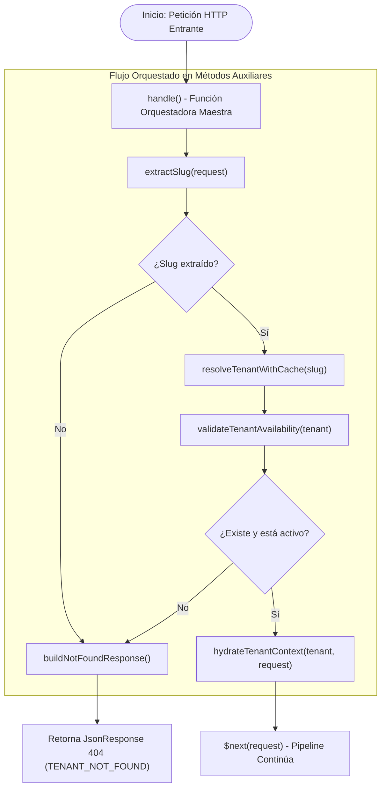

# Especificación Técnica: Middleware de Resolución y Carga de Contexto de Inquilino

**Código de Especificación:** `SPEC-MW-001`  
**Módulo:** Núcleo Multi-Tenant / Capa HTTP  
**Componente:** `App\Http\Middleware\ResolveTenantContext`  
**Regla de Negocio Base:** `RN-01: Resolución Dinámica y Fallback de Inquilino`  
**Patrón Arquitectónico:** Patrón Orquestador (*Orchestrator Pattern*) mediante Métodos Auxiliares Atómicos  
**Metodología:** Desarrollo Guiado por Pruebas (*Test-First / TDD Obligatorio*)  
**Estado:** `Implementado`

---

## 1. Propósito y Alcance

El middleware `ResolveTenantContext` es el punto de entrada crítico y la primera línea de defensa para toda petición dirigida a la API de la plataforma. Su responsabilidad única consiste en identificar de forma fehaciente al inquilino (*tenant*) sobre el cual opera la solicitud, validar su existencia y disponibilidad, inyectar el inquilino en el singleton central `TenantContext` y dejar habilitado el aislamiento hermético (`TenantScope`) para las capas subsecuentes de la aplicación.

> [!IMPORTANT]
> **Aislamiento Hermético por Defecto:**  
> Ninguna petición puede atravesar este middleware sin que exista un inquilino válido y activo. Si no se puede resolver el inquilino, el pipeline HTTP se detiene inmediatamente antes de instanciar controladores, orquestadores de negocio o consultas de datos.

---

## 2. Regla de Negocio: RN-01 (Resolución Dinámica y Fallback de Inquilino)

### 2.1. Declaración de la Regla
Toda petición a la API debe resolver el inquilino mediante la cabecera HTTP:
```http
X-Tenant-Slug: {slug}
```

### 2.2. Mecanismo de Fallback (Extracción por Host)
Si la cabecera `X-Tenant-Slug` no está presente en la petición HTTP (por ejemplo, llamadas directas desde navegadores o tiendas en dominios personalizados), el middleware aplicará una estrategia de fallback extrayendo el subdominio a partir de la cabecera `Host`:
1. Si el host coincide con el patrón `{slug}.midominio.com`, se extrae `{slug}`.
2. Si el host es un dominio personalizado (ej. `tienda-ejemplo.com`), se evalúa contra la columna correspondiente del inquilino.
3. Si tras evaluar la cabecera y el fallback no se obtiene ningún identificador, la resolución se considera fallida.

### 2.3. Comportamiento ante Inexistencia o Inactividad
Si el inquilino no existe en el sistema **O** su columna `is_active` es `false`, la API debe abortar inmediatamente la solicitud con código HTTP **`404 Not Found`** y el siguiente cuerpo JSON estándar:

```json
{
  "error": {
    "code": "TENANT_NOT_FOUND",
    "message": "El inquilino solicitado no existe o se encuentra inactivo."
  }
}
```

> [!WARNING]
> **Seguridad y Prevención de Enumeración:**  
> Para mitigar ataques de enumeración y escaneo de inquilinos, un inquilino suspendido o desactivado (`is_active = false`) debe responder con el mismo código `404 Not Found` y mensaje estándar que un inquilino que no existe.

---

## 3. Contrato de Entrada y Salida HTTP

### 3.1. Petición de Entrada
* **Cabecera Primaria:** `X-Tenant-Slug: [a-z0-9-]+` (Cadena alfanumérica en minúsculas con guiones opcionales).
* **Cabecera Secundaria (Fallback):** `Host: {slug}.plataforma.com`

### 3.2. Respuestas del Middleware

#### A. Resolución Exitosa
* **Código HTTP:** Continúa la ejecución hacia el siguiente middleware / controlador (`$next($request)`).
* **Efectos Secundarios en la Aplicación:**
  - Instancia `Tenant` registrada en el contenedor de servicios como singleton bajo `App\Context\TenantContext`.
  - Instancia `Tenant` vinculada a la petición HTTP mediante `$request->attributes->set('tenant', $tenant)`.
  - El global scope `TenantScope` queda automáticamente parametrizado con el `tenant_id` para todas las entidades que usen `BelongsToTenant`.

#### B. Inquilino No Encontrado o Inactivo
* **Código HTTP:** `404 Not Found`
* **Cabeceras:** `Content-Type: application/json`
* **Payload:**
```json
{
  "error": {
    "code": "TENANT_NOT_FOUND",
    "message": "El inquilino solicitado no existe o se encuentra inactivo."
  }
}
```

---

## 4. Diseño de Arquitectura: Patrón Orquestador con Métodos Auxiliares

Siguiendo el mandato de arquitectura del sistema, el middleware no debe acumular lógica monolítica dentro del método `handle()`. En su lugar, actúa como un **Orquestador de Resolución**, delegando cada paso en métodos auxiliares privados, atómicos y fuertemente tipados.

### 4.1. Diagrama de Flujo del Orquestador



---

### 4.2. Desglose de Funciones Auxiliares

| Método | Visibilidad | Parámetros | Retorno | Responsabilidad Única |
|---|---|---|---|---|
| `handle` | `public` | `Request $request, Closure $next` | `Response` | **Función Maestra Orquestadora:** Gobierna el orden secuencial de pasos y retorna la respuesta final. |
| `extractSlug` | `private` | `Request $request` | `?string` | Lee la cabecera `X-Tenant-Slug`. Si falta, ejecuta el fallback extrayendo el subdominio de `Host`. Retorna cadena sanitizada en minúsculas o `null`. |
| `resolveTenantWithCache` | `private` | `string $slug` | `?Tenant` | Busca el inquilino en caché de Redis (`tenant:slug:{slug}`) con TTL de 3600 segundos; ante fallo de caché, consulta PostgreSQL vía Eloquent y almacena el resultado. |
| `isTenantAvailable` | `private` | `?Tenant $tenant` | `bool` | Evalúa si el modelo existe (`$tenant !== null`) y si su columna `$tenant->is_active === true`. |
| `hydrateTenantContext` | `private` | `Tenant $tenant, Request $request` | `void` | Inyecta el tenant en `TenantContext::set($tenant)` y lo añade a los atributos del Request `$request->attributes->set('tenant', $tenant)`. |
| `buildNotFoundResponse` | `private` | *(Ninguno)* | `JsonResponse` | Construye la respuesta JSON inmutable con código `404 Not Found` y estructura estándar `TENANT_NOT_FOUND`. |

---

## 5. Estrategia de Caché en Redis (RNF-01)

Para cumplir con el requerimiento no funcional **RNF-01** (tiempo de respuesta $\le 15\text{ ms}$ en la resolución del inquilino), el middleware debe implementar almacenamiento en Redis:

1. **Estructura de la Clave:**
   ```text
   tenant:slug:{slug}
   ```
2. **Tiempo de Vida (TTL):**
   `3600` segundos (1 hora).
3. **Invalidación de Caché:**
   Cualquier actualización del inquilino (cambio de estado `is_active`, cambio de nombre o regeneración de slug) en el panel administrativo o CLI debe disparar la eliminación de la clave:
   ```php
   Cache::forget("tenant:slug:{$tenant->slug}");
   ```

---

## 6. Especificación de Pruebas Test-First (TDD con Pest)

Antes de escribir el código del middleware, se debe crear la suite de pruebas en `tests/Feature/Middleware/ResolveTenantContextTest.php`.

### 6.1. Matriz de Casos de Prueba

| ID | Escenario de Prueba | Entrada | Salida Esperada |
|---|---|---|---|
| `TC-MW-01` | Petición sin cabecera ni subdominio | Headers vacíos | `404 Not Found`, JSON `TENANT_NOT_FOUND` |
| `TC-MW-02` | Petición con slug inexistente | `X-Tenant-Slug: inexistente` | `404 Not Found`, JSON `TENANT_NOT_FOUND` |
| `TC-MW-03` | Petición con tenant inactivo (`is_active = false`) | `X-Tenant-Slug: tienda-suspendida` | `404 Not Found`, JSON `TENANT_NOT_FOUND` |
| `TC-MW-04` | Petición válida con cabecera `X-Tenant-Slug` | `X-Tenant-Slug: tienda-activa` | `200 OK`, `TenantContext` poblado con el tenant |
| `TC-MW-05` | Petición válida mediante Fallback de Host | `Host: tienda-activa.plataforma.com` | `200 OK`, Tenant resuelto y `TenantContext` poblado |
| `TC-MW-06` | Verificación de caché en Redis | 2 peticiones consecutivas con el mismo slug | 1 sola consulta SQL a base de datos; la 2da petición se sirve de Redis |
| `TC-MW-07` | Verificación de activación de `TenantScope` | Consulta a entidad tenant-scoped (ej. `Category`) | Cláusula `WHERE tenant_id = ?` aplicada automáticamente |

---

### 6.2. Código de Referencia para la Suite de Pruebas Pest

```php
<?php

use App\Context\TenantContext;
use App\Models\Tenant;
use Illuminate\Support\Facades\Cache;
use Illuminate\Support\Facades\DB;
use Illuminate\Support\Facades\Route;

beforeEach(function () {
    // Definimos una ruta ficticia protegida por el middleware para las pruebas
    Route::middleware('tenant.context')->get('/test-tenant-resolution', function () {
        $context = app(TenantContext::class);

        return response()->json([
            'status' => 'success',
            'tenant_id' => $context->id(),
            'tenant_slug' => $context->get()->slug,
        ]);
    });
});

test('aborta con 404 cuando no se proporciona cabecera X-Tenant-Slug ni dominio reconocible', function () {
    $response = $this->getJson('/test-tenant-resolution');

    $response->assertStatus(404)
        ->assertJson([
            'error' => [
                'code' => 'TENANT_NOT_FOUND',
                'message' => 'El inquilino solicitado no existe o se encuentra inactivo.',
            ],
        ]);
});

test('aborta con 404 cuando el slug no existe en la base de datos', function () {
    $response = $this->withHeader('X-Tenant-Slug', 'empresa-inexistente')
        ->getJson('/test-tenant-resolution');

    $response->assertStatus(404)
        ->assertJson([
            'error' => [
                'code' => 'TENANT_NOT_FOUND',
                'message' => 'El inquilino solicitado no existe o se encuentra inactivo.',
            ],
        ]);
});

test('aborta con 404 cuando el inquilino existe pero su estado is_active es false', function () {
    $inactiveTenant = Tenant::factory()->create([
        'slug' => 'tienda-suspendida',
        'is_active' => false,
    ]);

    $response = $this->withHeader('X-Tenant-Slug', $inactiveTenant->slug)
        ->getJson('/test-tenant-resolution');

    $response->assertStatus(404)
        ->assertJson([
            'error' => [
                'code' => 'TENANT_NOT_FOUND',
                'message' => 'El inquilino solicitado no existe o se encuentra inactivo.',
            ],
        ]);
});

test('resuelve exitosamente el inquilino e inyecta TenantContext cuando la cabecera es valida', function () {
    $tenant = Tenant::factory()->create([
        'slug' => 'tienda-valida',
        'is_active' => true,
    ]);

    $response = $this->withHeader('X-Tenant-Slug', 'tienda-valida')
        ->getJson('/test-tenant-resolution');

    $response->assertStatus(200)
        ->assertJson([
            'status' => 'success',
            'tenant_id' => $tenant->id,
            'tenant_slug' => 'tienda-valida',
        ]);

    expect(app(TenantContext::class)->isSet())->toBeTrue()
        ->and(app(TenantContext::class)->id())->toBe($tenant->id);
});

test('resuelve exitosamente mediante fallback de cabecera Host con subdominio', function () {
    $tenant = Tenant::factory()->create([
        'slug' => 'tienda-subdominio',
        'is_active' => true,
    ]);

    $response = $this->withServerVariables(['HTTP_HOST' => 'tienda-subdominio.plataforma.test'])
        ->getJson('/test-tenant-resolution');

    $response->assertStatus(200)
        ->assertJson([
            'status' => 'success',
            'tenant_id' => $tenant->id,
            'tenant_slug' => 'tienda-subdominio',
        ]);
});

test('almacena en cache de Redis la resolucion del inquilino evitando consultas SQL repetitivas', function () {
    Cache::flush();

    $tenant = Tenant::factory()->create([
        'slug' => 'tienda-con-cache',
        'is_active' => true,
    ]);

    // 1. Primera llamada: llena la cache desde BD
    $this->withHeader('X-Tenant-Slug', 'tienda-con-cache')->getJson('/test-tenant-resolution')->assertOk();

    expect(Cache::has("tenant:slug:{$tenant->slug}"))->toBeTrue();

    // 2. Segunda llamada: verifica que no ejecute consultas SQL a la tabla tenants
    DB::enableQueryLog();

    $this->withHeader('X-Tenant-Slug', 'tienda-con-cache')->getJson('/test-tenant-resolution')->assertOk();

    $queries = collect(DB::getQueryLog())->filter(fn ($q) => str_contains($q['query'], '"tenants"'));
    expect($queries)->toBeEmpty();
});
```

---

## 7. Diseño Estructural de la Clase (`ResolveTenantContext`)

Estructura de la implementación basada en el patrón orquestador:

```php
<?php

namespace App\Http\Middleware;

use App\Context\TenantContext;
use App\Models\Tenant;
use Closure;
use Illuminate\Http\JsonResponse;
use Illuminate\Http\Request;
use Illuminate\Support\Facades\Cache;
use Illuminate\Support\Str;
use Symfony\Component\HttpFoundation\Response;

class ResolveTenantContext
{
    public function __construct(
        protected TenantContext $tenantContext
    ) {}

    /**
     * Función Maestra Orquestadora.
     */
    public function handle(Request $request, Closure $next): Response
    {
        // Paso Auxiliar 1: Extraer el slug de cabecera o fallback de host
        $slug = $this->extractSlug($request);

        if ($slug === null) {
            return $this->buildNotFoundResponse();
        }

        // Paso Auxiliar 2: Resolver el inquilino con estrategia de caché en Redis
        $tenant = $this->resolveTenantWithCache($slug);

        // Paso Auxiliar 3: Validar disponibilidad (existencia y estado activo)
        if (! $this->isTenantAvailable($tenant)) {
            return $this->buildNotFoundResponse();
        }

        // Paso Auxiliar 4: Hidratar el contexto global y el request
        $this->hydrateTenantContext($tenant, $request);

        // Paso Auxiliar 5: Continuar con el pipeline
        return $next($request);
    }

    /**
     * Paso Auxiliar 1: Extrae el slug sanitizado de X-Tenant-Slug o subdominio Host.
     */
    private function extractSlug(Request $request): ?string
    {
        $headerSlug = $request->header('X-Tenant-Slug');

        if (! empty($headerSlug) && is_string($headerSlug)) {
            return Str::lower(trim($headerSlug));
        }

        // Fallback: Analizar cabecera Host
        $host = $request->getHost();
        $parts = explode('.', $host);

        if (count($parts) >= 2 && $parts[0] !== 'www' && $parts[0] !== 'api') {
            return Str::lower(trim($parts[0]));
        }

        return null;
    }

    /**
     * Paso Auxiliar 2: Resuelve el inquilino desde Redis o PostgreSQL.
     */
    private function resolveTenantWithCache(string $slug): ?Tenant
    {
        $cacheKey = "tenant:slug:{$slug}";

        return Cache::remember($cacheKey, 3600, function () use ($slug): ?Tenant {
            return Tenant::query()
                ->where('slug', $slug)
                ->first();
        });
    }

    /**
     * Paso Auxiliar 3: Comprueba si el inquilino existe y se encuentra activo.
     */
    private function isTenantAvailable(?Tenant $tenant): bool
    {
        return $tenant !== null && (bool) $tenant->is_active;
    }

    /**
     * Paso Auxiliar 4: Registra la instancia en el TenantContext y atributos del request.
     */
    private function hydrateTenantContext(Tenant $tenant, Request $request): void
    {
        $this->tenantContext->set($tenant);
        $request->attributes->set('tenant', $tenant);
    }

    /**
     * Paso Auxiliar 5: Genera la respuesta estandarizada 404 Not Found.
     */
    private function buildNotFoundResponse(): JsonResponse
    {
        return response()->json([
            'error' => [
                'code' => 'TENANT_NOT_FOUND',
                'message' => 'El inquilino solicitado no existe o se encuentra inactivo.',
            ],
        ], Response::HTTP_NOT_FOUND);
    }
}
```

---

## 8. Registro en el Pipeline de Laravel (`bootstrap/app.php`)

Para habilitar el middleware en la aplicación, se debe registrar su alias en `bootstrap/app.php`:

```php
->withMiddleware(function (Middleware $middleware): void {
    $middleware->alias([
        'tenant.context' => \App\Http\Middleware\ResolveTenantContext::class,
    ]);
})
```

Y en `routes/api.php`, se aplicará al grupo de rutas correspondiente:

```php
Route::prefix('v1')
    ->middleware(['tenant.context'])
    ->group(function () {
        // Rutas de Storefront y Admin protegidas bajo aislamiento de inquilino
    });
```

---

## 9. Criterios de Aceptación (Definition of Done - DoD)

1. [x] El archivo de especificación `docs/spects/01_SPEC-MW-001_middleware_resolve_tenant_context.md` está versionado en Git.
2. [x] Se escribe la prueba `tests/Feature/Middleware/ResolveTenantContextTest.php` antes de implementar el middleware y se verifica su fallo inicial (`RED`).
3. [x] El middleware `App\Http\Middleware\ResolveTenantContext` implementa estrictamente los métodos auxiliares privados descritos sin lógica monolítica en `handle()`.
4. [x] Ante falta de cabecera, slug inexistente o `is_active = false`, responde exactamente `404 Not Found` con `code: TENANT_NOT_FOUND`.
5. [x] La resolución exitosa almacena el modelo en Redis (`tenant:slug:{slug}`) reduciendo consultas a PostgreSQL.
6. [x] La suite completa de Pest pasa al 100% (`vendor/bin/pest`).
7. [x] PHPStan no reporta errores de nivel estricto (`vendor/bin/phpstan analyse`).
8. [x] Código formateado con Laravel Pint (`vendor/bin/pint --dirty --format agent`).

---

## 10. Resumen de Implementación

* **Fecha de Implementación:** 2026-11-06
* **Clase:** `App\Http\Middleware\ResolveTenantContext`
* **Alias de Middleware:** `tenant.context` registrado en `bootstrap/app.php`
* **Ruta Base API:** Grupo de rutas con prefijo `v1` en `routes/api.php`
* **Resultados de Validación:**
  * Pruebas del Middleware: 9/9 casos aprobados en `tests/Feature/Middleware/ResolveTenantContextTest.php`.
  * Suite Global: 51/51 pruebas aprobadas sin regresiones.
  * Análisis Estático: Nivel estricto de PHPStan superado con 0 errores.
  * Estilo de Código: Cumplimiento total de estándares con Laravel Pint.
