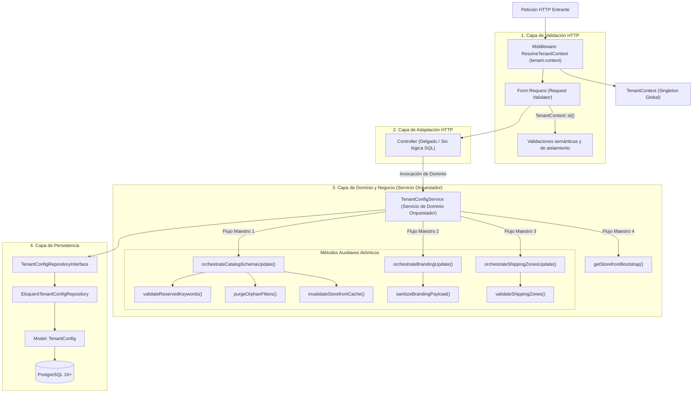

# Especificación Técnica: Gestión Integral de Configuración de Inquilino (TenantConfig)

**Código de Especificación:** `SPEC-TC-002`  
**Módulos:** Vitrina Pública (*Storefront*) & Panel Administrativo del Inquilino (*Tenant Admin*)  
**Entidad Base:** `App\Models\TenantConfig` (1:1 con `App\Models\Tenant`)  
**Patrones Arquitectónicos Obligatorios:** Repository Pattern + Service Layer + Orchestrator Pattern con Métodos Auxiliares + Request Validators (Form Requests)  
**Mecanismos de Aislamiento:** Middleware `ResolveTenantContext` (`tenant.context`), `TenantContext` Singleton y `TenantScope`  
**Metodología:** Desarrollo Guiado por Pruebas (*Test-First / TDD Obligatorio*)  
**Estado:** `Aprobado para Implementación`

---

## 1. Visión General y Alcance

La entidad `TenantConfig` gobierna la parametrización dinámica y el comportamiento visual y operativo de cada comercio electrónico en la plataforma. Siguiendo el principio de **Arquitectura Agnóstica al Rubro Comercial (*Schema-Driven Architecture*)**, el código del sistema no acopla reglas de industrias específicas (como calzado, indumentaria o electrónica); en su lugar, delega en `tenant_configs` la definición de:
1. **Identidad Visual y Theming CSS (`branding`):** Paleta de colores, tipografía, logotipos, banners y canales sociales.
2. **Esquema Dinámico de Atributos (`metadata_schema`):** Definición de propiedades dinámicas de los productos y dimensiones que particionan inventario en variantes (`affects_stock`).
3. **Configuración de Búsqueda y Navegación Facetada (`filter_config`):** Filtros del sistema y filtros dinámicos expuestos al público comprador.
4. **Zonas Geográficas y Tarifas de Despacho (`shipping_zones`):** Cobertura y costos logísticos por departamento/región.
5. **Reglas de Recompensas Salientes (`outbound_reward_rules`):** Umbrales de compra para emisión de vouchers cruzados con comercios aliados.

---

## 2. Mapa de Endpoints de la Entidad

| Módulo | Método | Endpoint | Middleware / Autenticación | Propósito y SLA |
|---|---|---|---|---|
| **Storefront** | `GET` | `/api/v1/storefront/config` | `tenant.context` | Entrega bootstrap público para renderizar la tienda (branding, filtros activos y zonas de envío). Servido desde Redis ($\le 15\text{ ms}$). |
| **Admin** | `GET` | `/api/v1/admin/config` | `auth:sanctum`, `tenant.context` | Retorna la configuración integral del comercio para el panel de administración. |
| **Admin** | `PUT` | `/api/v1/admin/config/catalog-schema` | `auth:sanctum`, `tenant.context` | Actualiza `metadata_schema` y `filter_config`. Valida atributos dinámicos, purga filtros huérfanos e invalida caché. |
| **Admin** | `PUT` | `/api/v1/admin/config/branding` | `auth:sanctum`, `tenant.context` | Actualiza colores, fuentes, URLs de marca y redes sociales. Invalida caché. |
| **Admin** | `PUT` | `/api/v1/admin/config/shipping-zones` | `auth:sanctum`, `tenant.context` | Actualiza zonas de despacho y sus tarifas logísticas. Invalida caché. |

---

## 3. Contexto Arquitectónico y Uso de Abstracciones del Sistema

Para garantizar aislamiento hermético, alta cohesión y bajo acoplamiento, la implementación de esta entidad debe apoyarse estrictamente en las abstracciones base ya construidas:



### 3.1. Reutilización de Abstracciones Base:
1. **Middleware `tenant.context` (`ResolveTenantContext`):**  
   Resuelve el inquilino a partir de `X-Tenant-Slug` (o fallback de `Host`), garantizando que cualquier petición que ingrese a las rutas cuente con un inquilino válido y activo.
2. **`TenantContext` Singleton:**  
   Permite al repositorio, orquestador y validadores acceder al tenant actual sin depender de parámetros HTTP manuales ni llamadas a base de datos redundantes.
3. **Aislamiento Multi-Tenant en Administración:**  
   Para las rutas bajo `auth:sanctum`, se debe asertar que el usuario autenticado pertenece al mismo `tenant_id` que el resuelto por `TenantContext`. Un usuario del *Tenant A* intentando consultar o alterar la configuración del *Tenant B* debe ser rechazado inmediatamente con `403 Forbidden` o `404 Not Found`.

---

## 4. Componentes de Arquitectura Obligatorios

La implementación de la rebanada vertical debe constar de los siguientes componentes obligatorios:

### 4.1. Capa de Validación (Form Requests)
* **`UpdateCatalogSchemaRequest`:**
  - Valida la estructura de `metadata_schema` (claves en snake_case, tipos válidos, presencia obligatoria de `options` si es select).
  - Prohíbe el uso de palabras reservadas del sistema (`id`, `sku`, `price`, etc.).
  - Valida la estructura de `filter_config` (orden numérico, tipos válidos `system` o `metadata`).
* **`UpdateBrandingConfigRequest`:**
  - Valida códigos de color hexadecimales (`#RRGGBB`).
  - Valida URLs seguras (`https://`) para logotipos, banners y favicons.
  - Valida formato de redes sociales y teléfonos de contacto (WhatsApp).
* **`UpdateShippingZonesRequest`:**
  - Valida que `shipping_zones` sea un arreglo de objetos con `code` (string no vacío), `name` (string) y `fee` (numérico $\ge 0$).

### 4.2. Capa de Controladores (Thin Controllers)
* **`StorefrontConfigController` (Invokable `__invoke`):**
  - Delega directamente en el método de orquestación `TenantConfigService::getStorefrontBootstrap()`.
  - Retorna respuesta `200 OK` formateada exclusivamente con los datos públicos (ocultando datos sensibles o administrativos).
* **`AdminTenantConfigController`:**
  - `show()`: Delega en `TenantConfigService::getAdminConfig()` y retorna la configuración completa del inquilino autenticado.
  - `updateCatalogSchema()`: Delega en el método orquestador `TenantConfigService::orchestrateCatalogSchemaUpdate()` y retorna la configuración actualizada.
  - `updateBranding()`: Delega en el método orquestador `TenantConfigService::orchestrateBrandingUpdate()` y retorna la configuración actualizada.
  - `updateShippingZones()`: Delega en el método orquestador `TenantConfigService::orchestrateShippingZonesUpdate()` y retorna la configuración actualizada.

### 4.3. Capa de Dominio y Negocio: Servicio de Dominio Orquestador (`TenantConfigService`)

En la arquitectura del sistema, **los orquestadores son Servicios de Dominio** (en este caso, `App\Services\Tenant\TenantConfigService`) que, en lugar de fragmentar la lógica en múltiples clases micro-orquestadoras dispersas, concentran la gobernanza del ciclo de vida del inquilino a través de **métodos especializados en orquestación**, apoyándose internamente en **métodos auxiliares atómicos y fuertemente tipados**:

#### Estructura y Flujos del Servicio Orquestador:
* **Método Orquestador 1: `orchestrateCatalogSchemaUpdate(Tenant $tenant, array $payload): TenantConfig`**
  - *Responsabilidad:* Coordina de forma transaccional la actualización de atributos dinámicos y filtros del catálogo.
  - *Métodos Auxiliares:*
    1. `validateReservedKeywords(array $metadataSchema): void` $\rightarrow$ Valida que no se utilicen nombres del sistema (`id`, `sku`, etc.).
    2. `validateAttributeDataTypes(array $metadataSchema): void` $\rightarrow$ Valida tipos de datos permitidos y obligatoriedad de `options` en selects.
    3. `purgeOrphanFilters(array $metadataSchema, array $filterConfig): array` $\rightarrow$ Sanea filtros descartando aquellos que apunten a claves eliminadas.
    4. `persistCatalogSchema(Tenant $tenant, array $metadataSchema, array $filterConfig): TenantConfig` $\rightarrow$ Persiste mediante el repositorio bajo `DB::transaction()`.
    5. `invalidateStorefrontCache(Tenant $tenant): void` $\rightarrow$ Purga la clave de Redis `tenant:{tenant_id}:storefront_config`.

* **Método Orquestador 2: `orchestrateBrandingUpdate(Tenant $tenant, array $payload): TenantConfig`**
  - *Responsabilidad:* Coordina la actualización de la identidad corporativa y canales sociales.
  - *Métodos Auxiliares:*
    1. `sanitizeBrandingPayload(array $payload): array` $\rightarrow$ Normaliza colores hex a mayúsculas y limpia cadenas.
    2. `persistBranding(Tenant $tenant, array $brandingData): TenantConfig` $\rightarrow$ Persiste vía repositorio.
    3. `invalidateStorefrontCache(Tenant $tenant): void` $\rightarrow$ Purga la caché de Redis.

* **Método Orquestador 3: `orchestrateShippingZonesUpdate(Tenant $tenant, array $payload): TenantConfig`**
  - *Responsabilidad:* Coordina la matriz logística de envíos y tarifas.
  - *Métodos Auxiliares:*
    1. `validateShippingZones(array $zones): void` $\rightarrow$ Valida unicidad de códigos de zona y montos $\ge 0$.
    2. `persistShippingZones(Tenant $tenant, array $zones): TenantConfig` $\rightarrow$ Persiste vía repositorio.
    3. `invalidateStorefrontCache(Tenant $tenant): void` $\rightarrow$ Purga la caché de Redis.

* **Método Orquestador 4: `getStorefrontBootstrap(Tenant $tenant): array`**
  - *Responsabilidad:* Entrega eficiente de la configuración pública bajo el patrón Cache-Aside con SLA $\le 15\text{ ms}$.
  - *Métodos Auxiliares:*
    1. `resolveFromRedisCache(Tenant $tenant): ?array` $\rightarrow$ Intenta recuperar la clave de Redis.
    2. `buildStorefrontPayload(Tenant $tenant, TenantConfig $config): array` $\rightarrow$ Filtra y formatea solo los campos públicos.
    3. `storeInRedisCache(Tenant $tenant, array $payload): void` $\rightarrow$ Almacena en Redis con TTL de 3600 segundos ante cache miss.

### 4.4. Capa de Persistencia (Repository Pattern)
* **Contrato:** `App\Repositories\Contracts\TenantConfigRepositoryInterface`
  - `findByTenantId(string $tenantId): ?TenantConfig`
  - `updateCatalogSchema(string $tenantId, array $metadataSchema, array $filterConfig): TenantConfig`
  - `updateBranding(string $tenantId, array $brandingData): TenantConfig`
  - `updateShippingZones(string $tenantId, array $shippingZones): TenantConfig`
* **Implementación:** `App\Repositories\Eloquent\EloquentTenantConfigRepository`

---

## 5. Especificación de Endpoints y Contratos HTTP

### 5.1. `GET /api/v1/storefront/config` (Vitrina Pública)
* **Cabecera Requerida:** `X-Tenant-Slug: {slug}`
* **Estrategia de Almacenamiento:** Servido desde Redis bajo la clave `tenant:{tenant_id}:storefront_config`.
* **Respuesta Exitosa `200 OK`:**
```json
{
  "tenant": {
    "name": "Calzados Elegantes",
    "currency_code": "HNL",
    "country_code": "HN"
  },
  "branding": {
    "primary_color": "#1E293B",
    "secondary_color": "#475569",
    "accent_color": "#F59E0B",
    "font_family": "Inter",
    "logo_url": "https://cdn.plataforma.com/t1/logo.webp",
    "banner_url": "https://cdn.plataforma.com/t1/banner.webp",
    "favicon_url": "https://cdn.plataforma.com/t1/favicon.ico",
    "social_links": {
      "whatsapp": "+50499887766",
      "instagram": "calzados_hn",
      "facebook": "calzadoseleganteshn"
    }
  },
  "filters": [
    { "type": "system", "key": "price", "label": "Rango de Precio", "data_type": "range", "order": 1 },
    { "type": "system", "key": "category", "label": "Categoría", "data_type": "select", "order": 2 },
    { "type": "metadata", "key": "talla", "label": "Talla", "data_type": "select", "options": ["38", "39", "40", "41"], "affects_stock": true, "order": 3 }
  ],
  "shipping_zones": [
    { "code": "HN-CR", "name": "Cortés", "fee": 80.00 },
    { "code": "HN-FM", "name": "Francisco Morazán", "fee": 120.00 }
  ]
}
```

> [!CAUTION]
> **Privacidad de Reglas Internas:**  
> Este endpoint público **nunca** debe exponer `outbound_reward_rules`, configuraciones de comisiones ni datos sensibles de contacto administrativo.

---

### 5.2. `GET /api/v1/admin/config` (Panel de Administración)
* **Cabeceras Requeridas:** `Authorization: Bearer {token}`, `X-Tenant-Slug: {slug}`
* **Respuesta Exitosa `200 OK`:**
```json
{
  "tenant_id": "990e8400-e29b-41d4-a716-446655440000",
  "branding": {
    "primary_color": "#1E293B",
    "secondary_color": "#475569",
    "accent_color": "#F59E0B",
    "font_family": "Inter",
    "logo_url": "https://cdn.plataforma.com/t1/logo.webp",
    "banner_url": "https://cdn.plataforma.com/t1/banner.webp",
    "favicon_url": "https://cdn.plataforma.com/t1/favicon.ico"
  },
  "contact_info": {
    "whatsapp_sales": "+50499887766",
    "support_email": "soporte@mitienda.com",
    "social_links": {
      "instagram": "mitienda_hn"
    }
  },
  "shipping_zones": [
    { "code": "HN-CR", "name": "Cortés", "fee": 80.00 }
  ],
  "metadata_schema": [
    {
      "key": "talla",
      "label": "Talla",
      "data_type": "select",
      "options": ["38", "39", "40"],
      "is_required": true,
      "affects_stock": true
    }
  ],
  "filter_config": [
    { "type": "system", "key": "price", "label": "Precio", "order": 1 },
    { "type": "metadata", "key": "talla", "label": "Talla", "order": 2 }
  ],
  "outbound_reward_rules": {
    "min_order_amount": 1000.00,
    "reward_partner_id": "110e8400-e29b-41d4-a716-446655440001",
    "is_enabled": true
  },
  "updated_at": "2026-11-06T20:00:00Z"
}
```

---

### 5.3. `PUT /api/v1/admin/config/catalog-schema`
* **Cabeceras Requeridas:** `Authorization: Bearer {token}`, `X-Tenant-Slug: {slug}`
* **Cuerpo de la Petición (`Request Body`):**
```json
{
  "metadata_schema": [
    {
      "key": "talla",
      "label": "Talla Calzado",
      "data_type": "select",
      "options": ["38", "39", "40", "41", "42"],
      "is_required": true,
      "affects_stock": true
    },
    {
      "key": "material",
      "label": "Material Exterior",
      "data_type": "text",
      "is_required": false,
      "affects_stock": false
    }
  ],
  "filter_config": [
    { "type": "system", "key": "price", "label": "Rango de Precio", "order": 1 },
    { "type": "metadata", "key": "talla", "label": "Talla", "order": 2 }
  ]
}
```
* **Respuesta Exitosa `200 OK`:** Retorna el modelo `TenantConfig` actualizado.
* **Efectos Secundarios:**
  - Se purga la caché de Redis: `tenant:{tenant_id}:storefront_config`.
  - Si en `filter_config` venía algún filtro de tipo `metadata` cuya clave no figure en `metadata_schema`, el orquestador lo purga automáticamente o el validador emite `422 Unprocessable Entity`.

---

### 5.4. `PUT /api/v1/admin/config/branding`
* **Cuerpo de la Petición (`Request Body`):**
```json
{
  "primary_color": "#0F172A",
  "secondary_color": "#334155",
  "accent_color": "#E11D48",
  "font_family": "Plus Jakarta Sans",
  "logo_url": "https://cdn.plataforma.com/t1/nuevo-logo.webp",
  "banner_url": "https://cdn.plataforma.com/t1/nuevo-banner.webp",
  "favicon_url": "https://cdn.plataforma.com/t1/favicon.ico",
  "social_links": {
    "whatsapp": "+50499001122",
    "instagram": "nueva_tienda_hn"
  }
}
```
* **Respuesta Exitosa `200 OK`:** Retorna la configuración de branding actualizada.
* **Efectos Secundarios:** Purga inmediata de la clave de caché en Redis.

---

### 5.5. `PUT /api/v1/admin/config/shipping-zones`
* **Cuerpo de la Petición (`Request Body`):**
```json
{
  "shipping_zones": [
    { "code": "HN-CR", "name": "Cortés (San Pedro Sula y alrededores)", "fee": 90.00 },
    { "code": "HN-FM", "name": "Francisco Morazán (Tegucigalpa)", "fee": 130.00 },
    { "code": "HN-AT", "name": "Atlántida (La Ceiba)", "fee": 150.00 }
  ]
}
```
* **Respuesta Exitosa `200 OK`:** Retorna el arreglo actualizado de zonas de despacho.
* **Efectos Secundarios:** Purga inmediata de la clave de caché en Redis.

---

## 6. Reglas de Negocio y Restricciones de Dominio

### RN-TC-01: Palabras Reservadas Prohibidas en `metadata_schema`
Los siguientes identificadores representan columnas nativas o atributos estructurales del sistema SQL y quedan **estrictamente prohibidos** como `key` en `metadata_schema`:
```text
id, tenant_id, name, slug, description, category_id, sku, price, 
stock, status, is_active, created_at, updated_at, deleted_at, metadata
```
Cualquier intento de registrar una de estas claves debe disparar un error `422 Unprocessable Entity` con el mensaje:
> *"La clave [nombre] es una palabra reservada del sistema y no puede ser utilizada como metadato dinámico."*

### RN-TC-02: Integridad de Tipos de Datos y Opciones
* Tipos soportados en `data_type`: `text`, `number`, `boolean`, `select`, `multiselect`, `date`.
* Si `data_type` es `select` o `multiselect`, el campo `options` debe ser un arreglo con al menos un elemento de tipo string. Para los demás tipos, `options` no debe ser requerido o debe ser ignorado.

### RN-TC-03: Dimensión de Inventario (`affects_stock`)
* Si `affects_stock = true`, el atributo actúa como dimensionador de variantes en `product_variants.metadata`.
* Si `affects_stock = false`, el atributo describe al producto base en `products.metadata`.

### RN-TC-04: Cero Filtros Huérfanos (*Orphan Filter Consistency*)
En `filter_config`, los elementos con `"type": "metadata"` deben corresponder exactamente a una `key` declarada en `metadata_schema`. Si un administrador envía un filtro referenciando una clave que no existe en el esquema, el orquestador tiene la obligación de sanear el arreglo descartando los filtros no reconocidos antes de persistir.

### RN-TC-05: Coherencia de Tarifas de Envío
* Cada zona de envío debe incluir un identificador regional único (`code`), un nombre descriptivo (`name`) y una tarifa (`fee`).
* El valor de `fee` no puede ser negativo (`fee >= 0`). Tarifas de `0.00` representan envío gratuito (*Free Shipping*).

---

## 7. Plan de Pruebas Test-First (Pest Suite Exhaustiva)

En apego a la metodología **Test-First**, la implementación solo podrá dar inicio tras la creación de las siguientes pruebas en estado fallido (`RED`).

### 7.1. Suite de Pruebas de Característica (Feature Tests)

#### A. Vitrina Pública: `tests/Feature/Api/V1/Storefront/StorefrontConfigTest.php`
* **Happy Path:**
  1. `test('retorna 200 con estructura publica completa para un tenant valido')`: Verifica que el endpoint retorne `tenant`, `branding`, `filters` y `shipping_zones` con los tipos de datos correctos.
  2. `test('sirve la configuracion de vitrina desde cache de redis en subsecuentes peticiones')`: Verifica que tras la primera llamada, las llamadas siguientes no ejecuten consultas SQL a `tenant_configs`.
* **Bad Path & Casos Borde:**
  3. `test('aborta con 404 cuando la peticion no incluye la cabecera X-Tenant-Slug')`
  4. `test('aborta con 404 cuando el inquilino solicitado no existe o esta suspendido')`
  5. `test('no expone campos sensibles como outbound_reward_rules en la respuesta publica')`
  6. `test('retorna filtros y zonas vacias cuando el tenant no ha configurado valores aun')`

---

#### B. Panel Administrativo - Lectura: `tests/Feature/Api/V1/Admin/TenantConfigShowTest.php`
* **Happy Path:**
  1. `test('administrador autenticado puede obtener la configuracion completa de su tenant')`: Verifica retorno exitoso `200 OK` con todos los metadatos y reglas internas.
* **Bad Path & Seguridad Multi-Tenant:**
  2. `test('usuario no autenticado recibe 401 Unauthorized')`
  3. `test('administrador del Tenant A no puede consultar la configuracion del Tenant B')`: Crea dos inquilinos (`Tenant A` y `Tenant B`) con sus respectivos administradores; el administrador de A realiza la petición hacia B con `X-Tenant-Slug: tenant-b` y recibe `403 Forbidden` o `404 Not Found`.

---

#### C. Panel Administrativo - Catálogo y Esquema: `tests/Feature/Api/V1/Admin/UpdateCatalogSchemaTest.php`
* **Happy Path:**
  1. `test('administrador puede actualizar exitosamente metadata_schema y filter_config')`: Envía esquema con atributos tipo `select` y `text`, verifica actualización en base de datos (`assertDatabaseHas`) y respuesta `200 OK`.
  2. `test('actualizar el catalogo schema invalida la cache de vitrina en Redis')`: Llena la caché del Storefront, ejecuta el `PUT /catalog-schema` y verifica que `Cache::has('tenant:{id}:storefront_config')` sea falso.
  3. `test('purga automaticamente filtros huerfanos presentes en filter_config')`: Envía un filtro para una clave que no existe en `metadata_schema`; el orquestador persiste el esquema y omite el filtro huérfano.
* **Bad Path & Validaciones:**
  4. `test('rechaza con 422 el uso de palabras reservadas del sistema como claves de metadato')`: Prueba payloads con claves como `id`, `sku`, `price`, `stock`, `status`, esperando `422 Unprocessable Entity` con mensaje explicativo.
  5. `test('rechaza con 422 atributos tipo select que no proporcionen el arreglo options')`
  6. `test('rechaza con 422 claves con caracteres especiales o espacios no conformes con snake_case')`
* **Casos Borde:**
  7. `test('permite vaciar completamente el esquema de metadatos enviando arreglos vacios')`
  8. `test('preserva atributos existentes cuando solo se reordenan los filtros')`

---

#### D. Panel Administrativo - Branding: `tests/Feature/Api/V1/Admin/UpdateBrandingTest.php`
* **Happy Path:**
  1. `test('administrador puede actualizar la paleta de colores y enlaces sociales')`: Verifica actualización exitosa de colores hex y canales de atención.
  2. `test('actualizacion de branding invalida la cache de storefront')`
* **Bad Path & Casos Borde:**
  3. `test('rechaza con 422 colores que no cumplan formato hexadecimal valido')` (ej. `#FFF1`, `rojo`, `#ZZZZZZ`).
  4. `test('rechaza URLs malformadas para logotipo o banner')`
  5. `test('acepta colores en minusculas o mayusculas normalizandolos')`

---

#### E. Panel Administrativo - Zonas de Envío: `tests/Feature/Api/V1/Admin/UpdateShippingZonesTest.php`
* **Happy Path:**
  1. `test('administrador puede configurar las tarifas de envio por zona geografica')`
  2. `test('permite configurar tarifa 0 para envio gratuito')`
  3. `test('actualizacion de zonas de envio invalida la cache de vitrina')`
* **Bad Path & Casos Borde:**
  4. `test('rechaza con 422 tarifas con montos negativos')`
  5. `test('rechaza con 422 elementos de zona que carezcan de codigo o nombre')`

---

### 7.2. Suite de Pruebas Unitarias (Unit Tests)

1. **`tests/Unit/Services/TenantConfigServiceOrchestratorTest.php`:**
   - Comprueba de forma aislada que el método auxiliar `validateReservedKeywords()` detecte y rechace la lista negra de nombres del sistema (`id`, `sku`, `price`, `stock`, etc.).
   - Comprueba de forma aislada que `purgeOrphanFilters()` sanee un arreglo de filtros mixtos descartando aquellos que apunten a atributos no existentes en `metadata_schema`.
   - Comprueba que `sanitizeBrandingPayload()` normalice colores en mayúsculas y preserve URLs válidas.
   - Comprueba que `validateShippingZones()` rechace arreglos con tarifas negativas o campos faltantes.
2. **`tests/Unit/Services/TenantConfigCacheOperationsTest.php`:**
   - Verifica la construcción de la clave Redis `tenant:{tenant_id}:storefront_config`.
   - Verifica el almacenamiento y retorno de datos bajo el patrón Cache-Aside.
   - Verifica la purga explícita de caché (`Cache::forget`) ante llamadas de invalidación.

---

## 8. Criterios de Aceptación (Definition of Done - DoD)

1. [ ] El documento de especificación `docs/spects/02_SPEC-TC-002_tenant_config_management.md` está versionado en Git.
2. [ ] Se escriben y ejecutan en primer lugar todas las pruebas Feature y Unit en Pest, verificando su fallo en rojo (`RED`).
3. [ ] Todos los componentes de arquitectura obligatorios están implementados:
   - Form Requests: `UpdateCatalogSchemaRequest`, `UpdateBrandingConfigRequest`, `UpdateShippingZonesRequest`.
   - Controladores: `StorefrontConfigController` y `AdminTenantConfigController`.
   - Servicio de Dominio Orquestador: `TenantConfigService` con sus métodos orquestadores maestros y métodos auxiliares atómicos.
   - Repositorio: `TenantConfigRepositoryInterface` y `EloquentTenantConfigRepository`.
4. [ ] La vitrina pública (`GET /api/v1/storefront/config`) responde en $\le 15\text{ ms}$ gracias a la caché de Redis.
5. [ ] Cualquier mutación administrativa en branding, catálogo o envíos purga automáticamente la clave de vitrina en Redis.
6. [ ] La suite de pruebas de Pest pasa al 100% sin excepciones (`vendor/bin/pest`).
7. [ ] PHPStan no reporta errores en nivel estricto (`vendor/bin/phpstan analyse`).
8. [ ] Código formateado con Laravel Pint (`vendor/bin/pint --dirty --format agent`).
