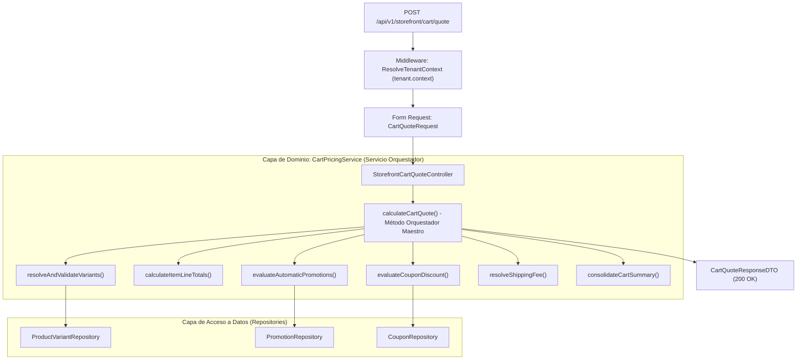
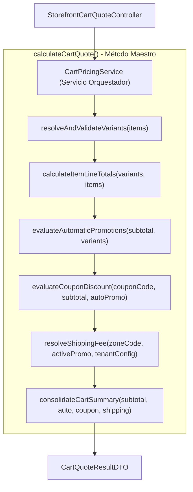

# Especificación Técnica: Motor de Precios, Promociones, Cupones y Cotizador de Carrito

**Código de Especificación:** `SPEC-PRM-004`  
**Módulos:** Vitrina Pública (*Storefront*) & Panel Administrativo (*Tenant Admin*)  
**Entidades Nucleares:** `App\Models\Promotion`, `App\Models\Coupon`, `App\Models\Affiliate`, `App\Models\TenantConfig`, `App\Models\ProductVariant`  
**Patrones Arquitectónicos Obligatorios:** Repository-Service-Controller + Servicio de Dominio Orquestador (`CartPricingService`) con Métodos Auxiliares Atómicos + Form Requests  
**Aislamiento y Alcance:** `BelongsToTenant`, `TenantScope`, `TenantContext` y Middleware `tenant.context`  
**Metodología:** Desarrollo Guiado por Pruebas (*Test-First / TDD Obligatorio*)  
**Estado:** `Aprobado para Implementación`

---

## 1. Visión General y Propósito del Módulo

El motor de precios y promociones es el núcleo matemático del comercio electrónico. Su función principal consiste en recibir los ítems seleccionados por el comprador en su vitrina pública, comprobar la disponibilidad preliminar de inventario, evaluar qué reglas de descuento automáticas son elegibles, validar cupones manuales introducidos por el usuario (y su atribución a afiliados), calcular la tarifa logística según el departamento de entrega y entregar un desglose inmutable y transparente de importes antes de la formalización del pedido.



---

## 2. Mapa de Endpoints del Módulo

| Módulo | Método | Endpoint | Middleware / Auth | SLA / Propósito |
|---|---|---|---|---|
| **Storefront** | `POST` | `/api/v1/storefront/cart/quote` | `tenant.context` | **Cotización en Tiempo Real:** Calcula precios efectivos, aplica promociones automáticas, valida cupones y resuelve flete geográfico ($\le 30\text{ ms}$). |
| **Admin** | `POST` | `/api/v1/admin/promotions` | `auth:sanctum`, `tenant.context` | Crea regla de descuento automática o por cupón con condiciones JSONB. |
| **Admin** | `GET` | `/api/v1/admin/promotions` | `auth:sanctum`, `tenant.context` | Lista promociones activas e inactivas del tenant. |
| **Admin** | `PUT` | `/api/v1/admin/promotions/{id}` | `auth:sanctum`, `tenant.context` | Actualiza montos, tipos, vigencia o condiciones de una promoción. |
| **Admin** | `POST` | `/api/v1/admin/coupons` | `auth:sanctum`, `tenant.context` | Genera código de cupón alfanumérico con límites de uso y asignación opcional de afiliado. |
| **Admin** | `GET` | `/api/v1/admin/coupons` | `auth:sanctum`, `tenant.context` | Lista cupones con métricas de redención (`used_count` vs `max_uses`). |
| **Admin** | `POST` | `/api/v1/admin/affiliates` | `auth:sanctum`, `tenant.context` | Registra colaborador externo receptor de comisiones referidas. |
| **Admin** | `GET` | `/api/v1/admin/affiliates` | `auth:sanctum`, `tenant.context` | Lista afiliados y sus tasas de comisión acordadas. |

---

## 3. Reglas de Negocio Estrictas del Motor de Cálculo

### RN-PRM-01: Tipos de Descuento Soportados
La columna `promotions.discount_type` admite los siguientes tipos:
1. `PERCENTAGE`: Descuento porcentual (ej. $15.00\%$) aplicado sobre el subtotal de ítems elegibles.
2. `FIXED_AMOUNT`: Descuento de valor monetario fijo (ej. L. $150.00$). El descuento nunca puede superar el subtotal (el total neto mínimo de ítems antes de flete es $0.00$).
3. `FREE_SHIPPING`: Descuento que anula íntegramente la tarifa logística de envío (`shipping_fee = 0.00`).

---

### RN-PRM-02: Condiciones de Activación Dinámicas (`promotions.conditions`)
El campo semiestructurado `conditions` (`JSONB`) permite al comercio definir reglas de activación sin modificar código. Soporta los siguientes predicados combinables:
* `min_subtotal` (numérico): Importe mínimo de compra requerido para activar la promoción.
* `min_quantity` (entero): Número mínimo de unidades totales en el carrito.
* `eligible_category_ids` (array de UUIDs): Aplica únicamente si el carrito contiene productos de dichas categorías.
* `eligible_variant_ids` (array de UUIDs): Aplica únicamente sobre variantes específicas.

---

### RN-PRM-03: Regla de Apilamiento y Prevalencia (`allow_stacking`)
Una orden puede estar expuesta simultáneamente a una **promoción automática de tienda** y a un **cupón manual ingresado por el comprador**. Para evitar sangrías de margen comercial, se aplica la siguiente política:

1. **Si `allow_stacking = true` en ambas promociones:**  
   Se aplican ambos descuentos de forma acumulativa: primero la promoción automática y luego el cupón sobre el subtotal restante.
2. **Si `allow_stacking = false` (No acumulables):**  
   Prevalece la **Regla del Mayor Beneficio para el Comprador**:
   - El orquestador calcula el descuento proyectado de la promoción automática ($D_A$) y el descuento proyectado del cupón ($D_C$).
   - Si $D_C \ge D_A$: Se aplica el cupón manual, se anula la promoción automática y se informa al usuario.
   - Si $D_A > D_C$: Se mantiene la promoción automática activa y el cupón se marca como no aplicado en la cotización, retornando un mensaje informativo:  
     > *"La promoción automática [Nombre] otorga un mayor descuento que el cupón ingresado y no son acumulables."*

---

### RN-PRM-04: Validación Rigurosa de Cupones (`coupons`)
Para que un cupón sea considerado válido, debe satisfacer la totalidad de los siguientes criterios:
1. **Pertenencia al Tenant:** `coupon.tenant_id === TenantContext::id()`.
2. **Estado Activo:** `coupon.is_active === true` y su promoción subyacente `promotion.is_active === true`.
3. **Ventana Temporal:** `starts_at <= now()` y (`ends_at === null` o `ends_at >= now()`).
4. **Límite de Usos Global:** Si `max_uses !== null`, debe cumplirse que `used_count < max_uses`. Si `used_count >= max_uses`, el cupón se rechaza con código `COUPON_EXHAUSTED`.
5. **Cumplimiento de Condiciones:** Debe satisfacer las condiciones estipuladas en `promotions.conditions` (ej. monto mínimo de compra).

---

### RN-PRM-05: Resolución de Tarifa Logística de Despacho
1. El cotizador recibe el código de departamento/región en `shipping_zone_code` (ej. `HN-CR` para Cortés, `HN-FM` para Francisco Morazán).
2. Cruza el código contra la matriz `shipping_zones` configurada en `tenant_configs` del inquilino.
3. Si el código existe, toma el valor `fee`. Si el código no existe o no se envía, la tarifa se establece en $0.00$ y se emite una advertencia o se marca zona no definida.
4. Si la promoción activa o cupón otorga `FREE_SHIPPING`, el `shipping_fee` se establece automáticamente en $0.00$.

---

### RN-PRM-06: Precios Efectivos y Disponibilidad de Stock
1. El precio unitario de cada ítem en el carrito respeta la sobreescritura de la variante:
   $$\text{unit\_price} = \text{variant.price} \ne \text{null} \ ? \ \text{variant.price} : \text{product.base\_price}$$
2. El cotizador **no bloquea inventario** (el bloqueo pesimista se reserva exclusivamente para el checkout final), pero verifica la existencia de stock disponible:
   - Si `item.quantity > variant.stock`, la cotización retorna `is_valid: false` o incluye una advertencia explícita por ítem indicando el stock disponible real (`available_stock`).

---

## 4. Contratos de Petición y Respuesta HTTP: `POST /api/v1/storefront/cart/quote`

### 4.1. Cuerpo de la Petición (`Request Body`)
```json
{
  "items": [
    {
      "variant_id": "660e8400-e29b-41d4-a716-446655440010",
      "quantity": 2
    },
    {
      "variant_id": "660e8400-e29b-41d4-a716-446655440012",
      "quantity": 1
    }
  ],
  "coupon_code": "PROMOVERANO",
  "shipping_zone_code": "HN-CR"
}
```

---

### 4.2. Respuesta Exitosa `200 OK`
```json
{
  "is_valid": true,
  "items": [
    {
      "variant_id": "660e8400-e29b-41d4-a716-446655440010",
      "product_name": "Zapato Oxford Clásico",
      "sku": "OXF-CUERO-39-NEG",
      "variant_attributes": {
        "talla": "39",
        "color": "Negro"
      },
      "quantity": 2,
      "available_stock": 15,
      "unit_price": 1450.00,
      "line_total": 2900.00
    },
    {
      "variant_id": "660e8400-e29b-41d4-a716-446655440012",
      "product_name": "Zapato Oxford Clásico",
      "sku": "OXF-CUERO-41-CAFE",
      "variant_attributes": {
        "talla": "41",
        "color": "Café"
      },
      "quantity": 1,
      "available_stock": 8,
      "unit_price": 1550.00,
      "line_total": 1550.00
    }
  ],
  "summary": {
    "subtotal": 4450.00,
    "auto_promotion": {
      "applied": false,
      "id": null,
      "name": null,
      "discount_amount": 0.00
    },
    "coupon": {
      "applied": true,
      "id": "880e8400-e29b-41d4-a716-446655440088",
      "code": "PROMOVERANO",
      "discount_amount": 445.00,
      "message": "Cupón de 10% de descuento aplicado exitosamente."
    },
    "shipping": {
      "zone_code": "HN-CR",
      "zone_name": "Cortés",
      "shipping_fee": 80.00,
      "is_free": false
    },
    "total_net": 4085.00
  }
}
```

---

### 4.3. Respuesta ante Errores de Validación de Cupón (Sin romper el carrito)
Si el carrito es válido pero el cupón ingresado no existe, expiró o no cumple el mínimo, el cotizador **no aborta con 400 ni 500**; calcula el subtotal y flete normalmente, informando el rechazo en el nodo `coupon`:
```json
{
  "summary": {
    "subtotal": 1200.00,
    "coupon": {
      "applied": false,
      "code": "CUPONEXPIRADO",
      "discount_amount": 0.00,
      "rejection_code": "COUPON_EXPIRED",
      "message": "El cupón ingresado ha expirado o no se encuentra vigente."
    },
    "total_net": 1280.00
  }
}
```

---

## 5. Diseño Arquitectónico: Patrón Orquestador con Métodos Auxiliares

Toda la lógica de tarificación y evaluación se encapsula en el Servicio de Dominio Orquestador **`App\Services\Cart\CartPricingService`**, apoyándose en métodos auxiliares privados fuertemente tipados:



### 5.1. Desglose de Métodos Auxiliares:
1. `resolveAndValidateVariants(array $items): Collection`:  
   Consulta las variantes activas mediante `ProductVariantRepository`, asegurando que pertenezcan al `tenant_id` activo e hidratando la relación con el producto base.
2. `calculateItemLineTotals(Collection $variants, array $items): array`:  
   Determina para cada ítem su precio unitario efectivo (`variant.price ?? product.base_price`), calcula `line_total = quantity * unit_price` y consolida el `subtotal`.
3. `evaluateAutomaticPromotions(float $subtotal, Collection $variants): ?object`:  
   Consulta las promociones activas de tipo `AUTOMATIC`, evalúa las condiciones JSONB (`min_subtotal`, etc.) y selecciona la promoción más favorable.
4. `evaluateCouponDiscount(?string $couponCode, float $subtotal, ?object $autoPromo): ?object`:  
   Valida el cupón contra fechas, límites y pertenencia de inquilino. Comprueba la regla de apilamiento (`allow_stacking`) frente a la promoción automática y resuelve el descuento final.
5. `resolveShippingFee(?string $zoneCode, ?object $activePromo, TenantConfig $config): object`:  
   Busca la zona en `tenant_configs.shipping_zones`. Si la promoción otorga `FREE_SHIPPING`, fija la tarifa en $0.00$.
6. `consolidateCartSummary(float $subtotal, ?object $auto, ?object $coupon, object $shipping): array`:  
   Calcula `total_net = max(0, subtotal - auto_discount - coupon_discount) + shipping_fee`.

---

## 6. Plan de Pruebas Test-First (Pest Suite Exhaustiva)

En cumplimiento de la regla **Test-First**, se deben escribir primero las pruebas en estado fallido (`RED`).

### 6.1. Pruebas de Característica: `tests/Feature/Api/V1/Storefront/CartQuoteTest.php`

#### A. Casos de Éxito (Happy Path):
1. `test('calcula correctamente el subtotal e importes para multiples variantes sin promociones')`:
   - Envía 2 variantes con cantidades distintas.
   - Verifica precio efectivo (una con sobreescritura de precio y otra con precio base).
   - Aserta que `subtotal === total_net` (cuando flete es 0).
2. `test('aplica promocion automatica de descuento porcentual cuando se supera el subtotal minimo')`:
   - Configura promoción automática del $15\%$ con `min_subtotal: 1000`.
   - Carrito de $L. 2000 \rightarrow$ Aserta descuento de $L. 300$ y total neto $L. 1700$.
3. `test('aplica exitosamente cupon manual con descuento de monto fijo')`:
   - Configura cupón con promoción de $L. 250$ de descuento.
   - Aserta reducción exacta en el resumen del carrito.
4. `test('calcula tarifa de envio regional segun el departamento seleccionado')`:
   - Tenant con zona `HN-FM` configurada a $L. 120$.
   - Envía `shipping_zone_code: "HN-FM"` $\rightarrow$ Aserta `shipping_fee = 120.00` sumado al total neto.
5. `test('aplica envio gratis cuando la promocion activa es de tipo FREE_SHIPPING')`:
   - Aserta `shipping_fee = 0.00` y bandera `is_free = true`.

---

#### B. Casos de Validación y Negocio (Bad Path & Casos Borde):
6. `test('informa rechazo sin romper la cotizacion cuando el cupon no existe')`:
   - Envía `coupon_code: "CODIGO_FALSO"`.
   - Aserta respuesta `200 OK` con `coupon.applied: false` y mensaje semántico de error.
7. `test('informa rechazo de cupon cuando ha superado su limite maximo de usos')`:
   - Cupón con `max_uses: 10` y `used_count: 10`.
   - Aserta rechazo por usos agotados (`COUPON_EXHAUSTED`).
8. `test('informa rechazo de cupon cuando su fecha de vigencia ha expirado')`:
   - Cupón con `ends_at` en el pasado.
   - Aserta rechazo con código `COUPON_EXPIRED`.
9. `test('aplica regla de no apilamiento eligiendo el mayor beneficio cuando se combinan cupon y promo automatica')`:
   - Promo automática del $10\%$ ($L. 100$). Cupón del $20\%$ ($L. 200$). Ambas con `allow_stacking = false`.
   - Aserta que se aplique el cupón ($L. 200$) y se desactive la promo automática.
10. `test('impide que un descuento de monto fijo superior al subtotal genere un total neto negativo')`:
    - Subtotal $L. 150$, cupón de descuento fijo de $L. 300$.
    - Aserta que el subtotal descontado sea $0.00$ y el total neto sea exactamente el costo del flete.
11. `test('rechaza con 422 peticiones de cotizacion con items vacios o cantidades menores a 1')`:
    - Prueba validación de Form Request.
12. `test('marca stock insuficiente en los items cuando la cantidad solicitada supera el stock de la variante')`:
    - Variante con stock 3, pedido con cantidad 5.
    - Aserta que la cotización informe `available_stock = 3` y señale la advertencia.

---

### 6.2. Pruebas Unitarias: `tests/Unit/Services/CartPricingServiceTest.php`

1. `test('calculo matematico de line_total y subtotal con decimales exactos')`
2. `test('evaluador de condiciones jsonb valida correctamente umbrales de categoria y subtotal')`
3. `test('resolucion de flete maneja codigos de departamento en minusculas y mayusculas')`

---

## 7. Criterios de Aceptación (Definition of Done - DoD)

1. [x] El documento `docs/spects/04_SPEC-PRM-004_cart_quote_and_promotions.md` está versionado en Git.
2. [x] Se escriben y ejecutan en primer lugar todas las pruebas Feature y Unit en Pest, verificando su fallo en rojo (`RED`).
3. [x] Todos los componentes de arquitectura obligatorios están implementados:
   - Form Requests: `CartQuoteRequest`, `CreatePromotionRequest`, `CreateCouponRequest`.
   - Controlador: `StorefrontCartQuoteController` y controladores de administración.
   - Servicio de Dominio Orquestador: `CartPricingService` con sus métodos auxiliares atómicos.
   - Repositorios: `PromotionRepositoryInterface` y `CouponRepositoryInterface`.
4. [x] La cotización responde en $\le 30\text{ ms}$ y maneja cupones inválidos con elegancia sin abortar el carrito.
5. [x] Las promociones respetan rigurosamente la regla de no apilamiento (`allow_stacking`).
6. [x] La suite de pruebas Pest pasa al 100% (`vendor/bin/pest`).
7. [x] PHPStan en nivel estricto reporta 0 errores (`vendor/bin/phpstan analyse`).
8. [x] Código formateado con Laravel Pint (`vendor/bin/pint --dirty --format agent`).
