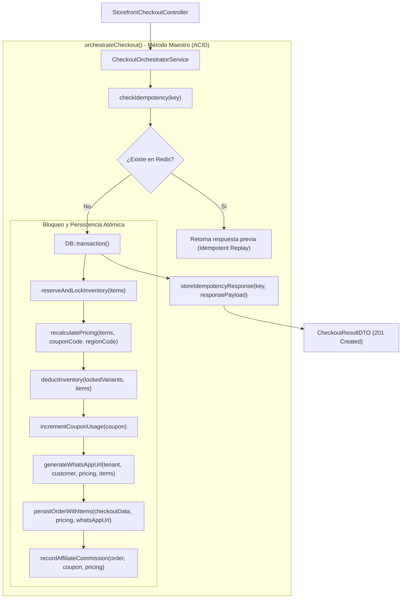

# Especificación Técnica: Checkout Transaccional, Creación de Órdenes y Enlaces de WhatsApp

**Código de Especificación:** `SPEC-ORD-005`  
**Módulos:** Vitrina Pública (*Storefront*) & Panel Administrativo (*Tenant Admin*)  
**Entidades Nucleares:** `App\Models\Order`, `App\Models\OrderItem`, `App\Models\ProductVariant`, `App\Models\Coupon`, `App\Models\Commission`, `App\Models\TenantConfig`  
**Patrones Arquitectónicos Obligatorios:** Repository-Service-Controller + Servicio de Dominio Orquestador (`CheckoutOrchestratorService`) con Métodos Auxiliares Atómicos + Form Requests  
**Aislamiento y Alcance:** `BelongsToTenant`, `TenantScope`, `TenantContext` y Middleware `tenant.context`  
**Metodología:** Desarrollo Guiado por Pruebas (*Test-First / TDD Obligatorio*)  
**Estado:** `Aprobado para Implementación`

---

## 1. Visión General y Propósito del Módulo

El Checkout Transaccional es la culminación del embudo de ventas y la operación más sensible de la plataforma. Su responsabilidad consiste en transformar una intención de compra (carrito cotizado) en una **Orden formal y vinculante** en la base de datos, garantizando consistencia absoluta (**ACID**):

1. **Idempotencia Incondicional:** Prevención de duplicación de pedidos o cobros múltiples causados por reintentos de red del navegador o cortes de conexión mediante la cabecera `Idempotency-Key`.
2. **Control Pesimista de Inventario:** Bloqueo exclusivo de registros en PostgreSQL (`SELECT ... FOR UPDATE`) sobre las variantes afectadas durante la transacción para eliminar condiciones de carrera y sobreventas (*zero overselling*).
3. **Inmutabilidad Histórica (*Snapshotting*):** Congelación exacta de precios unitarios, SKU y atributos de la variante en `order_items.variant_snapshot`, asegurando que futuras modificaciones en el catálogo no alteren los registros contables pasados.
4. **Atribución de Comisiones:** Liquidación y registro automático de comisiones en estado `RETENIDA` cuando el pedido se consolida mediante un cupón de afiliado.
5. **Formalización de Cierre vía WhatsApp:** Generación de un enlace dinámico enriquecido y codificado hacia el número de WhatsApp oficial del inquilino para la liquidación manual mediante transferencia bancaria.

---

## 2. Mapa de Endpoints del Módulo

| Módulo | Método | Endpoint | Middleware / Auth | SLA / Propósito |
|---|---|---|---|---|
| **Storefront** | `POST` | `/api/v1/storefront/checkout` | `tenant.context` | **Checkout Transaccional:** Valida idempotencia, bloquea y descuenta stock, crea orden/ítems, atribuye comisiones y genera URL de WhatsApp ($\le 80\text{ ms}$). |
| **Admin** | `GET` | `/api/v1/admin/orders` | `auth:sanctum`, `tenant.context` | Listado paginado de órdenes del comercio con filtros por estado, fechas y cliente. |
| **Admin** | `GET` | `/api/v1/admin/orders/{id}` | `auth:sanctum`, `tenant.context` | Ficha exhaustiva del pedido con líneas de producto, comisión y voucher asociado. |
| **Admin** | `PATCH` | `/api/v1/admin/orders/{id}/status` | `auth:sanctum`, `tenant.context` | Transición controlada de estado (`PENDIENTE_PAGO` $\rightarrow$ `COMPLETADA` / `CANCELADA`). |

---

## 3. Reglas de Negocio Estrictas del Checkout

### RN-ORD-01: Idempotencia en Redis (`Idempotency-Key`)
1. Toda petición a `POST /api/v1/storefront/checkout` **requiere obligatoriamente** la cabecera HTTP:
   ```http
   Idempotency-Key: {UUID-v4}
   ```
2. La clave se almacena en Redis con el prefijo:
   ```text
   idempotency:{tenant_id}:{idempotency_key}
   ```
   con un tiempo de vida (**TTL**) de $86,400$ segundos (24 horas).
3. **Comportamiento ante Reintentos:**
   - Si la clave ya existe en Redis y la transacción concluyó con éxito, la API **no reejecuta la compra ni descuenta stock por segunda vez**; retorna de inmediato la respuesta previamente almacenada con código `200 OK` (o `201 Created`) y la cabecera `X-Idempotent-Replay: true`.
   - Si una segunda petición idéntica entra en el mismo milisegundo mientras la primera aún se está ejecutando, Redis bloquea la concurrencia mediante un lock atómico retornando `409 Conflict` (`TRANSACTION_IN_PROGRESS`).

---

### RN-ORD-02: Bloqueo Pesimista y Cero Sobreventas (*Zero Overselling*)
1. Antes de realizar cualquier mutación, el orquestador aplica `lockForUpdate()` sobre las variantes involucradas:
   ```sql
   SELECT * FROM product_variants WHERE id IN (...) AND tenant_id = ? FOR UPDATE;
   ```
2. Para cada ítem solicitado, se evalúa:
   - Que la variante siga activa (`is_active = true`) y no haya sido eliminada lógicamente.
   - Que el stock actual satisfaga la cantidad:
     $$\text{variant.stock} \ge \text{item.quantity}$$
3. Si cualquiera de las variantes incumple la condición de stock, **toda la transacción se revierte de inmediato (`ROLLBACK`)** y la API responde con código **`409 Conflict`** y el error estándar:
   ```json
   {
     "error": {
       "code": "INSUFFICIENT_STOCK",
       "message": "El stock para la variante [SKU] se ha agotado durante el proceso de compra. Stock disponible: 1, solicitado: 2."
     }
   }
   ```

---

### RN-ORD-03: Descuento Físico Atómico de Inventario
1. Tras superar la verificación de stock bajo bloqueo pesimista, el inventario de cada variante se decrementa en la base de datos:
   ```php
   $variant->decrement('stock', $item['quantity']);
   ```
2. La base de datos garantiza la integridad mediante la restricción de motor `CHECK (stock >= 0)`.

---

### RN-ORD-04: Recálculo Reutilizado de Importes
El Checkout no duplica la lógica de precios. Invoca directamente el método de cálculo de `CartPricingService` (diseñado en `SPEC-PRM-004`) para obtener la cotización oficial inmutable:
- `subtotal`
- `auto_discount_total`
- `coupon_discount_total`
- `shipping_fee`
- `total_net`

---

### RN-ORD-05: Generación del Número Correlativo de Orden
1. Cada pedido recibe un código visible y amigable para el comprador:
   ```text
   #ORD-{6_CARACTERES_ALFANUMERICOS_MAYUSCULAS}
   ```
   *Ejemplo:* `#ORD-8392K1`.
2. El número de orden debe ser único dentro del inquilino: `UNIQUE(tenant_id, order_number)`.

---

### RN-ORD-06: Snapshot Inmutable en `order_items`
Cada línea de pedido (`order_items`) almacena una fotografía JSONB inalterable de la variante adquirida:
```json
{
  "sku": "OXF-CUERO-39-NEG",
  "product_name": "Zapato Oxford Clásico",
  "attributes": {
    "talla": "39",
    "color": "Negro"
  },
  "unit_price": 1450.00
}
```
Si en el futuro el comercio altera el nombre del producto, edita los atributos o borra la variante, la orden mantiene su valor histórico fiel al momento de la venta.

---

### RN-ORD-07: Redención de Cupones y Atribución de Comisiones
1. **Consumo del Cupón:** Si el pedido utilizó un cupón válido, el orquestador ejecuta:
   ```php
   $coupon->increment('used_count');
   ```
2. **Atribución de Comisión al Afiliado:**
   - Si `coupon.affiliate_id !== null`, se consulta el afiliado asociado.
   - Se calcula el importe de la comisión:
     - Si `affiliate.commission_type === 'PERCENTAGE'`:
       $$\text{amount} = \text{subtotal} \times \left(\frac{\text{commission\_value}}{100}\right)$$
     - Si `affiliate.commission_type === 'FIXED'`:
       $$\text{amount} = \text{commission\_value}$$
   - Se crea el registro en `commissions` con estado inicial `RETENIDA`.

---

### RN-ORD-08: Construcción Estructurada de la URL de WhatsApp
1. El número de destino se extrae de `tenant_configs.contact_info.whatsapp_sales` (o teléfono del inquilino).
2. Se genera el mensaje en texto plano formateado con negritas de WhatsApp (`*texto*`) y saltos de línea:
   ```text
   *¡NUEVO PEDIDO #ORD-8392K1!*
   
   *Cliente:* Carlos Mendoza
   *Teléfono:* +504 9876-5432
   *Dirección:* Col. Trejo, San Pedro Sula (Cortés)
   
   *Detalle de Productos:*
   • 2x Zapato Oxford Clásico (Talla: 39, Color: Negro) - L. 2,900.00
   • 1x Zapato Oxford Clásico (Talla: 41, Color: Café) - L. 1,550.00
   
   *Subtotal:* L. 4,450.00
   *Descuento Cupón (PROMOVERANO):* -L. 445.00
   *Envío (Cortés):* L. 80.00
   *TOTAL A PAGAR:* L. 4,085.00
   
   *Datos para Transferencia Bancaria:*
   Banco Ficohsa: 2000-1234-5678 (Cuenta de Cheques)
   A nombre de: Calzados Elegantes S. de R.L.
   
   _Por favor adjunte el comprobante de pago respondiendo a este mensaje._
   ```
3. La URL final se codifica según el estándar RFC 3986:
   ```text
   https://wa.me/50499887766?text=...
   ```

---

## 4. Contrato HTTP del Endpoint: `POST /api/v1/storefront/checkout`

### 4.1. Cabeceras Obligatorias
* `X-Tenant-Slug: calzados-hn`
* `Idempotency-Key: e82f8d39-2a91-4e4b-9759-86c5598d9c22`
* `Content-Type: application/json`
* `Accept: application/json`

---

### 4.2. Cuerpo de la Petición (`Request Body`)
```json
{
  "customer_info": {
    "full_name": "Carlos Mendoza",
    "whatsapp_phone": "+50498765432",
    "email": "carlos@correo.com"
  },
  "shipping_address": {
    "region_code": "HN-CR",
    "address_line": "Col. Trejo, 10 Calle, 15 Avenida, Casa #42",
    "reference": "Portón gris frente al parque"
  },
  "items": [
    {
      "variant_id": "660e8400-e29b-41d4-a716-446655440010",
      "quantity": 2
    },
    {
      "variant_id": "660e8400-e29b-41d4-a716-446655440012",
      "quantity": 1
    }
  ],
  "coupon_code": "PROMOVERANO"
}
```

---

### 4.3. Respuesta Exitosa `201 Created`
```json
{
  "order_id": "990e8400-e29b-41d4-a716-446655440999",
  "order_number": "#ORD-8392K1",
  "status": "PENDIENTE_PAGO",
  "customer": {
    "full_name": "Carlos Mendoza",
    "whatsapp_phone": "+50498765432"
  },
  "summary": {
    "subtotal": 4450.00,
    "auto_discount_total": 0.00,
    "coupon_discount_total": 445.00,
    "shipping_fee": 80.00,
    "total_net": 4085.00
  },
  "whatsapp_redirect_url": "https://wa.me/50499887766?text=%2ANUEVO%20PEDIDO%20%23ORD-8392K1%2A...",
  "created_at": "2026-11-06T22:30:00Z"
}
```

---

## 5. Diseño Arquitectónico: Patrón Orquestador con Métodos Auxiliares

La complejidad del flujo transaccional se gobierna a través del Servicio de Dominio Orquestador **`App\Services\Checkout\CheckoutOrchestratorService`**:



### 5.1. Desglose de Métodos Auxiliares del Orquestador:

| Método Auxiliar | Parámetros | Retorno | Responsabilidad Única |
|---|---|---|---|
| `checkIdempotency` | `string $key` | `?array` | Comprueba en Redis si la petición ya fue procesada anteriormente con éxito. |
| `reserveAndLockInventory` | `array $items` | `Collection` | Ejecuta `SELECT ... FOR UPDATE` sobre las variantes. Valida que `stock >= quantity`. Lanza `InsufficientStockException` si falta inventario. |
| `recalculatePricing` | `array $items, ?string $coupon, string $region` | `CartQuoteResultDTO` | Invoca `CartPricingService` para calcular subtotales, descuentos y tarifas oficiales. |
| `deductInventory` | `Collection $variants, array $items` | `void` | Aplica `decrement('stock', $qty)` a cada variante bloqueada. |
| `incrementCouponUsage` | `?Coupon $coupon` | `void` | Incrementa `used_count` en la base de datos bajo transacción. |
| `generateWhatsAppUrl` | `Tenant $tenant, array $customer, CartQuoteResultDTO $pricing, ...` | `string` | Ensambla el mensaje estructurado con datos de orden y cuentas bancarias, retornando la URL codificada. |
| `persistOrderWithItems` | `array $data, CartQuoteResultDTO $pricing, string $waUrl` | `Order` | Persiste la cabecera `Order` y las líneas `OrderItem` con sus respectivos `variant_snapshot`. |
| `recordAffiliateCommission` | `Order $order, ?Coupon $coupon, CartQuoteResultDTO $pricing` | `void` | Si el cupón tiene afiliado, calcula el importe y persiste el registro en `commissions` (`RETENIDA`). |
| `storeIdempotencyResponse` | `string $key, array $payload` | `void` | Guarda la respuesta serializada en Redis con TTL de 24 horas. |

---

## 6. Plan de Pruebas Test-First (Pest Suite Exhaustiva)

En apego a la metodología **Test-First**, se deben escribir primero las pruebas en estado fallido (`RED`).

### 6.1. Pruebas de Característica: `tests/Feature/Api/V1/Storefront/CheckoutTest.php`

#### A. Casos de Éxito (Happy Path):
1. `test('completa exitosamente el checkout creando orden items y descontando stock en base de datos')`:
   - Prepara 2 variantes con stock 10 y 5.
   - Ejecuta `POST /storefront/checkout` con `Idempotency-Key`.
   - Aserta código `201 Created` y estructura completa.
   - Verifica que el stock en `product_variants` haya bajado a 8 y 4.
   - Verifica existencia de registro en `orders` con estado `PENDIENTE_PAGO`.
   - Verifica existencia de 2 registros en `order_items` con `variant_snapshot` intacto.
2. `test('genera url de whatsapp valida con el desglose de importes y datos bancarios')`:
   - Verifica que la respuesta contenga `whatsapp_redirect_url` que comience por `https://wa.me/` y contenga el número de orden codificado.
3. `test('atribuye comision en estado RETENIDA al afiliado cuando la orden usa un cupon referenciado')`:
   - Asocia cupón a un afiliado con comisión del $10\%$.
   - Orden con subtotal $L. 2,000$.
   - Verifica que en la tabla `commissions` se haya creado un registro con `amount = 200.00` y `status = 'RETENIDA'`.

---

#### B. Idempotencia y Concurrencia (Bad Path & Casos Borde):
4. `test('rechaza con 422 peticiones de checkout que omitan la cabecera Idempotency-Key')`
5. `test('retorna la orden existente sin descontar stock dos veces ante peticiones repetidas con la misma Idempotency-Key')`:
   - Ejecuta checkout exitoso (stock inicial 10, baja a 8).
   - Reintenta la misma petición exacta con la misma cabecera `Idempotency-Key`.
   - Aserta código `200 OK` (o `201 Created`), mismo `order_id` y cabecera `X-Idempotent-Replay: true`.
   - Aserta que el stock continúe en 8 (no en 6).
6. `test('aborta con 409 Conflict y revierte la transaccion cuando el stock es insuficiente')`:
   - Variante con stock 1, petición solicitando cantidad 2.
   - Aserta código `409 Conflict` con error `INSUFFICIENT_STOCK`.
   - Aserta que en `orders` no se haya creado ningún registro (`assertDatabaseCount('orders', 0)`).
   - Aserta que el stock permanezca en 1.
7. `test('soporta compras concurrentes bloqueando pesimistamente con lockForUpdate')`:
   - Simula dos transacciones concurrentes pidiendo la última unidad disponible.
   - La primera transacción debe completar la compra exitosamente y la segunda debe recibir `409 Conflict` por stock agotado.
8. `test('incrementa atomicamente el contador used_count del cupon aplicado')`:
   - Cupón con `used_count = 0`.
   - Tras el checkout, `used_count` pasa a 1.
9. `test('preserva snapshot inmutable aun cuando el producto base o variante sea modificada o borrada posteriormente')`:
   - Se procesa el pedido.
   - Posteriormente, el administrador borra la variante (`SoftDeletes`) o cambia el precio del producto a $L. 99,999$.
   - Al consultar la orden y sus ítems, el snapshot y `unit_price` mantienen los valores originales con los que se realizó la compra.

---

### 6.2. Pruebas Unitarias: `tests/Unit/Services/CheckoutOrchestratorTest.php`

1. `test('generador de whatsapp codifica correctamente caracteres especiales y saltos de linea')`
2. `test('calculo de comisiones de afiliado maneja esquemas porcentuales y montos fijos')`
3. `test('generador de correlativo de orden produce codigos de 6 caracteres unicos')`

---

## 7. Criterios de Aceptación (Definition of Done - DoD)

1. [x] El documento `docs/spects/05_SPEC-ORD-005_transactional_checkout_and_orders.md` está versionado en Git.
2. [x] Se escriben y ejecutan en primer lugar todas las pruebas Feature y Unit en Pest, verificando su fallo en rojo (`RED`).
3. [x] Todos los componentes de arquitectura obligatorios están implementados:
   - Form Request: `StorefrontCheckoutRequest`.
   - Controlador: `StorefrontCheckoutController`.
   - Servicio de Dominio Orquestador: `CheckoutOrchestratorService` con sus métodos auxiliares atómicos.
   - Repositorios: `OrderRepositoryInterface`, `OrderItemRepositoryInterface`, `CommissionRepositoryInterface`.
4. [x] La cabecera `Idempotency-Key` previene duplicidad respaldada por Redis (TTL 24h).
5. [x] El inventario se descuenta con bloqueo pesimista `lockForUpdate()` dentro de `DB::transaction()`.
6. [x] La respuesta incluye la URL oficial de WhatsApp con el desglose del pedido codificado.
7. [x] La suite de pruebas Pest pasa al 100% (`vendor/bin/pest`).
8. [x] PHPStan en nivel estricto reporta 0 errores (`vendor/bin/phpstan analyse`).
9. [x] Código formateado con Laravel Pint (`vendor/bin/pint --dirty --format agent`).
