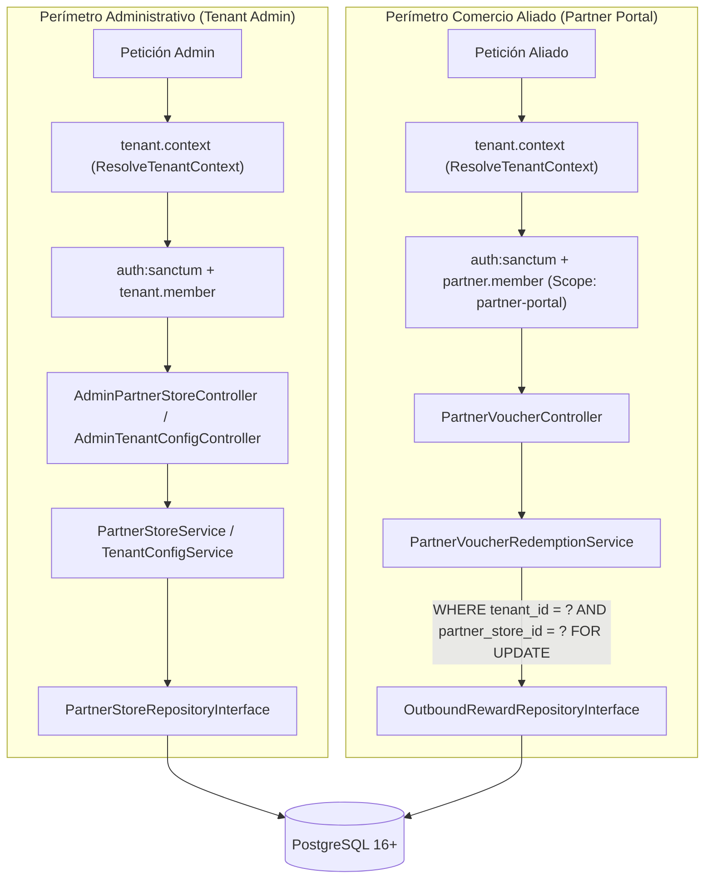

# Especificación Técnica: Comercios Aliados, Reglas de Fidelización Cruzada y Portal de Canje de Vouchers

**Código de Especificación:** `SPEC-PTR-007`  
**Módulos:** Panel Administrativo (*Tenant Admin*) & Portal de Comercios Aliados (*Partner Portal*)  
**Entidades Nucleares:** `App\Models\PartnerStore`, `App\Models\OutboundReward`, `App\Models\TenantConfig`, `App\Models\Order`  
**Patrones Arquitectónicos Obligatorios:** Repository-Service-Controller + Servicios de Dominio Orquestadores (`PartnerStoreService`, `PartnerVoucherRedemptionService` y extensión de `TenantConfigService`) con Métodos Auxiliares Atómicos + Form Requests  
**Mecanismos de Aislamiento:** Middleware `ResolveTenantContext` (`tenant.context`), `EnsureTenantMembership` (`tenant.member`), `EnsurePartnerMembership` (`partner.member`), `TenantContext` Singleton y `BelongsToTenant`  
**Metodología:** Desarrollo Guiado por Pruebas (*Test-First / TDD Obligatorio*)  
**Estado:** `Aprobado para Implementación`

---

## 1. Visión General y Alcance del Módulo

El ecosistema de fidelización cruzada permite a cada tienda en la plataforma establecer alianzas comerciales con negocios externos (cafeterías, gimnasios, spas, restaurantes u otras tiendas) para premiar compras que superan un umbral determinado.

Mientras que `SPEC-ORD-006` gobierna la **emisión asíncrona** del voucher cuando una orden pasa a estado `COMPLETADA`, esta especificación cierra el ciclo completo definiendo:

1. **Administración de Comercios Aliados (`partner_stores`):** Alta, consulta y mantenimiento de los negocios receptores de beneficios dentro del inquilino, incluyendo sus credenciales de acceso al portal externo, título del beneficio y términos legales.
2. **Parametrización de Reglas de Recompensas y Contacto Bancario (`tenant_configs`):** Configuración administrativa de `outbound_reward_rules` (activación, monto/ítems mínimos, comercio aliado destino y días de vigencia) y de `contact_info` (WhatsApp oficial de ventas y cuentas bancarias utilizadas en el checkout).
3. **Portal de Verificación y Redención Física (*Partner Portal*):** Interfaz API restringida mediante tokens con alcance exclusivo (`partner-portal`) donde el cajero o encargado del comercio aliado consulta un código `RWD-...` presentado por el comprador y ejecuta su **canje definitivo e irreversible** bajo bloqueo pesimista.

---

## 2. Mapa de Endpoints en Alcance

| Módulo | Método | Endpoint | Middleware / Autenticación | Propósito |
|---|---|---|---|---|
| **Admin** | `PUT` | `/api/v1/admin/config/contact-info` | `tenant.context`, `auth:sanctum`, `tenant.member` | Actualiza WhatsApp de ventas, correo de soporte y cuentas bancarias de transferencia. Invalida caché de vitrina. |
| **Admin** | `PUT` | `/api/v1/admin/config/outbound-rewards` | `tenant.context`, `auth:sanctum`, `tenant.member` | Configura `outbound_reward_rules` validando que el `partner_store_id` pertenezca al tenant y esté activo. |
| **Admin** | `GET` | `/api/v1/admin/partner-stores` | `tenant.context`, `auth:sanctum`, `tenant.member` | Lista los comercios aliados del tenant con conteos de vouchers emitidos y canjeados. |
| **Admin** | `POST` | `/api/v1/admin/partner-stores` | `tenant.context`, `auth:sanctum`, `tenant.member` | Registra un nuevo comercio aliado con `portal_email` único por tenant y contraseña hasheada. |
| **Admin** | `PUT` | `/api/v1/admin/partner-stores/{id}` | `tenant.context`, `auth:sanctum`, `tenant.member` | Actualiza datos del beneficio, términos, contacto, credenciales opcionales y bandera `is_active`. |
| **Partner Portal** | `GET` | `/api/v1/partner-portal/vouchers/{code}` | `tenant.context`, `auth:sanctum`, `partner.member` | Consulta autenticidad, vigencia y beneficio de un voucher asignado al comercio aliado autenticado. |
| **Partner Portal** | `POST` | `/api/v1/partner-portal/vouchers/{code}/redeem` | `tenant.context`, `auth:sanctum`, `partner.member` | Ejecuta el canje atómico (`EMITIDO` $\rightarrow$ `CANJEADO`) con `lockForUpdate()` previniendo doble uso (`409 Conflict`). |

---

## 3. Contexto Arquitectónico y Uso de Abstracciones del Sistema

Este módulo introduce un **doble perímetro de aislamiento** (aislamiento *Inter-Tenant* entre comercios de la plataforma y aislamiento *Intra-Tenant* entre distintos comercios aliados de una misma tienda):



### 3.1. Uso de las Abstracciones Existentes:
1. **`ResolveTenantContext` (`tenant.context`) y `TenantContext`:**  
   Tanto las peticiones administrativas como las del portal de aliados resuelven primero el inquilino emisor mediante `X-Tenant-Slug` (o `Host`), poblando `TenantContext`.
2. **Trait `BelongsToTenant` y `TenantScope`:**  
   `PartnerStore` y `OutboundReward` incluyen `BelongsToTenant`. Toda consulta ejecutada por los repositorios lleva inyectado automáticamente `WHERE tenant_id = TenantContext::id()`, haciendo imposible leer o redimir un código `RWD-...` emitido por otra tienda distinta, aun conociendo el código exacto.
3. **Delimitación por Comercio Aliado Autenticado (`partner_store_id`):**  
   Dentro de un mismo inquilino pueden existir múltiples comercios aliados (ej. *Cafetería Aroma* y *Gimnasio Titan*). El servicio orquestador de redención debe filtrar siempre por el `id` del `PartnerStore` autenticado en la sesión de Sanctum (`partner_store_id = $authenticatedPartner->id`), impidiendo que un aliado consulte o consuma cupones dirigidos a otro aliado del mismo tenant.
4. **Concurrencia Segura en Caja Física (`lockForUpdate`):**  
   Para evitar que dos cajeros o un doble clic en el punto de venta canjeen dos veces el mismo beneficio, la redención bloquea exclusivamente la fila de `outbound_rewards` en PostgreSQL dentro de `DB::transaction()`.

---

## 4. Componentes de Arquitectura Obligatorios

### 4.1. Capa de Validación HTTP (Form Requests)
* **`UpdateContactInfoRequest`:** Valida `whatsapp_sales` (teléfono en formato internacional/numérico requerido), `support_email` (correo válido opcional), `bank_accounts` (arreglo de cuentas con `bank_name`, `account_number`, `account_type`, `holder_name`) y enlaces de atención.
* **`UpdateOutboundRewardRulesRequest`:** Valida `is_enabled` (booleano requerido); cuando `is_enabled === true`, exige `partner_store_id` (UUID existente en `partner_stores` del `tenant_id` actual y con `is_active = true`), al menos un umbral positivo (`min_order_amount > 0` o `min_items >= 1`) y `validity_days` (entero entre `1` y `365`).
* **`CreatePartnerStoreRequest`:** Valida `name` (requerido, máx. 150), `portal_email` (email único dentro del `tenant_id` activo), `portal_password` (mín. 8 caracteres), `benefit_title` (requerido, máx. 200), `terms_conditions` (texto requerido), `contact_info` (arreglo opcional con dirección/teléfono) e `is_active` (booleano).
* **`UpdatePartnerStoreRequest`:** Mismas reglas permitiendo omitir `portal_password` si no se desea rotar la credencial, e ignorando el registro actual en la unicidad de `portal_email` acotada al `tenant_id`.

### 4.2. Capa de Controladores Delgados (Thin Controllers)
* **`AdminTenantConfigController` (Extensión):**
  - `updateContactInfo(UpdateContactInfoRequest $request)`: Delega en `TenantConfigService::orchestrateContactInfoUpdate()`.
  - `updateOutboundRewardRules(UpdateOutboundRewardRulesRequest $request)`: Delega en `TenantConfigService::orchestrateOutboundRewardRulesUpdate()`.
* **`AdminPartnerStoreController`:**
  - `index()`: Delega en `PartnerStoreService::listPartnerStoresWithMetrics()`.
  - `store(CreatePartnerStoreRequest $request)`: Delega en `PartnerStoreService::orchestratePartnerCreation()`.
  - `update(UpdatePartnerStoreRequest $request, string $id)`: Delega en `PartnerStoreService::orchestratePartnerUpdate()`.
* **`PartnerVoucherController`:**
  - `show(Request $request, string $code)`: Obtiene el `PartnerStore` autenticado e invoca `PartnerVoucherRedemptionService::inspectVoucher()`.
  - `redeem(Request $request, string $code)`: Obtiene el `PartnerStore` autenticado e invoca `PartnerVoucherRedemptionService::orchestrateRedemption()`.

### 4.3. Capa de Dominio: Servicios de Dominio Orquestadores

#### A. Extensión en `App\Services\Tenant\TenantConfigService`
* **`orchestrateContactInfoUpdate(Tenant $tenant, array $payload): TenantConfig`:**
  - *Métodos Auxiliares:* `sanitizeContactInfoPayload()`, `persistContactInfo()`, `invalidateStorefrontCache()` (purga Redis si algún dato social o WhatsApp impacta el bootstrap público).
* **`orchestrateOutboundRewardRulesUpdate(Tenant $tenant, array $payload): TenantConfig`:**
  - *Métodos Auxiliares:* `assertPartnerStoreEligibleForRewards()` (verifica pertenencia al tenant y `is_active = true`), `normalizeOutboundRewardRules()`, `persistOutboundRewardRules()`.

#### B. `App\Services\Partners\PartnerStoreService`
* **`orchestratePartnerCreation(Tenant $tenant, array $payload): PartnerStore`** y **`orchestratePartnerUpdate(Tenant $tenant, string $partnerId, array $payload): PartnerStore`:**
  - *Métodos Auxiliares:*
    1. `normalizePartnerEmail(string $email): string` $\rightarrow$ Sanitiza correo en minúsculas y sin espacios.
    2. `persistPartnerStore(...)` $\rightarrow$ Crea o actualiza a través del repositorio asegurando que `portal_password` quede hasheado y oculto en serialización.
    3. `revokePartnerTokensIfDeactivated(PartnerStore $partner): void` $\rightarrow$ Si `is_active` pasa a `false` o se rota `portal_password`, revoca inmediatamente los tokens activos de Sanctum de ese comercio aliado.

#### C. `App\Services\Partners\PartnerVoucherRedemptionService`
* **Método de Consulta: `inspectVoucher(PartnerStore $partner, string $code): VoucherInspectionResultDTO`**
  - *Métodos Auxiliares:*
    1. `sanitizeVoucherCode(string $code): string` $\rightarrow$ Normaliza a mayúsculas y aplica `trim`.
    2. `resolveVoucherForPartner(PartnerStore $partner, string $code): OutboundReward` $\rightarrow$ Consulta el voucher con sus relaciones `order` y `tenant` restringido a `partner_store_id = $partner->id`. Si no existe, lanza `404` (`VOUCHER_NOT_FOUND`).
    3. `computeEffectiveStatusAndRedeemability(OutboundReward $reward): array` $\rightarrow$ Determina si es redimible (`status === 'EMITIDO'` y `expires_at > now()`). Si venció en el tiempo pero sigue marcado `EMITIDO`, proyecta estado efectivo `EXPIRADO` y `is_redeemable = false`.
* **Método Orquestador Maestro: `orchestrateRedemption(PartnerStore $partner, string $code): VoucherRedemptionResultDTO`**  
  Ejecuta el canje dentro de `DB::transaction()` mediante métodos auxiliares atómicos:
  1. `lockVoucherForPartner(PartnerStore $partner, string $code): OutboundReward` $\rightarrow$ Ejecuta `SELECT ... FOR UPDATE` acotado a `tenant_id` y `partner_store_id`. Si no existe, aborta con `404` (`VOUCHER_NOT_FOUND`).
  2. `assertNotAlreadyRedeemed(OutboundReward $reward): void` $\rightarrow$ Si `status === 'CANJEADO'` o `redeemed_at !== null`, aborta con **`409 Conflict`** (`VOUCHER_ALREADY_REDEEMED`) adjuntando la marca `redeemed_at` original.
  3. `assertNotExpired(OutboundReward $reward): void` $\rightarrow$ Si `status === 'EXPIRADO'` o `expires_at->isPast()`, actualiza el registro a `EXPIRADO` si aún estaba en `EMITIDO` y aborta con **`422 Unprocessable Entity`** (`VOUCHER_EXPIRED`).
  4. `markAsRedeemed(OutboundReward $reward): OutboundReward` $\rightarrow$ Persiste `status = 'CANJEADO'` y `redeemed_at = now()`.

### 4.4. Capa de Persistencia (Repository Pattern)
* **`PartnerStoreRepositoryInterface` / `EloquentPartnerStoreRepository`:**
  - `listWithRewardCounts(): Collection` (usando `withCount` por estado para cero N+1).
  - `findById(string $id): ?PartnerStore`
  - `findActiveById(string $id): ?PartnerStore`
  - `findByPortalEmail(string $email): ?PartnerStore`
  - `create(array $attributes): PartnerStore`
  - `update(PartnerStore $partner, array $attributes): PartnerStore`
* **`OutboundRewardRepositoryInterface` / `EloquentOutboundRewardRepository`:**
  - `findDetailedByCodeForPartner(string $partnerStoreId, string $code): ?OutboundReward` (con `with(['order', 'tenant', 'partnerStore'])`).
  - `findByCodeForPartnerWithLock(string $partnerStoreId, string $code): ?OutboundReward`
  - `updateStatus(OutboundReward $reward, array $attributes): OutboundReward`

---

## 5. Reglas de Negocio y Contratos HTTP

### RN-PTR-01: Privacidad de Datos del Comprador frente al Comercio Aliado
Al consultar un voucher en `GET /api/v1/partner-portal/vouchers/{code}`, el comercio aliado **únicamente** debe recibir el nombre del comprador (`customer_info.full_name`) y el nombre de la tienda origen (`tenant.name`). Queda **estrictamente prohibido** exponer el teléfono, correo electrónico, dirección de domicilio o desglose financiero de la orden original al comercio aliado.

### RN-PTR-02: Idempotencia Negativa / Bloqueo de Doble Redención
A diferencia del checkout (donde un reintento devuelve `200`), en un punto de venta físico intentar canjear por segunda vez un voucher ya utilizado constituye una alerta operativa para el cajero. Por contrato de API, todo intento posterior al primer canje exitoso debe responder **`409 Conflict`** informando la fecha y hora exacta en que fue redimido.

### RN-PTR-03: Coherencia al Desactivar un Comercio Aliado
1. Si un comercio aliado tiene `is_active = false`, no puede ser asignado como destino en `PUT /api/v1/admin/config/outbound-rewards` (`422 Unprocessable Entity`), ni tampoco se emitirán nuevos vouchers para él al completarse órdenes.
2. Al pasar un `PartnerStore` a `is_active = false`, sus credenciales dejan de tener acceso al Partner Portal de inmediato.

---

### 5.1. Consulta de Voucher: `GET /api/v1/partner-portal/vouchers/{code}`
* **Cabeceras:** `X-Tenant-Slug: tienda-ejemplo`, `Authorization: Bearer {partner_token}`
* **Respuesta `200 OK`:**
```json
{
  "voucher_code": "RWD-9F8A-7C2B-4E1D",
  "status": "EMITIDO",
  "is_redeemable": true,
  "benefit_title": "20% de descuento en consumo total",
  "terms_conditions": "Válido de lunes a viernes en consumo en salón. No acumulable con otras promociones.",
  "customer_name": "Carlos Mendoza",
  "origin_tenant_name": "Tienda Ejemplo",
  "expires_at": "2026-12-06T23:59:59Z",
  "redeemed_at": null
}
```

### 5.2. Redención de Voucher: `POST /api/v1/partner-portal/vouchers/{code}/redeem`
* **Respuesta `200 OK` (Primer Canje Exitoso):**
```json
{
  "voucher_code": "RWD-9F8A-7C2B-4E1D",
  "status": "CANJEADO",
  "redeemed_at": "2026-11-06T23:05:30Z",
  "message": "Beneficio canjeado exitosamente."
}
```
* **Respuesta `409 Conflict` (Voucher Ya Canjeado):**
```json
{
  "error": {
    "code": "VOUCHER_ALREADY_REDEEMED",
    "message": "Este cupón ya fue canjeado previamente.",
    "redeemed_at": "2026-11-06T23:05:30Z"
  }
}
```
* **Respuesta `422 Unprocessable Entity` (Voucher Vencido):**
```json
{
  "error": {
    "code": "VOUCHER_EXPIRED",
    "message": "Este cupón expiró y ya no puede ser canjeado.",
    "expires_at": "2026-10-15T23:59:59Z"
  }
}
```

---

## 6. Plan de Pruebas Test-First (Pest Suite Exhaustiva)

Antes de implementar cualquier clase de producción, se deben escribir las siguientes pruebas verificando su fallo inicial (`RED`):

### 6.1. Pruebas de Característica (Feature Tests)

#### A. Gestión Administrativa de Aliados y Reglas: `tests/Feature/Api/V1/Admin/PartnerStoreAndRewardConfigTest.php`
* **Happy Path:**
  1. `test('administrador registra un comercio aliado hasheando portal_password y ocultandolo en la respuesta JSON')`
  2. `test('administrador lista sus comercios aliados con metricas de vouchers emitidos y canjeados')`
  3. `test('administrador actualiza datos de un comercio aliado sin alterar la contrasena cuando no se envia')`
  4. `test('administrador configura contact_info bancario y reglas outbound_reward_rules con aliado activo')`
* **Bad Path & Seguridad Multi-Tenant:**
  5. `test('rechaza con 422 registrar dos comercios aliados con el mismo portal_email en el mismo tenant')`
  6. `test('permite usar el mismo portal_email en dos tenants distintos respetando el aislamiento multi-tenant')`
  7. `test('rechaza con 422 configurar outbound_reward_rules apuntando a un PartnerStore inactivo o de otro tenant')`
  8. `test('administrador del Tenant A no puede listar ni editar comercios aliados del Tenant B')`
* **Casos Borde:**
  9. `test('desactivar un comercio aliado o rotar su contrasena revoca todos sus tokens activos de Sanctum')`
  10. `test('permite deshabilitar outbound_reward_rules con is_enabled false sin exigir umbrales ni aliado')`

---

#### B. Portal de Aliados - Consulta y Canje: `tests/Feature/Api/V1/PartnerPortal/VoucherVerificationAndRedemptionTest.php`
* **Happy Path:**
  1. `test('comercio aliado autenticado consulta un voucher EMITIDO vigente obteniendo beneficio y nombre del cliente')`
  2. `test('comercio aliado canjea exitosamente un voucher vigente cambiando su estado a CANJEADO y fijando redeemed_at')`
* **Bad Path, Concurrencia & Privacidad:**
  3. `test('respuesta de consulta de voucher jamas expone email telefono direccion ni montos de la orden original')`
  4. `test('segundo intento de canjear el mismo voucher retorna 409 VOUCHER_ALREADY_REDEEMED preservando el redeemed_at original')`
  5. `test('intentar canjear un voucher cuya fecha expires_at ya vencio retorna 422 VOUCHER_EXPIRED')`
  6. `test('consultar un voucher con expires_at en el pasado retorna is_redeemable false y estado efectivo EXPIRADO')`
  7. `test('Comercio Aliado A recibe 404 al intentar consultar o canjear un voucher emitido para el Comercio Aliado B del mismo tenant')`
  8. `test('Comercio Aliado del Tenant A recibe 403 o 404 al operar con X-Tenant-Slug del Tenant B')`
* **Casos Borde:**
  9. `test('busqueda y canje normalizan el codigo de voucher en minusculas o con espacios laterales')`
  10. `test('bloqueo pesimista lockForUpdate garantiza que ante peticiones concurrentes exactamente una canjee y la otra reciba 409')`

---

### 6.2. Pruebas Unitarias (Unit Tests)

1. **`tests/Unit/Services/PartnerVoucherRedemptionServiceTest.php`:**
   - Valida de forma aislada la lógica de elegibilidad temporal (`expires_at` exacto en el límite del segundo actual vs pasado).
   - Valida el saneamiento de códigos de voucher y la proyección de privacidad del DTO de inspección.

---

## 7. Criterios de Aceptación (Definition of Done - DoD)

1. [ ] El documento de especificación `docs/spects/07_SPEC-PTR-007_partner_stores_and_voucher_portal.md` está versionado en Git.
2. [ ] Se escriben y ejecutan primero todas las pruebas Feature y Unit en Pest, verificando su fallo inicial (`RED`).
3. [ ] Todos los componentes obligatorios están implementados:
   - Form Requests: `UpdateContactInfoRequest`, `UpdateOutboundRewardRulesRequest`, `CreatePartnerStoreRequest`, `UpdatePartnerStoreRequest`.
   - Controladores: `AdminPartnerStoreController`, `PartnerVoucherController` y métodos adicionales en `AdminTenantConfigController`.
   - Servicios Orquestadores: `PartnerStoreService`, `PartnerVoucherRedemptionService` y ampliación en `TenantConfigService`.
   - Repositorios: `PartnerStoreRepositoryInterface` y `OutboundRewardRepositoryInterface` con sus implementaciones Eloquent.
4. [ ] Queda garantizado el doble aislamiento: ni fugas entre tenants, ni visibilidad cruzada entre dos comercios aliados del mismo tenant, ni filtración de PII sensible del comprador.
5. [ ] La suite completa de Pest pasa al 100% (`vendor/bin/pest`), PHPStan reporta 0 errores y Pint formatea sin pendientes.
