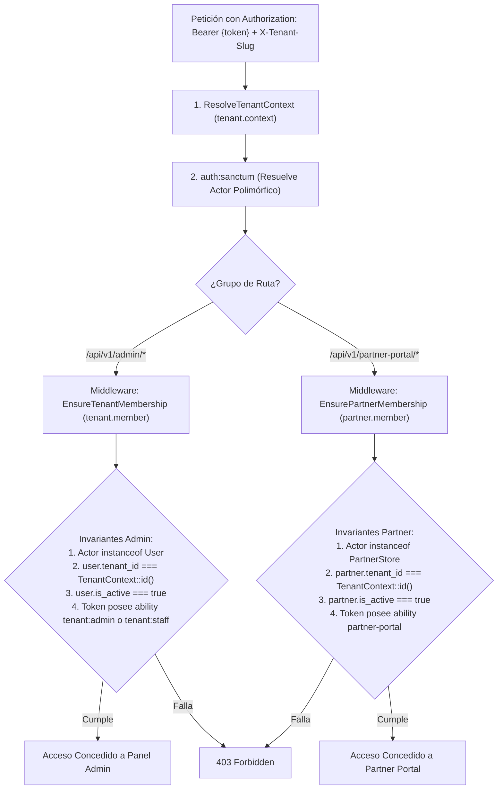

# Especificación Técnica: Autenticación API Multi-Tenant, Tokens Sanctum y Aislamiento de Alcances

**Código de Especificación:** `SPEC-AUTH-008`  
**Módulo:** Seguridad Transversal — Autenticación de Administradores (`User`) y Comercios Aliados (`PartnerStore`)  
**Entidades Nucleares:** `App\Models\User`, `App\Models\PartnerStore`, `Laravel\Sanctum\PersonalAccessToken`  
**Patrones Arquitectónicos Obligatorios:** Repository-Service-Controller + Servicio de Dominio Orquestador (`TenantAuthenticationService`) con Métodos Auxiliares Atómicos + Middlewares de Perímetro de Actor (`tenant.member` y `partner.member`) + Form Requests  
**Mecanismos de Aislamiento:** `ResolveTenantContext` (`tenant.context`), `TenantContext` Singleton, `BelongsToTenant`, `TenantScope` y Alcances Explícitos de Sanctum (*Token Abilities*)  
**Metodología:** Desarrollo Guiado por Pruebas (*Test-First / TDD Obligatorio*)  
**Estado:** `Aprobado para Implementación`

---

## 1. Visión General y Alcance del Módulo

La plataforma expone dos planos autenticados completamente independientes dentro de cada inquilino:
1. **Panel Administrativo del Comercio (`/api/v1/admin/*`):** Operado por personal interno de la tienda (`App\Models\User` con roles `ADMIN` o `STAFF`).
2. **Portal de Validación de Comercios Aliados (`/api/v1/partner-portal/*`):** Operado por negocios externos asociados (`App\Models\PartnerStore`) cuya única facultad es consultar y canjear vouchers de fidelización cruzada.

Ambos modelos comparten la infraestructura polimórfica de `personal_access_tokens` (`uuidMorphs('tokenable')`) de **Laravel Sanctum** exigida en `RNF-02`. Por ello, esta especificación establece los flujos de emisión y revocación de credenciales y blinda la **separación criptográfica y de tipos de actor** para impedir cualquier escalación horizontal (entre tenants) o vertical (de comercio aliado hacia administrador de tienda).

---

## 2. Mapa de Endpoints en Alcance

| Perímetro | Método | Endpoint | Middleware / Protección | Propósito |
|---|---|---|---|---|
| **Admin Auth** | `POST` | `/api/v1/admin/auth/login` | `tenant.context`, `throttle:tenant-auth` | Valida `email` y `password` acotados al `tenant_id` activo y emite Bearer Token con alcance administrativo. |
| **Admin Auth** | `GET` | `/api/v1/admin/auth/me` | `tenant.context`, `auth:sanctum`, `tenant.member` | Retorna identidad del administrador/staff autenticado y resumen del tenant activo. |
| **Admin Auth** | `POST` | `/api/v1/admin/auth/logout` | `tenant.context`, `auth:sanctum`, `tenant.member` | Revoca únicamente el token Bearer utilizado en la petición actual. |
| **Admin Auth** | `POST` | `/api/v1/admin/auth/logout-all` | `tenant.context`, `auth:sanctum`, `tenant.member` | Revoca todos los tokens activos del usuario en cualquier dispositivo. |
| **Partner Auth** | `POST` | `/api/v1/partner-portal/auth/login` | `tenant.context`, `throttle:tenant-auth` | Valida `portal_email` y `portal_password` acotados al `tenant_id` activo y emite Bearer Token con alcance `partner-portal`. |
| **Partner Auth** | `GET` | `/api/v1/partner-portal/auth/me` | `tenant.context`, `auth:sanctum`, `partner.member` | Retorna identidad del comercio aliado autenticado, beneficio activo y tienda emisora. |
| **Partner Auth** | `POST` | `/api/v1/partner-portal/auth/logout` | `tenant.context`, `auth:sanctum`, `partner.member` | Revoca el token Bearer activo del comercio aliado. |

---

## 3. Contexto Arquitectónico y Matriz de Aislamiento de Tres Invariantes

Dado que `personal_access_tokens` almacena tokens polimórficos tanto para `App\Models\User` como para `App\Models\PartnerStore`, y ambos modelos poseen la columna `tenant_id`, verificar únicamente `$actor->tenant_id === TenantContext::id()` **no es suficiente**. Un `PartnerStore` pertenece legítimamente al mismo `tenant_id` que la tienda emisora, pero jamás debe cruzar hacia `/api/v1/admin/*`.



### 3.1. Uso y Evolución de las Abstracciones Existentes:
1. **`ResolveTenantContext` (`tenant.context`) y `TenantScope` en Login:**  
   Dado que `User` y `PartnerStore` implementan `BelongsToTenant`, cuando `tenant.context` se ejecuta antes del controlador de login, cualquier búsqueda por correo (`email` o `portal_email`) queda automáticamente filtrada por `WHERE tenant_id = ?`. Esto permite que un mismo correo electrónico exista como administrador en *Tienda A* y en *Tienda B* con contraseñas independientes sin colisionar (`UNIQUE(tenant_id, email)`).
2. **Refinamiento de `EnsureTenantMembership` (`tenant.member`):**  
   Además de comprobar pertenencia al `tenant_id` e `is_active = true`, debe exigir que el modelo autenticado sea instancia estricta de `App\Models\User` y que su token posea alcance administrativo válido (`tenant:admin` o `tenant:staff`), rechazando con `403 Forbidden` cualquier token emitido para `PartnerStore`.
3. **Nuevo Middleware `EnsurePartnerMembership` (`partner.member`):**  
   Registrado en `bootstrap/app.php`, exige que el actor autenticado sea instancia estricta de `App\Models\PartnerStore`, pertenezca al `tenant_id` activo en `TenantContext`, tenga `is_active === true` y su token posea explícitamente la habilidad `partner-portal` (`tokenCan('partner-portal')`).
4. **Capacidad Autenticable en `PartnerStore`:**  
   El modelo `App\Models\PartnerStore` debe extender `Illuminate\Foundation\Auth\User` (`Authenticatable`) e incorporar el trait `HasApiTokens` de Sanctum, manteniendo intactos `BelongsToTenant`, `HasUuids`, el cast `'portal_password' => 'hashed'` y `'hidden' => ['portal_password']`.

---

## 4. Componentes de Arquitectura Obligatorios

### 4.1. Capa de Validación HTTP y Throttling
* **Rate Limiter Dedicado (`throttle:tenant-auth`):**  
  Configurado en `AppServiceProvider` combinando `TenantContext::id() + email + IP` (ej. máximo 5 intentos fallidos por minuto) para que un ataque de fuerza bruta contra un usuario o en una tienda no bloquee a otros usuarios ni a otros inquilinos (`429 Too Many Requests`).
* **`AdminLoginRequest`:** Valida `email` (requerido, formato email, normalizado a minúsculas/trim), `password` (string requerido) y `device_name` opcional (por defecto `'admin-web'`, máx. 100 caracteres).
* **`PartnerPortalLoginRequest`:** Valida `email` / `portal_email` (requerido, formato email normalizado), `password` (string requerido) y `device_name` opcional (por defecto `'partner-pos'`).

### 4.2. Capa de Controladores Delgados (Thin Controllers)
* **`AdminAuthController`:**
  - `login(AdminLoginRequest $request)`: Delega en `TenantAuthenticationService::orchestrateAdminLogin()`.
  - `me(Request $request)`: Retorna el recurso de identidad del `User` autenticado y su `Tenant` actual.
  - `logout(Request $request)`: Delega en `TenantAuthenticationService::revokeCurrentToken()`.
  - `logoutAll(Request $request)`: Delega en `TenantAuthenticationService::revokeAllTokens()`.
* **`PartnerPortalAuthController`:**
  - `login(PartnerPortalLoginRequest $request)`: Delega en `TenantAuthenticationService::orchestratePartnerLogin()`.
  - `me(Request $request)`: Retorna el perfil público-operativo del `PartnerStore` autenticado y el nombre de la tienda origen.
  - `logout(Request $request)`: Delega en `TenantAuthenticationService::revokeCurrentToken()`.

### 4.3. Capa de Dominio: Servicio de Dominio Orquestador (`TenantAuthenticationService`)

Centraliza toda la lógica de autenticación, verificación criptográfica y ciclo de vida de tokens mediante métodos maestros orquestadores y métodos auxiliares atómicos:

* **Método Orquestador 1: `orchestrateAdminLogin(Tenant $tenant, array $credentials): IssuedTokenResultDTO`**
  - *Métodos Auxiliares:*
    1. `findTenantUserByEmail(string $email): ?User` $\rightarrow$ Consulta vía `UserRepositoryInterface` acotada al `TenantContext`.
    2. `verifyPasswordConstantTime(?string $hashedPassword, string $plainPassword): bool` $\rightarrow$ Verifica el hash con `Hash::check`. Si el usuario no existe, ejecuta igualmente un `Hash::check` contra un hash señuelo precomputado para evitar ataques de enumeración de cuentas por diferencia de tiempos de respuesta (*timing attacks*), abortando con `401 Unauthorized` (`INVALID_CREDENTIALS`).
    3. `assertAccountIsActive(bool $isActive, Authenticatable $actor): void` $\rightarrow$ Si las credenciales son válidas pero `is_active === false`, purga cualquier token remanente y aborta con `403 Forbidden` (`ACCOUNT_SUSPENDED`).
    4. `resolveAdminAbilities(User $user): array` $\rightarrow$ Asigna `['tenant:admin']` si `role === 'ADMIN'` o `['tenant:staff']` si `role === 'STAFF'`.
    5. `issueSanctumToken(Authenticatable $actor, string $deviceName, array $abilities): NewAccessToken` $\rightarrow$ Emite el token aplicando la fecha de expiración `expires_at` definida en configuración (`RNF-02`).

* **Método Orquestador 2: `orchestratePartnerLogin(Tenant $tenant, array $credentials): IssuedTokenResultDTO`**
  - *Métodos Auxiliares:*
    1. `findTenantPartnerByEmail(string $portalEmail): ?PartnerStore` $\rightarrow$ Consulta vía `PartnerStoreRepositoryInterface` acotada al `TenantContext`.
    2. `verifyPasswordConstantTime(?string $hashedPassword, string $plainPassword): bool` $\rightarrow$ Verifica contra `portal_password` en tiempo constante (`401 INVALID_CREDENTIALS` ante fallo).
    3. `assertAccountIsActive(...)` $\rightarrow$ Verifica `partner.is_active === true` (`403 ACCOUNT_SUSPENDED` si fue desactivado).
    4. `issueSanctumToken($partner, $deviceName, ['partner-portal'])` $\rightarrow$ Emite el token polimórfico exclusivamente con la habilidad `partner-portal`.

* **Métodos de Revocación: `revokeCurrentToken(Authenticatable $actor): void` y `revokeAllTokens(Authenticatable $actor): int`**
  - Eliminan de forma limpia el token actual (`currentAccessToken()`) o la totalidad de tokens del sujeto autenticado.

### 4.4. Capa de Persistencia (Repository Pattern)
* **`UserRepositoryInterface` / `EloquentUserRepository`:**
  - `findByEmail(string $email): ?User` (protegido por `TenantScope`).
  - `findById(string $id): ?User`
* **`PartnerStoreRepositoryInterface` / `EloquentPartnerStoreRepository`:**
  - `findByPortalEmail(string $portalEmail): ?PartnerStore` (protegido por `TenantScope`).

---

## 5. Reglas de Negocio y Contratos HTTP

### RN-AUTH-01: Cero Enumeración de Cuentas entre Inquilinos
Si un atacante envía un correo que no existe, un correo que sí existe en *otro* tenant pero no en el `X-Tenant-Slug` actual, o una contraseña errónea, la respuesta HTTP debe ser **idéntica en código (`401`) y estructura JSON**:
```json
{
  "error": {
    "code": "INVALID_CREDENTIALS",
    "message": "Las credenciales proporcionadas son incorrectas."
  }
}
```

### RN-AUTH-02: Efecto Inmediato de Suspensión de Cuenta o Inquilino
1. Si un `User` es desactivado mediante el CLI `php artisan tenant:manage toggle-user-status` (`is_active = false`), cualquier petición subsecuente con un token emitido previamente es rechazada en el acto por `tenant.member` con `403 Forbidden`.
2. Si un `Tenant` completo pasa a `is_active = false`, `ResolveTenantContext` (`SPEC-MW-001`) bloquea en primera línea con `404 TENANT_NOT_FOUND` tanto el login como el uso de tokens vigentes de administradores y comercios aliados de esa tienda.

### RN-AUTH-03: Expiración Definida de Tokens (`RNF-02`)
Todo token emitido por login debe registrar una marca `expires_at` explícita en `personal_access_tokens` configurable por entorno (por defecto ej. 7 días / 10080 minutos para Admin y 30 días para puntos de venta Partner Portal). Un token vencido recibe `401 Unauthorized`.

---

### 5.1. Login Administrativo: `POST /api/v1/admin/auth/login`
* **Cabecera:** `X-Tenant-Slug: tienda-ejemplo`
* **Request Body:**
```json
{
  "email": "admin@tiendaejemplo.com",
  "password": "PasswordSeguro123!",
  "device_name": "Chrome Linux Desktop"
}
```
* **Respuesta `200 OK`:**
```json
{
  "access_token": "1|laravel_sanctum_plain_text_token...",
  "token_type": "Bearer",
  "abilities": ["tenant:admin"],
  "expires_at": "2026-11-13T23:00:00Z",
  "user": {
    "id": "550e8400-e29b-41d4-a716-446655440000",
    "name": "Ana Administradora",
    "email": "admin@tiendaejemplo.com",
    "role": "ADMIN"
  },
  "tenant": {
    "id": "990e8400-e29b-41d4-a716-446655440001",
    "name": "Tienda Ejemplo",
    "slug": "tienda-ejemplo"
  }
}
```

### 5.2. Login Comercio Aliado: `POST /api/v1/partner-portal/auth/login`
* **Cabecera:** `X-Tenant-Slug: tienda-ejemplo`
* **Request Body:**
```json
{
  "email": "caja@cafearoma.com",
  "password": "ClaveAliado2026!",
  "device_name": "Tablet Caja #1"
}
```
* **Respuesta `200 OK`:**
```json
{
  "access_token": "2|laravel_sanctum_partner_token...",
  "token_type": "Bearer",
  "abilities": ["partner-portal"],
  "expires_at": "2026-12-06T23:00:00Z",
  "partner_store": {
    "id": "770e8400-e29b-41d4-a716-446655440222",
    "name": "Café Aroma",
    "portal_email": "caja@cafearoma.com",
    "benefit_title": "20% de descuento en consumo total"
  },
  "origin_tenant": {
    "name": "Tienda Ejemplo",
    "slug": "tienda-ejemplo"
  }
}
```

---

## 6. Plan de Pruebas Test-First (Pest Suite Exhaustiva)

Antes de implementar controladores, middlewares o servicios de autenticación, se deben escribir las siguientes pruebas verificando su estado fallido inicial (`RED`):

### 6.1. Pruebas de Característica (Feature Tests)

#### A. Autenticación Administrativa: `tests/Feature/Api/V1/Auth/AdminAuthenticationTest.php`
* **Happy Path:**
  1. `test('administrador inicia sesion con credenciales validas recibiendo token Bearer con ability tenant:admin y expiracion')`
  2. `test('usuario con rol STAFF recibe token Bearer con ability tenant:staff')`
  3. `test('endpoint me retorna el perfil del usuario autenticado sin exponer password ni secretos 2FA')`
  4. `test('logout revoca unicamente el token actual manteniendo vivos los tokens de otros dispositivos del usuario')`
  5. `test('logout-all revoca todas las sesiones activas del usuario')`
* **Bad Path & Seguridad Multi-Tenant:**
  6. `test('login con contrasena incorrecta o correo inexistente retorna 401 INVALID_CREDENTIALS con estructura identica')`
  7. `test('credenciales validas del Tenant A enviadas con X-Tenant-Slug del Tenant B retornan 401 INVALID_CREDENTIALS')`
  8. `test('dos usuarios con el mismo email en Tenant A y Tenant B inician sesion cada uno en su respectivo tenant sin colision')`
  9. `test('usuario con is_active false recibe 403 ACCOUNT_SUSPENDED al intentar iniciar sesion')`
  10. `test('token emitido para Tenant A usado posteriormente contra rutas con X-Tenant-Slug del Tenant B recibe 403 CROSS_TENANT_ACCESS_DENIED')`
* **Casos Borde:**
  11. `test('superar el limite de intentos fallidos dispara 429 Too Many Requests aislado por tenant e IP')`
  12. `test('token cuyo expires_at ya vencio es rechazado con 401 Unauthorized')`

---

#### B. Autenticación de Aliados y Frontera de Privilegios: `tests/Feature/Api/V1/Auth/PartnerPortalAuthAndScopeIsolationTest.php`
* **Happy Path:**
  1. `test('comercio aliado activo inicia sesion con portal_email y portal_password obteniendo token con ability partner-portal')`
  2. `test('comercio aliado consulta su perfil en partner-portal/auth/me y cierra sesion revocando su token')`
* **Bad Path & Escalación de Privilegios (Críticos):**
  3. `test('BLOQUEO DE ESCALACION VERTICAL: token valido de PartnerStore usado en cualquier ruta /api/v1/admin/* del MISMO tenant recibe 403 Forbidden')`
  4. `test('AISLAMIENTO INVERSO: token valido de User Admin usado en rutas /api/v1/partner-portal/* del mismo tenant recibe 403 Forbidden')`
  5. `test('comercio aliado con is_active false recibe 403 al iniciar sesion o al usar un token emitido previamente')`
  6. `test('token de PartnerStore del Tenant A es rechazado con 403 al enviarse con X-Tenant-Slug del Tenant B')`
  7. `test('login en tenant inactivo aborta en primera linea con 404 TENANT_NOT_FOUND sin evaluar credenciales')`

---

### 6.2. Pruebas Unitarias (Unit Tests)

1. **`tests/Unit/Services/TenantAuthenticationServiceTest.php`:**
   - Valida mapeo exacto de roles (`ADMIN` $\rightarrow$ `tenant:admin`, `STAFF` $\rightarrow$ `tenant:staff`).
   - Valida cálculo de `expires_at` para ambos tipos de actor.
   - Valida sanitización de correos en mayúsculas y espacios en blanco antes de consultar repositorios.

---

## 7. Criterios de Aceptación (Definition of Done - DoD)

1. [ ] El documento de especificación `docs/spects/multi_tenant_authentication_and_scopes.md` está versionado en Git.
2. [ ] Se escriben y ejecutan primero todas las pruebas Feature y Unit en Pest, verificando su fallo inicial (`RED`).
3. [ ] Todos los componentes de arquitectura obligatorios están implementados:
   - Adaptación de `PartnerStore` como `Authenticatable` con `HasApiTokens`.
   - Middlewares de perímetro: `EnsureTenantMembership` (`tenant.member` verificando `instanceof User` + ability) y `EnsurePartnerMembership` (`partner.member` verificando `instanceof PartnerStore` + `tokenCan('partner-portal')`).
   - Form Requests: `AdminLoginRequest`, `PartnerPortalLoginRequest` y Rate Limiter `tenant-auth`.
   - Controladores: `AdminAuthController`, `PartnerPortalAuthController`.
   - Servicio de Dominio Orquestador: `TenantAuthenticationService` con métodos auxiliares atómicos.
   - Repositorios: `UserRepositoryInterface` / `EloquentUserRepository` y método `findByPortalEmail` en `PartnerStoreRepositoryInterface`.
4. [ ] Queda probado que un token de `PartnerStore` jamás puede invocar endpoints de `/api/v1/admin/*` aunque comparta el mismo `tenant_id`.
5. [ ] La suite completa de Pest pasa al 100% (`vendor/bin/pest`), PHPStan reporta 0 errores y Pint formatea sin pendientes.
