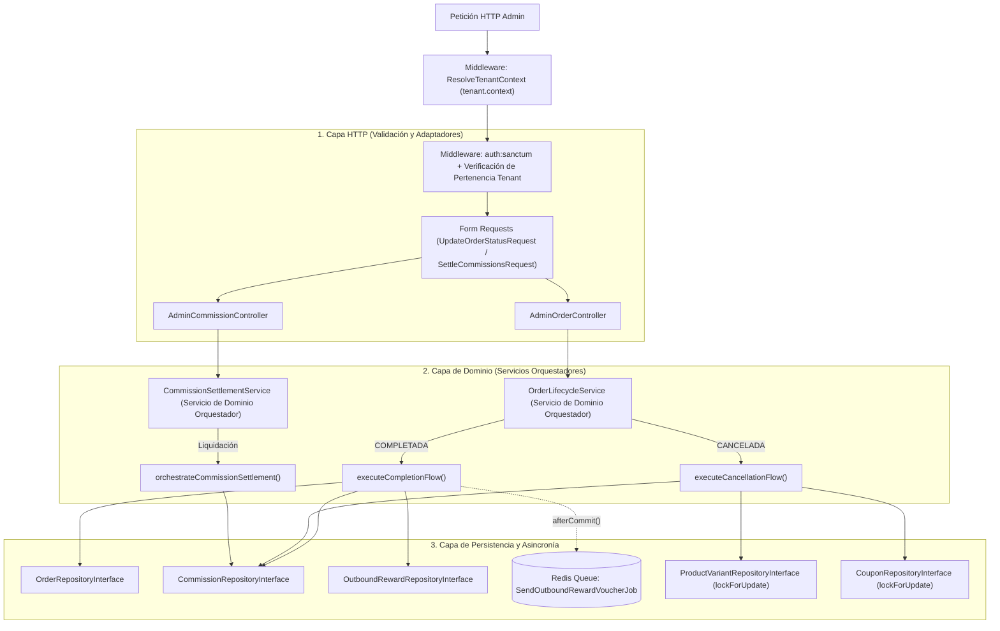
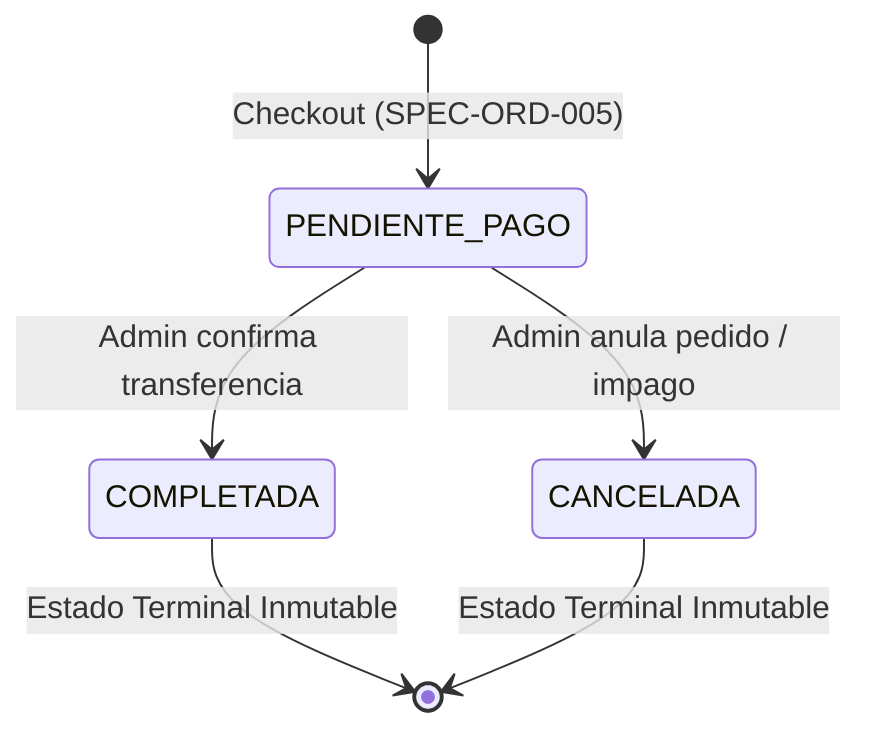
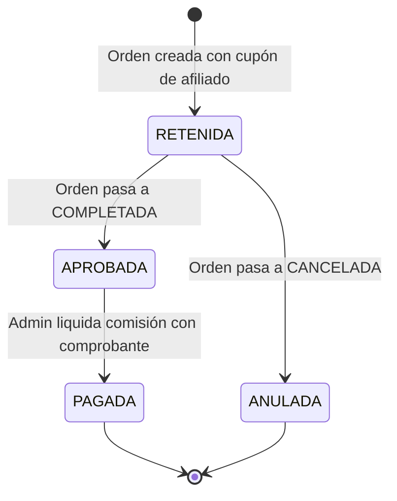

# Especificación Técnica: Ciclo de Vida de Órdenes, Liquidación de Comisiones y Emisión de Vouchers Cruzados

**Código de Especificación:** `SPEC-ORD-006`  
**Módulo:** Panel Administrativo del Inquilino (*Tenant Admin*) & Procesamiento Asíncrono (*Queues*)  
**Entidades Nucleares:** `App\Models\Order`, `App\Models\OrderItem`, `App\Models\ProductVariant`, `App\Models\Coupon`, `App\Models\Commission`, `App\Models\PartnerStore`, `App\Models\OutboundReward`, `App\Models\TenantConfig`  
**Patrones Arquitectónicos Obligatorios:** Repository-Service-Controller + Servicios de Dominio Orquestadores (`OrderLifecycleService` y `CommissionSettlementService`) con Métodos Auxiliares Atómicos + Form Requests + Jobs Asíncronos (`ShouldQueue`)  
**Mecanismos de Aislamiento:** Middleware `ResolveTenantContext` (`tenant.context`), `auth:sanctum`, `TenantContext` Singleton, `BelongsToTenant` y `TenantScope`  
**Metodología:** Desarrollo Guiado por Pruebas (*Test-First / TDD Obligatorio*)  
**Estado:** `Aprobado para Implementación`

---

## 1. Visión General y Alcance del Módulo

En el modelo de comercio electrónico asistido por WhatsApp, el checkout (`SPEC-ORD-005`) deja la orden formalizada en estado `PENDIENTE_PAGO` con su inventario reservado y descontado. El ciclo comercial concluye cuando el administrador del comercio verifica la transferencia bancaria enviada por el comprador o descarta el pedido por falta de pago.

Esta especificación gobierna las **operaciones post-checkout del panel administrativo**, abarcando cuatro responsabilidades transaccionales indivisibles:

1. **Máquina de Estados Inmutable de la Orden:** Transición controlada y atómica desde `PENDIENTE_PAGO` hacia los estados terminales `COMPLETADA` o `CANCELADA`.
2. **Restitución Íntegra en Cancelaciones:** Devolución automática de las unidades físicas al inventario de `product_variants` (incluyendo variantes archivadas con borrado lógico), liberación del cupo de uso del cupón (`coupons.used_count`) y anulación contable de comisiones retenidas.
3. **Ciclo Contable y Liquidación de Micro-Afiliados:** Promoción automática de comisiones de `RETENIDA` a `APROBADA` al confirmarse el pago de la orden, y liquidación bancaria posterior hacia `PAGADA` con respaldo documental de transferencia.
4. **Motor de Fidelización Cruzada (*Outbound Rewards*):** Evaluación de umbrales configurados en `tenant_configs.outbound_reward_rules` al completarse una orden para emitir vouchers criptográficos canjeables en comercios aliados (`partner_stores`) y despacharlos de forma asíncrona por correo electrónico vía colas en Redis.

---

## 2. Mapa de Endpoints en Alcance

| Módulo | Método | Endpoint | Middleware / Autenticación | Propósito |
|---|---|---|---|---|
| **Admin** | `GET` | `/api/v1/admin/orders` | `auth:sanctum`, `tenant.context` | Listado paginado de órdenes del inquilino con filtros por estado, rango de fechas y búsqueda de cliente/folio. |
| **Admin** | `GET` | `/api/v1/admin/orders/{order_id}` | `auth:sanctum`, `tenant.context` | Ficha integral de la orden con ítems (`variant_snapshot`), desglose financiero, comisión y vouchers emitidos. |
| **Admin** | `PATCH` | `/api/v1/admin/orders/{order_id}/status` | `auth:sanctum`, `tenant.context` | Ejecuta la transición transaccional de estado a `COMPLETADA` o `CANCELADA` disparando todos sus efectos colaterales. |
| **Admin** | `GET` | `/api/v1/admin/affiliates/{affiliate_id}/commissions` | `auth:sanctum`, `tenant.context` | Estado de cuenta paginado de comisiones de un afiliado con totales consolidados por estado. |
| **Admin** | `POST` | `/api/v1/admin/affiliates/{affiliate_id}/commissions/settle` | `auth:sanctum`, `tenant.context` | Liquida un lote de comisiones en estado `APROBADA` marcándolas como `PAGADA` con referencia y comprobante. |

---

## 3. Contexto Arquitectónico y Reutilización de Abstracciones del Sistema

La implementación debe apoyarse estrictamente en la infraestructura multi-tenant establecida en las especificaciones previas para blindar el inventario, la contabilidad de comisiones y los beneficios cruzados de cada comercio:



### 3.1. Uso de las Abstracciones Existentes:
1. **Middleware `tenant.context` y `TenantContext` Singleton:**  
   Resuelven el inquilino activo antes de tocar cualquier capa de negocio. Ningún repositorio ni servicio recibe un `tenant_id` arbitrario desde el cuerpo de la petición; siempre se subordina a `TenantContext::id()`.
2. **Verificación Cruzada Usuario-Inquilino:**  
   En todas las rutas administrativas, el usuario autenticado por Sanctum debe pertenecer exactamente al mismo `tenant_id` cargado en `TenantContext`. Si un administrador con sesión válida del *Tenant A* envía la cabecera `X-Tenant-Slug` del *Tenant B*, la petición debe abortar con `403 Forbidden` o `404 Not Found`.
3. **Aislamiento Automático por `BelongsToTenant` y `TenantScope`:**  
   Los modelos `Order`, `OrderItem`, `ProductVariant`, `Coupon`, `Commission`, `PartnerStore` y `OutboundReward` incorporan `BelongsToTenant`. Esto garantiza que:
   - Al buscar `{order_id}` o `{affiliate_id}`, Eloquent filtre automáticamente por el `tenant_id` actual (devolviendo `404` si el UUID pertenece a otro comercio).
   - Al insertar un `OutboundReward`, el trait inyecte automáticamente el `tenant_id` activo y bloquee cualquier asignación cruzada con una `LogicException`.
4. **Delimitación Transaccional del Stock del Tenant:**  
   Al revertir una orden cancelada, la restitución de stock opera exclusivamente sobre las `product_variants` del inquilino activo bajo `lockForUpdate()`, garantizando que dos operaciones simultáneas (ej. una compra entrante en Storefront y una cancelación administrativa) serialicen el acceso a la fila en PostgreSQL sin corromper el conteo de unidades.

---

## 4. Componentes de Arquitectura Obligatorios

### 4.1. Capa de Validación HTTP (Form Requests)
* **`FilterOrdersRequest`:** Valida parámetros de paginación, filtro `status` (`PENDIENTE_PAGO`, `COMPLETADA`, `CANCELADA`), fechas ISO (`date_from`, `date_to` con `date_to >= date_from`) y cadena de búsqueda sanitizada (`q`).
* **`UpdateOrderStatusRequest`:** Valida que `status` sea estrictamente uno de los estados destino permitidos (`COMPLETADA`, `CANCELADA`) y valida campos opcionales de auditoría (`payment_notes` o `cancellation_reason`, string máx. 500 caracteres).
* **`SettleCommissionsRequest`:** Valida que `commission_ids` sea un arreglo no vacío de UUIDs sin duplicados acotados al `tenant_id` activo, `payment_reference` (string requerido, máx. 120 caracteres) y `payment_receipt_url` (URL válida opcional/requerida, máx. 255 caracteres).

### 4.2. Capa de Controladores Delgados (Thin Controllers)
* **`AdminOrderController`:**
  - `index(FilterOrdersRequest $request)`: Delega la consulta paginada a `OrderLifecycleService` y retorna colección JSON con metadatos de paginación.
  - `show(string $orderId)`: Delega la obtención del detalle a `OrderLifecycleService`.
  - `updateStatus(UpdateOrderStatusRequest $request, string $orderId)`: Invoca el método orquestador `OrderLifecycleService::orchestrateStatusTransition()` y retorna el resumen de efectos ejecutados.
* **`AdminCommissionController`:**
  - `index(Request $request, string $affiliateId)`: Delega en `CommissionSettlementService::getAffiliateLedger()`.
  - `settle(SettleCommissionsRequest $request, string $affiliateId)`: Invoca `CommissionSettlementService::orchestrateCommissionSettlement()`.

### 4.3. Capa de Dominio: Servicios de Dominio Orquestadores

Siguiendo la convención arquitectónica del proyecto, los orquestadores son **Servicios de Dominio** con métodos maestros especializados en orquestación que delegan cada paso en métodos auxiliares privados y atómicos:

#### A. `App\Services\Orders\OrderLifecycleService`
* **Método Orquestador Maestro: `orchestrateStatusTransition(string $orderId, string $targetStatus, ?string $notes = null): OrderTransitionResultDTO`**  
  Coordina toda la mutación dentro de `DB::transaction()` apoyándose en los siguientes métodos auxiliares:
  1. `lockAndResolveOrder(string $orderId): Order` $\rightarrow$ Obtiene la orden del tenant con `lockForUpdate()` junto a sus `items`, `commission` y `appliedCoupon`. Lanza `404` si no existe.
  2. `validateStatusTransition(Order $order, string $targetStatus): void` $\rightarrow$ Verifica que el estado actual sea estrictamente `PENDIENTE_PAGO`. Si la orden ya está `COMPLETADA` o `CANCELADA`, aborta con error de dominio `INVALID_ORDER_STATUS_TRANSITION` (`409 Conflict`).
  3. `executeCompletionFlow(Order $order, ?string $notes): OrderTransitionResultDTO` $\rightarrow$ Sub-orquestador para confirmación de pago que encadena:
     - `markOrderAsCompleted(Order $order): void` (actualiza `status = 'COMPLETADA'` y `completed_at = now()`).
     - `approveRetainedCommission(Order $order): ?string` (si tiene comisión en `RETENIDA`, la actualiza a `APROBADA`).
     - `evaluateAndIssueOutboundReward(Order $order): ?OutboundReward` (verifica elegibilidad contra `tenant_configs.outbound_reward_rules`, valida que el `PartnerStore` esté activo y pertenezca al mismo tenant, y persiste el voucher con token criptográfico único).
     - `dispatchVoucherEmailAfterCommit(Order $order, OutboundReward $reward): void` (encola `SendOutboundRewardVoucherJob` en Redis usando `afterCommit()` para garantizar que solo se envíe si la transacción SQL confirma exitosamente).
  4. `executeCancellationFlow(Order $order, ?string $notes): OrderTransitionResultDTO` $\rightarrow$ Sub-orquestador para anulación de pedido que encadena:
     - `markOrderAsCancelled(Order $order): void` (actualiza `status = 'CANCELADA'` y `cancelled_at = now()`).
     - `restoreVariantsInventory(Order $order): void` (bloquea las `product_variants` involucradas con `lockForUpdate()`, contemplando incluso variantes con `SoftDeletes`, e incrementa `stock` según la `quantity` de cada `OrderItem`).
     - `releaseCouponUsageIfApplicable(Order $order): void` (si `applied_coupon_id` no es nulo, bloquea el cupón y reduce `used_count` en 1 sin bajar nunca de `0`).
     - `voidRetainedCommission(Order $order): ?string` (si existe comisión en `RETENIDA`, actualiza su estado a `ANULADA`).

#### B. `App\Services\Commissions\CommissionSettlementService`
* **Método Orquestador Maestro: `orchestrateCommissionSettlement(string $affiliateId, array $commissionIds, string $paymentReference, ?string $receiptUrl): CommissionSettlementResultDTO`**  
  Coordina el pago masivo o individual de comisiones dentro de `DB::transaction()` mediante métodos auxiliares:
  1. `resolveTenantAffiliate(string $affiliateId): Affiliate` $\rightarrow$ Verifica que el afiliado exista en el tenant actual (`404` si no existe o pertenece a otro tenant).
  2. `lockAndValidateCommissions(string $affiliateId, array $commissionIds): Collection` $\rightarrow$ Obtiene las comisiones con `lockForUpdate()`. Verifica que la cantidad encontrada coincida exactamente con los IDs solicitados, que pertenezcan al afiliado y que **todas** tengan `status === 'APROBADA'`. Si alguna está en `RETENIDA`, `PAGADA` o `ANULADA`, revierte y aborta con `422` (`COMMISSION_NOT_SETTLEABLE`).
  3. `persistSettlement(Collection $commissions, string $reference, ?string $receiptUrl, Carbon $paidAt): void` $\rightarrow$ Actualiza los registros a `status = 'PAGADA'`, registrando `paid_at`, `payment_reference` y `payment_receipt_url`.
  4. `calculateSettlementSummary(Collection $commissions, Carbon $paidAt): CommissionSettlementResultDTO` $\rightarrow$ Suma con precisión decimal el importe total liquidado (`total_paid`) y el conteo (`settled_count`).

### 4.4. Procesamiento Asíncrono en Cola (Jobs)
* **`App\Jobs\SendOutboundRewardVoucherJob` (`implements ShouldQueue`):**
  - Cumple con `RNF-04` y `RF-18`: nunca renderiza plantillas ni despacha correos durante el ciclo síncrono de la petición HTTP.
  - Recibe el identificador del `OutboundReward`, genera la representación visual/plantilla con el código de verificación, el beneficio (`partner_store.benefit_title`), términos y condiciones y fecha de expiración, lo envía al correo `order.customer_info.email` y registra la marca temporal `email_sent_at`.
  - Debe ser idempotente: si `email_sent_at !== null` o el voucher ya no está en `EMITIDO`, no reenvía duplicados.

### 4.5. Capa de Persistencia (Repository Pattern)
* **`OrderRepositoryInterface` / `EloquentOrderRepository`:**
  - `paginateForAdmin(array $filters, int $perPage = 20): LengthAwarePaginator` (con carga ansiosa explícita `with(...)` para cero N+1).
  - `findDetailedById(string $orderId): ?Order`
  - `findByIdWithLock(string $orderId): ?Order`
  - `updateStatus(Order $order, array $attributes): Order`
* **`CommissionRepositoryInterface` / `EloquentCommissionRepository`:**
  - `paginateByAffiliate(string $affiliateId, array $filters, int $perPage = 20): LengthAwarePaginator`
  - `getTotalsByStatusForAffiliate(string $affiliateId): array`
  - `findManyForAffiliateWithLock(string $affiliateId, array $commissionIds): Collection`
  - `markManyAsPaid(array $commissionIds, array $settlementData): int`
* **`OutboundRewardRepositoryInterface` / `EloquentOutboundRewardRepository`:**
  - `createReward(array $attributes): OutboundReward`
  - `existsForOrderAndPartner(string $orderId, string $partnerStoreId): bool`
* **`PartnerStoreRepositoryInterface` / `EloquentPartnerStoreRepository`:**
  - `findActiveById(string $partnerStoreId): ?PartnerStore`

---

## 5. Reglas de Negocio y Restricciones de Dominio

### RN-ORD-09: Máquina de Estados Estricta e Irreversibilidad

* Solo una orden en `PENDIENTE_PAGO` admite transiciones.
* Queda **estrictamente prohibido** pasar de `COMPLETADA` a `CANCELADA`, de `CANCELADA` a `COMPLETADA`, o re-aplicar el mismo estado terminal (de hacerlo, no podría volver a sumar stock ni volver a emitir vouchers). Cualquier intento retorna **`409 Conflict`** con código `INVALID_ORDER_STATUS_TRANSITION`.

---

### RN-ORD-10: Máquina de Estados Contable de Comisiones

* Una comisión en `RETENIDA` **jamás puede liquidarse directamente a `PAGADA`**; requiere primero que la orden subyacente sea `COMPLETADA`.
* Una comisión ya `PAGADA` o `ANULADA` no puede volver a incluirse en un lote de liquidación.

---

### RN-ORD-11: Reglas de Elegibilidad y Emisión de Vouchers Cruzados (`outbound_rewards`)
Cuando una orden transiciona a `COMPLETADA`, se inspecciona `tenant_configs.outbound_reward_rules`:
1. **Condiciones para Emitir:**
   - `is_enabled === true`.
   - El comercio aliado referenciado (`reward_partner_id` / `partner_store_id`) existe en `partner_stores`, pertenece al mismo `tenant_id` y tiene `is_active === true`.
   - El pedido cumple los umbrales configurados: `order.total_net >= min_order_amount` (si está definido) y/o la suma de cantidades de ítems `>= min_items` (si está definido).
   - No existe previamente un registro para el par `(order_id, partner_store_id)`.
2. **Generación del Código Criptográfico:**
   - Formato legible de alta entropía: `RWD-XXXX-XXXX-XXXX` (caracteres alfanuméricos en mayúsculas generados con aleatoriedad criptográfica segura `random_bytes` / `Str::upper`, garantizando unicidad en `outbound_rewards.code`).
   - Fecha de expiración (`expires_at`): `now()->addDays($validityDays)` (por defecto 30 días si la regla no especifica `validity_days`).
3. **Tolerancia Silenciosa cuando No Aplica:**
   - Si el tenant no tiene `outbound_reward_rules` activas, el comercio aliado fue desactivado, o la orden no alcanzó el monto mínimo, la orden **se completa con total normalidad** y el campo de respuesta informa `"outbound_reward_generated": false`.

---

### RN-ORD-12: Integridad de Restitución en Variantes Archivadas
Si entre el momento del checkout y el momento de la cancelación el administrador desactivó (`is_active = false`) o eliminó lógicamente (`SoftDeletes`) una de las variantes compradas, la restitución de inventario debe localizar igualmente el registro (incluyendo `withTrashed()` dentro del scope del tenant) y restaurar el conteo físico `stock`, sin reactivar la visibilidad pública de la variante.

---

## 6. Contratos HTTP de Entrada y Salida

### 6.1. Transición de Estado: `PATCH /api/v1/admin/orders/{order_id}/status`
* **Request Body:**
```json
{
  "status": "COMPLETADA",
  "payment_notes": "Transferencia BAC #9482910 verificada en estado de cuenta"
}
```
* **Respuesta `200 OK` (Caso Completada):**
```json
{
  "order_id": "990e8400-e29b-41d4-a716-446655440999",
  "order_number": "#ORD-8392K1",
  "status": "COMPLETADA",
  "commission_status": "APROBADA",
  "outbound_reward_generated": true,
  "outbound_reward_code": "RWD-9F8A-7C2B-4E1D",
  "completed_at": "2026-11-06T22:45:00Z",
  "cancelled_at": null
}
```
* **Respuesta `409 Conflict` (Transición Inválida sobre Orden Terminal):**
```json
{
  "error": {
    "code": "INVALID_ORDER_STATUS_TRANSITION",
    "message": "No es posible cambiar el estado de una orden que ya se encuentra en estado COMPLETADA."
  }
}
```

---

### 6.2. Liquidación de Comisiones: `POST /api/v1/admin/affiliates/{affiliate_id}/commissions/settle`
* **Request Body:**
```json
{
  "commission_ids": [
    "330e8400-e29b-41d4-a716-446655440333",
    "330e8400-e29b-41d4-a716-446655440334"
  ],
  "payment_reference": "ACH-884920",
  "payment_receipt_url": "https://cdn.plataforma.com/receipts/ach-884920.pdf"
}
```
* **Respuesta `200 OK`:**
```json
{
  "settled_count": 2,
  "total_paid": 350.00,
  "status": "PAGADA",
  "payment_reference": "ACH-884920",
  "paid_at": "2026-11-06T22:50:00Z"
}
```
* **Respuesta `422 Unprocessable Entity` (Comisión No Liquidable):**
```json
{
  "error": {
    "code": "COMMISSION_NOT_SETTLEABLE",
    "message": "Solo se pueden liquidar comisiones en estado APROBADA. Una o más comisiones seleccionadas no cumplen esta condición."
  }
}
```

---

## 7. Plan de Pruebas Test-First (Pest Suite Exhaustiva)

Antes de implementar cualquier controlador, servicio, job o repositorio, se deben crear las siguientes pruebas verificando su estado fallido inicial (`RED`):

### 7.1. Pruebas de Característica (Feature Tests)

#### A. Listado y Detalle Administrativo de Órdenes: `tests/Feature/Api/V1/Admin/OrderListingAndDetailTest.php`
* **Happy Path:**
  1. `test('administrador lista paginadamente las ordenes de su tienda filtrando por estado y rango de fechas')`
  2. `test('administrador consulta el detalle completo de una orden incluyendo snapshots comision y vouchers')`
  3. `test('busqueda filtra ordenes por numero de orden o nombre del comprador en customer_info')`
* **Bad Path & Seguridad Multi-Tenant:**
  4. `test('usuario no autenticado recibe 401 Unauthorized al consultar ordenes')`
  5. `test('administrador del Tenant A recibe 404 o 403 al intentar ver el detalle de una orden del Tenant B')`
  6. `test('listado de ordenes del Tenant A jamas incluye registros pertenecientes al Tenant B')`
  7. `test('rechaza con 422 filtros con estados inexistentes o rango de fechas invertido')`

---

#### B. Transiciones de Estado, Stock y Recompensas: `tests/Feature/Api/V1/Admin/OrderStatusTransitionTest.php`
* **Happy Path (Flujo `COMPLETADA`):**
  1. `test('completar una orden pendiente fija completed_at aprueba la comision retenida y retorna 200')`
  2. `test('completar una orden que supera el umbral emite voucher en outbound_rewards y encola SendOutboundRewardVoucherJob')`: Usa `Queue::fake()`, verifica creación del voucher en estado `EMITIDO` y aserta que el Job fue despachado tras el commit.
  3. `test('completar una orden sin comision ni umbral alcanzado finaliza exitosamente con outbound_reward_generated en false')`
* **Happy Path (Flujo `CANCELADA`):**
  4. `test('cancelar una orden pendiente restituye exactamente el stock descontado en todas las variantes involucradas')`
  5. `test('cancelar una orden con cupon aplicado decrementa used_count del cupon y cambia la comision a ANULADA')`
* **Bad Path & Seguridad Multi-Tenant:**
  6. `test('rechaza con 409 Conflict cualquier intento de cancelar una orden que ya estaba COMPLETADA sin alterar el stock')`
  7. `test('rechaza con 409 Conflict cualquier intento de completar o volver a cancelar una orden ya CANCELADA evitando duplicar restitucion de stock')`
  8. `test('rechaza con 422 estados no permitidos como PENDIENTE_PAGO o valores arbitrarios')`
  9. `test('administrador del Tenant A no puede cambiar el estado de una orden del Tenant B manteniendo su stock y comisiones intactas')`
* **Casos Borde:**
  10. `test('cancelar una orden cuya variante fue eliminada con SoftDeletes restituye igualmente el stock sin reactivar la variante')`
  11. `test('no emite voucher cruzado cuando el PartnerStore configurado esta inactivo o pertenece a otro tenant')`
  12. `test('decremento de used_count en cupon al cancelar nunca produce valores negativos si el contador estaba en cero')`
  13. `test('si falla cualquier paso interno de la transicion se revierte toda la transaccion sin despachar el job de correo')`

---

#### C. Estado de Cuenta y Liquidación de Comisiones: `tests/Feature/Api/V1/Admin/CommissionSettlementTest.php`
* **Happy Path:**
  1. `test('administrador consulta el estado de cuenta de un afiliado con desglose de totales retenidos aprobados y pagados')`
  2. `test('liquida exitosamente un lote de comisiones APROBADAS marcandolas como PAGADA con paid_at y referencia bancaria')`
* **Bad Path & Casos Borde:**
  3. `test('rechaza con 422 y revierte todo el lote si al menos una comision sigue en estado RETENIDA')`
  4. `test('rechaza con 422 si se intenta volver a liquidar una comision que ya esta PAGADA o ANULADA')`
  5. `test('rechaza con 422 o 404 si se envian commission_ids que pertenecen a otro afiliado del mismo tenant')`
  6. `test('aislamiento multi-tenant impide que el Tenant A liquide o consulte comisiones de afiliados del Tenant B')`
  7. `test('rechaza con 422 peticiones con arreglo commission_ids vacio o sin payment_reference')`

---

### 7.2. Pruebas Unitarias (Unit Tests)

1. **`tests/Unit/Services/OrderLifecycleRulesTest.php`:**
   - Valida de forma aislada la matriz de transiciones válidas e inválidas de la máquina de estados.
   - Valida la evaluación de umbrales de `outbound_reward_rules` (`min_order_amount`, `min_items`, bandera `is_enabled` y cálculo exacto de `expires_at`).
   - Verifica que el generador de códigos `RWD-XXXX-XXXX-XXXX` produzca tokens de alta entropía con el formato esperado.
2. **`tests/Unit/Jobs/SendOutboundRewardVoucherJobTest.php`:**
   - Usa `Mail::fake()` para verificar que el Job envía el correo al destinatario de `customer_info.email` y actualiza `email_sent_at`.
   - Verifica idempotencia del Job: si `email_sent_at` ya tiene fecha o el voucher no está `EMITIDO`, omite el reenvío.

---

## 8. Criterios de Aceptación (Definition of Done - DoD)

1. [x] El documento de especificación `docs/spects/order_lifecycle_commissions_and_rewards.md` está versionado en Git.
2. [x] Se escriben y ejecutan en primer lugar todas las pruebas Feature y Unit en Pest, verificando su fallo inicial en rojo (`RED`).
3. [x] Todos los componentes de arquitectura obligatorios están implementados:
   - Form Requests: `FilterOrdersRequest`, `UpdateOrderStatusRequest`, `SettleCommissionsRequest`.
   - Controladores: `AdminOrderController` y `AdminCommissionController`.
   - Servicios de Dominio Orquestadores: `OrderLifecycleService` y `CommissionSettlementService` estructurados con métodos maestros y métodos auxiliares atómicos.
   - Job Asíncrono: `SendOutboundRewardVoucherJob` despachado con `afterCommit()`.
   - Repositorios: `OrderRepositoryInterface`, `CommissionRepositoryInterface`, `OutboundRewardRepositoryInterface`, `PartnerStoreRepositoryInterface` y sus implementaciones Eloquent.
4. [x] Las órdenes terminales (`COMPLETADA`, `CANCELADA`) son estrictamente inmutables (`409 Conflict` ante reintentos).
5. [x] La cancelación restituye el inventario con `lockForUpdate()` sin riesgo de duplicación ni condiciones de carrera.
6. [x] La suite completa de Pest pasa al 100% (`vendor/bin/pest`).
7. [x] PHPStan en nivel estricto reporta 0 errores (`vendor/bin/phpstan analyse`).
8. [x] Código formateado con Laravel Pint (`vendor/bin/pint --dirty --format agent`).
