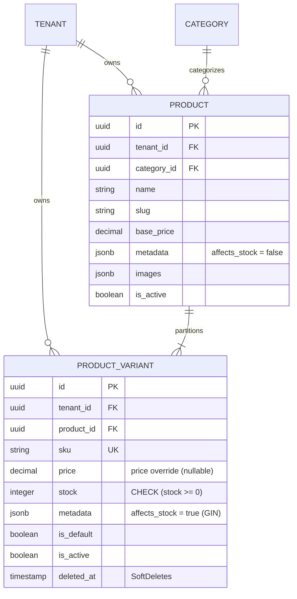
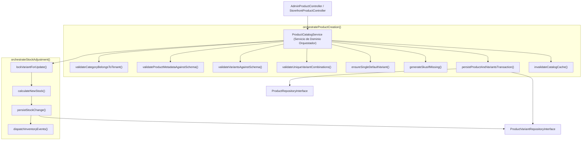

# Especificación Técnica: Catálogo de Productos y Variantes Gobernadas por Esquema

**Código de Especificación:** `SPEC-CAT-003`  
**Módulos:** Panel Administrativo (*Tenant Admin*) & Vitrina Pública (*Storefront*)  
**Entidades Nucleares:** `App\Models\Category`, `App\Models\Product`, `App\Models\ProductVariant`  
**Patrones Arquitectónicos Obligatorios:** Repository-Service-Controller + Servicio de Dominio Orquestador (`ProductCatalogService`) con Métodos Auxiliares Atómicos + Form Requests  
**Aislamiento y Alcance:** `BelongsToTenant`, `TenantScope`, `TenantContext` y Middleware `tenant.context`  
**Metodología:** Desarrollo Guiado por Pruebas (*Test-First / TDD Obligatorio*)  
**Estado:** `Aprobado para Implementación`

---

## 1. Visión General y Alcance del Módulo

El módulo de catálogo gestiona la estructura jerárquica de categorías, la ficha base de los productos y la partición dimensional de inventario a través de las **variantes de producto**. 

En apego a la arquitectura agnóstica al rubro comercial (*Schema-Driven*), los productos y sus variantes no poseen columnas rígidas para tallas, colores o materiales. En su lugar, el modelo combina atributos relacionales fijos con campos semiestructurados `JSONB`, gobernados de forma estricta por las definiciones activas en `tenant_configs.metadata_schema`:

1. **`products.metadata` (`JSONB`):** Almacena metadatos puramente descriptivos (`affects_stock = false`), tales como marca, material de fabricación o cuidados de lavado.
2. **`product_variants.metadata` (`JSONB`):** Almacena metadatos dimensionales de inventario (`affects_stock = true`), tales como talla, tamaño o color, indexados mediante índices PostgreSQL GIN (`jsonb_path_ops`).

---

## 2. Definición Profunda: Variantes de Productos (`product_variants`)

### 2.1. Propósito y Anatomía de una Variante
Una variante representa la **unidad mínima inventariable y vendible (*Stock Keeping Unit - SKU*)**. Mientras que el `Product` representa la ficha conceptual ("Camisa Oxford"), la `ProductVariant` representa el artículo físico individual disponible en bodega ("Camisa Oxford - Talla M - Color Azul").



---

### 2.2. Reglas de Negocio Estrictas para Variantes

#### RN-VAR-01: Gobernanza Dimensional por `TenantConfig.metadata_schema`
1. Cada clave presente en `product_variants.metadata` **debe existir obligatoriamente** en `tenant_configs.metadata_schema` del inquilino y tener su bandera `affects_stock = true`.
2. Si un atributo en el esquema está definido con `is_required = true` y `affects_stock = true`, **toda variante del producto debe contener dicha clave**.
3. Si el atributo es de tipo `select` o `multiselect`, el valor asignado en la variante debe coincidir de forma exacta con alguna de las opciones declaradas en el arreglo `options` del esquema.
4. Queda **terminantemente prohibido** incluir en `product_variants.metadata` atributos configurados con `affects_stock = false` (éstos deben pertenecer exclusivamente a `products.metadata`).

#### RN-VAR-02: Matriz de Unicidad Combinatoria (Cero Duplicados en Producto)
Dentro de un mismo producto, **no pueden coexistir dos variantes activas con la misma combinación exacta de metadatos dimensionales**.
* *Ejemplo Válido:*
  - Variante 1: `{"talla": "38", "color": "Negro"}`
  - Variante 2: `{"talla": "39", "color": "Negro"}`
* *Ejemplo Inválido (Rechazado con `422 Unprocessable Entity`):*
  - Variante 1: `{"talla": "38", "color": "Negro"}`
  - Variante 2: `{"talla": "38", "color": "Negro"}` $\rightarrow$ *Conflicto dimensional*.

#### RN-VAR-03: Política y Unicidad del Código SKU
1. El SKU identifica unívocamente la variante dentro del inquilino: `UNIQUE(tenant_id, sku)`.
2. Dos inquilinos distintos **sí pueden utilizar el mismo código SKU** sin colisión (aislamiento garantizado por índice compuesto).
3. **Generación Automática:** Si en la creación del producto el payload no especifica un SKU para una variante, el orquestador debe sintetizarlo automáticamente utilizando la convención:
   ```text
   {SLUG_PRODUCTO}-{VALOR_DIMENSION_1}-{VALOR_DIMENSION_2}
   ```
   *Ejemplo:* `camisa-oxford-m-azul` (sanitizado en mayúsculas: `CAMISA-OXFORD-M-AZUL`).
4. Si el usuario provee un SKU manual, debe sanitizarse a mayúsculas y validar que no colisione con otra variante activa del mismo inquilino.

#### RN-VAR-04: Política de Precios y Sobrescritura (*Price Overrides*)
1. La columna `product_variants.price` es nulable (`nullable`).
2. **Herencia de Precio Base:** Si `variant.price === null`, el precio efectivo de venta de la variante es el `product.base_price`.
3. **Sobrescritura de Precio:** Si `variant.price !== null` y es un valor decimal $> 0$, este valor sustituye al precio base. Permite tarifar diferencialmente variantes con mayor costo de producción (ej. tallas especiales o acabados premium).
4. El precio efectivo nunca puede ser negativo ($\ge 0$).

#### RN-VAR-05: Integridad Transaccional del Inventario Físico (`stock`)
1. El stock físico se almacena en `product_variants.stock` como número entero $\ge 0$.
2. La base de datos aplica la restricción a nivel de motor:
   ```sql
   ALTER TABLE product_variants ADD CONSTRAINT product_variants_stock_check CHECK (stock >= 0);
   ```
3. Cualquier operación que modifique inventario (ajuste manual, confirmación de pedido o devolución) debe ejecutarse bajo transacciones atómicas (`DB::transaction`) y con bloqueo pesimista:
   ```php
   ProductVariant::where('id', $variantId)->lockForUpdate()->first();
   ```
4. Quedan estrictamente prohibidas las ventas en descubierto (*backorders* o stock negativo). Si la cantidad solicitada supera el stock disponible, la operación aborta con excepción de dominio semántica.

#### RN-VAR-06: Regla de la Variante por Defecto (`is_default`)
1. Todo producto debe poseer **exactamente una** variante con `is_default = true`.
2. Al crear un producto con varias variantes:
   - Si ninguna variante viene marcada con `is_default = true`, la primera variante de la lista se promoverá automáticamente a default.
   - Si el payload marca más de una variante como default, la última evaluada o la especificada explícitamente prevalece, restableciendo las demás a `false`.
3. Al actualizar variantes, marcar una nueva variante como default conmuta automáticamente a `false` la variante que previamente tenía ese estado en el mismo producto.

#### RN-VAR-07: Inmutabilidad Histórica y Borrado Lógico (*SoftDeletes*)
1. Las variantes que hayan sido asociadas a pedidos formalizados (`order_items`) **jamás deben eliminarse físicamente de la base de datos (`HARD DELETE`)**, ya que violaría la integridad contable y referencial del inquilino.
2. La eliminación de una variante se procesa mediante borrado lógico (`softDeletesTz`).
3. Si se desactiva una variante (`is_active = false`) o se envía a la papelera:
   - Deja de ser visible y seleccionable en la vitrina pública (*Storefront*).
   - Si la variante eliminada era `is_default = true`, el orquestador debe reasignar el estado default a otra variante activa del producto.

---

## 3. Endpoints del Módulo de Catálogo y Variantes

| Módulo | Método | Endpoint | Middleware / Auth | Propósito |
|---|---|---|---|---|
| **Admin** | `POST` | `/api/v1/admin/categories` | `auth:sanctum`, `tenant.context` | Crea categoría (soporta jerarquía `parent_id`). |
| **Admin** | `GET` | `/api/v1/admin/categories` | `auth:sanctum`, `tenant.context` | Lista el árbol completo de categorías del tenant. |
| **Admin** | `POST` | `/api/v1/admin/products` | `auth:sanctum`, `tenant.context` | **Creación Orquestada:** Registra producto base y genera todas sus variantes gobernadas por esquema. |
| **Admin** | `GET` | `/api/v1/admin/products` | `auth:sanctum`, `tenant.context` | Listado paginado administrativo con recuento de variantes y stock total. |
| **Admin** | `GET` | `/api/v1/admin/products/{id}` | `auth:sanctum`, `tenant.context` | Ficha detallada con todas sus variantes e historial de inventario. |
| **Admin** | `PUT` | `/api/v1/admin/products/{id}` | `auth:sanctum`, `tenant.context` | Actualiza ficha base y sincroniza variantes (crear nuevas, actualizar o desactivar). |
| **Admin** | `PATCH` | `/api/v1/admin/variants/{id}/stock` | `auth:sanctum`, `tenant.context` | **Ajuste Rápido de Stock:** Modifica inventario con modo absoluto (`set`) o relativo (`adjust`). |
| **Admin** | `PATCH` | `/api/v1/admin/variants/{id}/status` | `auth:sanctum`, `tenant.context` | Activa o desactiva la variante para venta. |
| **Storefront** | `GET` | `/api/v1/storefront/categories` | `tenant.context` | Árbol público de categorías con productos activos. |
| **Storefront** | `GET` | `/api/v1/storefront/products` | `tenant.context` | **Búsqueda Facetada:** Filtra por texto, categorías, rango de precio y atributos JSONB sobre GIN. |
| **Storefront** | `GET` | `/api/v1/storefront/products/{slug}` | `tenant.context` | Detalle público del producto con sus variantes activas y disponibilidad. |

---

## 4. Contratos de Petición y Respuesta HTTP

### 4.1. Creación de Producto y Variantes: `POST /api/v1/admin/products`

#### A. Cuerpo de la Petición (`Request Body`):
```json
{
  "category_id": "990e8400-e29b-41d4-a716-446655440001",
  "name": "Zapato Oxford Clásico",
  "description": "Calzado de cuero genuino con suela antideslizante.",
  "base_price": 1450.00,
  "images": [
    "https://cdn.plataforma.com/t1/prod1-front.webp",
    "https://cdn.plataforma.com/t1/prod1-side.webp"
  ],
  "metadata": {
    "material": "Cuero Vacuno",
    "origen": "Honduras"
  },
  "variants": [
    {
      "sku": "OXF-CUERO-39-NEG",
      "price": null,
      "stock": 15,
      "metadata": {
        "talla": "39",
        "color": "Negro"
      },
      "is_default": true
    },
    {
      "sku": "OXF-CUERO-40-NEG",
      "price": null,
      "stock": 20,
      "metadata": {
        "talla": "40",
        "color": "Negro"
      },
      "is_default": false
    },
    {
      "sku": "OXF-CUERO-41-CAFE",
      "price": 1550.00,
      "stock": 8,
      "metadata": {
        "talla": "41",
        "color": "Café"
      },
      "is_default": false
    }
  ]
}
```

#### B. Respuesta Exitosa `201 Created`:
```json
{
  "data": {
    "id": "550e8400-e29b-41d4-a716-446655440000",
    "category_id": "990e8400-e29b-41d4-a716-446655440001",
    "name": "Zapato Oxford Clásico",
    "slug": "zapato-oxford-clasico",
    "description": "Calzado de cuero genuino con suela antideslizante.",
    "base_price": 1450.00,
    "metadata": {
      "material": "Cuero Vacuno",
      "origen": "Honduras"
    },
    "images": [
      "https://cdn.plataforma.com/t1/prod1-front.webp"
    ],
    "is_active": true,
    "variants_count": 3,
    "total_stock": 43,
    "variants": [
      {
        "id": "660e8400-e29b-41d4-a716-446655440010",
        "sku": "OXF-CUERO-39-NEG",
        "price": 1450.00,
        "price_override": null,
        "stock": 15,
        "metadata": {
          "talla": "39",
          "color": "Negro"
        },
        "is_default": true,
        "is_active": true
      },
      {
        "id": "660e8400-e29b-41d4-a716-446655440011",
        "sku": "OXF-CUERO-40-NEG",
        "price": 1450.00,
        "price_override": null,
        "stock": 20,
        "metadata": {
          "talla": "40",
          "color": "Negro"
        },
        "is_default": false,
        "is_active": true
      },
      {
        "id": "660e8400-e29b-41d4-a716-446655440012",
        "sku": "OXF-CUERO-41-CAFE",
        "price": 1550.00,
        "price_override": 1550.00,
        "stock": 8,
        "metadata": {
          "talla": "41",
          "color": "Café"
        },
        "is_default": false,
        "is_active": true
      }
    ]
  }
}
```

---

### 4.2. Ajuste Rápido de Stock: `PATCH /api/v1/admin/variants/{id}/stock`

#### A. Cuerpo de la Petición (`Request Body`):
Permite dos modos operacionales:
1. **Modo `set`:** Sobrescribe el inventario físico con un valor absoluto.
2. **Modo `adjust`:** Incrementa ($+N$) o decrementa ($-N$) el inventario relativo.

```json
{
  "mode": "adjust",
  "quantity": -5,
  "reason": "Venta presencial en showroom"
}
```

#### B. Respuestas:
* **`200 OK`:** Retorna la variante con el nuevo stock y el stock previo.
```json
{
  "data": {
    "variant_id": "660e8400-e29b-41d4-a716-446655440010",
    "sku": "OXF-CUERO-39-NEG",
    "previous_stock": 15,
    "current_stock": 10,
    "adjusted_by": -5
  }
}
```
* **`422 Unprocessable Entity` (Stock Insuficiente):** Si un ajuste negativo resultaría en `stock < 0`:
```json
{
  "error": {
    "code": "INSUFFICIENT_STOCK_FOR_ADJUSTMENT",
    "message": "No se puede decrementar 20 unidades. El stock actual es de 15 unidades."
  }
}
```

---

### 4.3. Búsqueda y Filtrado Facetado: `GET /api/v1/storefront/products`

* **Cabecera Requerida:** `X-Tenant-Slug: calzados-hn`
* **Query Params Soportados:**
  - `q`: Búsqueda parcial de texto en nombre y descripción (`ILIKE`).
  - `category_slug`: Filtro por categoría o subcategoría.
  - `price_min` / `price_max`: Rango numérico sobre el precio de venta.
  - `in_stock`: Boolean (`true` para listar solo productos con al menos una variante con `stock > 0`).
  - `attr[{key}]`: Objeto dinámico de atributos JSONB.  
    *Ejemplo:* `?attr[talla]=40&attr[color]=Negro&attr[material]=Cuero`

#### Resolución Interna sobre PostgreSQL:
1. Si la clave pertenece a `products.metadata` (`affects_stock = false`):  
   Se consulta directamente en la tabla padre:
   ```sql
   WHERE products.metadata @> '{"material": "Cuero"}'
   ```
2. Si la clave pertenece a `product_variants.metadata` (`affects_stock = true`):  
   Se consulta en la relación de variantes verificando disponibilidad:
   ```sql
   WHERE EXISTS (
       SELECT 1 FROM product_variants 
       WHERE product_variants.product_id = products.id
         AND product_variants.is_active = true
         AND product_variants.stock > 0
         AND product_variants.metadata @> '{"talla": "40", "color": "Negro"}'
   )
   ```
   Ambas consultas quedan respaldadas por los índices GIN `(metadata jsonb_path_ops)` creados en las migraciones.

---

## 5. Diseño Arquitectónico: Patrón Orquestador y Métodos Auxiliares

La lógica de negocio se centraliza en el Servicio de Dominio Orquestador **`App\Services\Catalog\ProductCatalogService`**, estructurado mediante métodos maestros orquestadores y métodos auxiliares atómicos:



### 5.1. Desglose de Métodos Auxiliares de `ProductCatalogService`:
1. `validateCategoryBelongsToTenant(?string $categoryId, string $tenantId): void`  
   Asegura que la categoría exista y pertenezca al inquilino activo.
2. `validateProductMetadataAgainstSchema(array $metadata, array $schema): void`  
   Valida que los metadatos del producto correspondan solo a atributos con `affects_stock = false`.
3. `validateVariantsAgainstSchema(array $variants, array $schema): void`  
   Valida que cada variante incluya los atributos obligatorios con `affects_stock = true` y que los valores coincidan con las `options` permitidas.
4. `validateUniqueVariantCombinations(array $variants): void`  
   Inspecciona la matriz de variantes enviadas comprobando que no existan tuplas de metadatos duplicadas.
5. `ensureSingleDefaultVariant(array &$variants): void`  
   Garantiza que exactamente una variante tenga `is_default = true`, promoviendo la primera en caso de omisión.
6. `generateSkusIfMissing(Product $product, array &$variants): void`  
   Autogenera identificadores SKU conformes a la convención si no fueron especificados por el usuario.
7. `persistProductAndVariantsTransaction(Tenant $tenant, array $productData, array $variantsData): Product`  
   Ejecuta `DB::transaction` invocando los repositorios para crear `Product` y sus `ProductVariant` en cascada.
8. `invalidateCatalogCache(Tenant $tenant): void`  
   Purga etiquetas o claves de catálogo en Redis.

---

## 6. Plan de Pruebas Test-First (Pest Suite Exhaustiva)

Siguiendo la metodología **Test-First**, se deben escribir primero las pruebas en estado fallido (`RED`).

### 6.1. Pruebas de Característica: `tests/Feature/Api/V1/Admin/ProductManagementTest.php`

#### A. Casos de Éxito (Happy Path):
1. `test('administrador crea exitosamente un producto con multiples variantes gobernadas por esquema')`:
   - Crea un inquilino con esquema de talla y color (`affects_stock = true`).
   - Envía producto con 3 variantes válidas.
   - Aserta código `201 Created`, estructura de respuesta y persistencia en `products` y `product_variants`.
2. `test('autogenera codigos SKU unicos para variantes que no proporcionan SKU explicito')`:
   - Envía variantes sin campo `sku`.
   - Verifica que en base de datos cada variante tenga un SKU generado en mayúsculas derivado del slug y metadatos.
3. `test('asigna automaticamente la primera variante como default cuando no se especifica is_default')`:
   - Envía variantes con `is_default = false` o nulo.
   - Verifica que la primera variante tenga `is_default = true` y las restantes `false`.
4. `test('hereda el base_price del producto cuando variant.price es nulo y respeta sobrescritura cuando tiene valor')`:
   - Verifica variante sin precio ($price = base\_price$) y variante con precio sobreescrito ($price = override$).

---

#### B. Casos de Validación y Negocio (Bad Path & Casos Borde en Variantes):
5. `test('rechaza con 422 cuando dos variantes dentro del mismo producto tienen la misma combinacion de metadatos')`:
   - Envía dos variantes con `{"talla": "40", "color": "Negro"}`.
   - Aserta `422 Unprocessable Entity` con error descriptivo sobre combinaciones duplicadas.
6. `test('rechaza con 422 cuando una variante incluye atributos con affects_stock false o no registrados en el esquema')`:
   - Intenta colocar `material` (que tiene `affects_stock = false`) dentro de la variante.
   - Aserta `422 Unprocessable Entity`.
7. `test('rechaza con 422 cuando el valor de una opcion select no coincide con las opciones permitidas en el esquema')`:
   - Si las tallas válidas son `["38", "39", "40"]`, enviar `{"talla": "48"}` debe fallar con `422`.
8. `test('rechaza con 422 cuando se intenta registrar un SKU duplicado para el mismo inquilino')`:
   - Registra una variante con `sku: "CALZ-001"`.
   - Intenta registrar otra variante en otro producto con `sku: "CALZ-001"`.
   - Aserta `422 Unprocessable Entity`.
9. `test('permite registrar el mismo SKU en dos inquilinos diferentes garantizando aislamiento multi-tenant')`:
   - Crea `Tenant A` y `Tenant B`.
   - Registra variante con `sku: "SKU-SHARED-1"` en ambos inquilinos.
   - Ambas operaciones retornan `201 Created` sin conflicto de unicidad.
10. `test('rechaza con 422 la creacion de producto con stock de variante negativo')`:
    - Envía `stock: -5`.
    - Aserta rechazo en Form Request (`min:0`).

---

### 6.2. Pruebas de Característica: `tests/Feature/Api/V1/Admin/VariantStockAdjustmentTest.php`

1. `test('ajusta exitosamente el stock en modo set reemplazando el valor absoluto')`:
   - Variante con stock inicial 10. Envía `{"mode": "set", "quantity": 25}`.
   - Aserta stock final 25.
2. `test('ajusta exitosamente el stock en modo adjust incrementando o decrementando de forma relativa')`:
   - Variante con stock inicial 20. Envía `{"mode": "adjust", "quantity": -5}`.
   - Aserta stock final 15.
3. `test('rechaza con 422 ajuste relativo que resulte en stock negativo')`:
   - Variante con stock inicial 5. Envía `{"mode": "adjust", "quantity": -10}`.
   - Aserta error semántico `INSUFFICIENT_STOCK_FOR_ADJUSTMENT`.
4. `test('bloquea concurrentemente la fila de la variante con lockForUpdate durante el ajuste')`:
   - Verifica ejecución bajo transacción atómica.

---

### 6.3. Pruebas de Característica: `tests/Feature/Api/V1/Storefront/FacetedCatalogSearchTest.php`

1. `test('filtra productos por atributos dimensionales de variante utilizando indices GIN')`:
   - Busca `?attr[talla]=40`.
   - Retorna solo los productos que tengan al menos una variante activa con `talla = 40` y `stock > 0`.
2. `test('omite productos cuyas variantes coincidentes tengan stock cero cuando in_stock es true')`:
   - Variante con `talla = 40` pero `stock = 0`.
   - Con `?in_stock=true`, el producto no debe aparecer en los resultados.
3. `test('filtra combinando texto libre rango de precios y metadatos en una sola consulta')`:
   - Consulta `?q=oxford&price_min=1000&price_max=1500&attr[color]=Negro`.
   - Aserta que los productos devueltos satisfagan todos los criterios simultáneamente.

---

### 6.4. Pruebas Unitarias: `tests/Unit/Services/ProductCatalogServiceTest.php`

1. `test('validador de combinaciones detecta duplicados en matrices de variantes en memoria')`
2. `test('generador de SKU sintetiza codigos limpios en mayusculas a partir del slug y atributos')`
3. `test('calculo de precio efectivo prioriza price_override sobre base_price')`

---

## 7. Criterios de Aceptación (Definition of Done - DoD)

1. [x] El documento `docs/spects/product_catalog_and_variants.md` está registrado en Git.
2. [x] Se escriben y ejecutan en primer lugar todas las pruebas Feature y Unit en Pest, verificando su fallo en rojo (`RED`).
3. [x] Todos los componentes de arquitectura obligatorios están implementados:
   - Form Requests: `CreateProductRequest`, `UpdateProductRequest`, `AdjustVariantStockRequest`, `FilterProductsRequest`, `CategoryRequest`.
   - Controladores: `AdminProductController`, `AdminVariantController`, `AdminCategoryController`, `StorefrontProductController`, `StorefrontCategoryController`.
   - Servicio de Dominio Orquestador: `ProductCatalogService` con sus métodos maestros y auxiliares atómicos.
   - Repositorios: `ProductRepositoryInterface`, `ProductVariantRepositoryInterface`, `CategoryRepositoryInterface`.
4. [x] Las variantes de producto cumplen todas las reglas dimensionales (`affects_stock`, validación contra `metadata_schema`, matriz de unicidad, autogeneración de SKU y stock $\ge 0$).
5. [x] Las búsquedas facetadas sobre `metadata` aprovechan los índices GIN de PostgreSQL (`jsonb_path_ops`).
6. [x] La suite de pruebas Pest pasa al 100% (`vendor/bin/pest`).
7. [x] PHPStan en nivel estricto reporta 0 errores (`vendor/bin/phpstan analyse`).
8. [x] Código formateado con Laravel Pint (`vendor/bin/pint --dirty --format agent`).

---

## 8. Resumen de Implementación

* **Fecha de Implementación:** 2026-11-06
* **Componentes Principales:**
  - Servicio Orquestador: `App\Services\Catalog\ProductCatalogService`
  - Controladores Delgados: `AdminCategoryController`, `AdminProductController`, `AdminVariantController`, `StorefrontCategoryController`, `StorefrontProductController`
  - Repositorios: `EloquentCategoryRepository`, `EloquentProductRepository`, `EloquentProductVariantRepository`
  - Form Requests: `CategoryRequest`, `CreateProductRequest`, `UpdateProductRequest`, `AdjustVariantStockRequest`, `FilterProductsRequest`
  - Excepción de Dominio: `InsufficientStockForAdjustmentException`
* **Resultados de Validación:**
  - 156 pruebas unitarias y de integración aprobadas (565 aserciones).
  - PHPStan en nivel estricto superado con 0 errores.
  - Estándar de código verificado con Laravel Pint.
